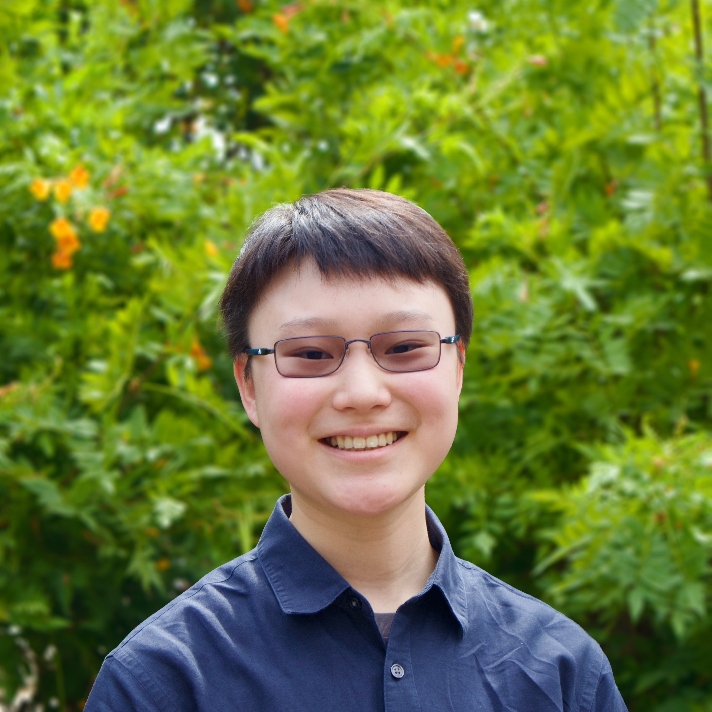

## About {.sec}

::: {.about}
::: {.about-col}

::: {.cbox}
<b class="mono">CONTACT</b>

<i class="bi bi-envelope-fill"></i> k<!-- fhetydagzzzgjds -->o12<!-- sdfjsdhfkjypcs -->na<!-- asjoxp -->t[at]gm<!-- aksdhflsjkhf -->ail[dot]co<!-- weafedsaf -->m

<i class="bi bi-geo-alt-fill"></i> Claremont, California, USA

<i class="bi bi-geo-alt-fill"></i> Vancouver, British Columbia, Canada

<i class="bi bi-geo-alt-fill"></i> Hong Kong, Hong Kong

<i class="bi bi-linkedin"></i> [LinkedIn](https://www.linkedin.com/in/ko12nat/)

<i class="bi bi-github"></i> [GitHub](https://github.com/natalieko2024)
:::
:::

::: {.about-col}
I'm an junior Engineering student at **Harvey Mudd College** specializing in mechatronics, with a Humanities, Social Sciences, and Arts concentration in Science, Technology, and Society. My work focuses on building reliable engineering solutions that prioritize the end user. My goal is to make Engineering solutions more accessible to everyone.

I thrive on solving physical problems through dynamic mechanical, electrical, and computer design, analytical modeling, rapid prototyping, and live troubleshooting.

### Interests 

* **Mechatronics:** Integrating electronic sensors and actuators with mechanical design, and controlling them through embedded systems and firmware.
* **Control Systems:** Utilizing feedback loops, characterizing system behaviour, predicting system outputs.
* **Human Centered Design:** Prioritizing human needs through empathizing with users and understanding their problems.
* **Manufacturing:** Optimizing manufacturing and maintenance processes, ensuring efficiency, quality, and safety.

### Hobbies & Outside the Lab

To be honest, I consider all of the projects on this page as well as my on-campus jobs part of my hobbies (they're fun!), but outside of that...

* **Music:** Composing and arranging music, playing in bands or solo (mainly trumpet and drum kit).

* **Physical Activity:** Competitive ball hockey (ice hockey but you run instead of skate), biking, axe-throwing, hiking.
:::
:::
