

  
<strong>Timeline:</strong> 

  
<strong>Skills:</strong> 

  
<strong>Roles:</strong> 

:::{.columns}
::: {.column width="49%"}
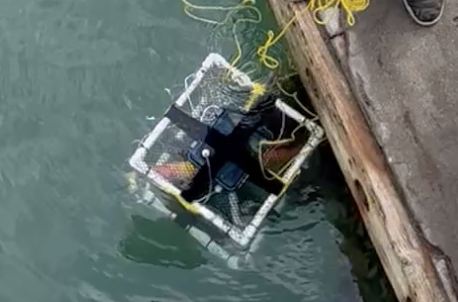

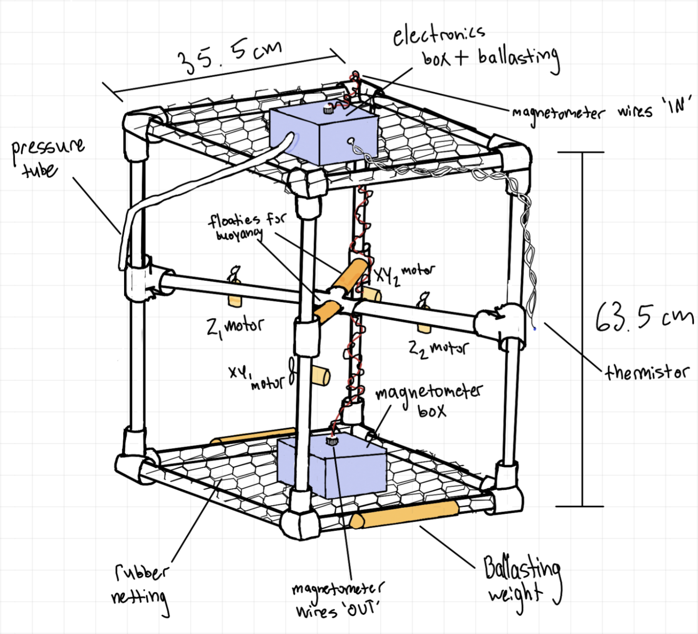
:::

::: {.column width="2%"}
:::

::: {.column width="49%"}
**Overview of Work:**
Worked in a team of 4 to design and deploy an AUV utilizing a pressure sensor, thermistor, and magnetometer to map the metal debris distribution on the ocean floor of Dana Point Harbour, and back-calculate debris drop locations using the principles of geostrophic balance. 

Key outcomes:

- **Built custom operational-amplifier circuits** to scale analog sensor outputs to the input range of a Teensy 4.0 to achieve higher resolutions
- **Troubleshot circuits and hardware during deployment**, conducted tests post-deployment to find and assess key failure modes
- **Utilized oscilloscopes, multimeters, and other electronic test instruments** to test and debug circuit outputs and **I2C communication protocols**
- **Programmed feedback control loops in C++** for AUV depth and surface control
- **Utilized MATLAB to process collected data**, perform signal processing algorithms (Fast Fourier Transform), and create 2D and contour plots

:::
:::

# Introduction and Background

The goal of this project was to explore the potential of using an autonomous underwater vehicle (AUV) to map seafloor debris and determine their water surface entry point. The United Nations Educational, Scientific, and Cultural Organization estimates there are three million shipwrecks worldwide, among other catastrophe-induced ocean debris. These wreckages are artifacts of human behaviour and are usually investigated to inform historical and cultural accounts. However, these investigations have historically been difficult because current methods to locate wreckages are complex and inefficient. These methods can be improved by detecting magnetic anomalies that indicate metal wreck pieces due to their material composition underwater and reconstructing their points of entry into the water.

An AUV was constructed to collect pressure, temperature, and magnetic flux density data at Dana Point Pier with a sample rate of 10Hz. Pressure and temperature data can be used to create a 3D vector field map of currents in the ocean. The magnetic flux density data can be used to form a contour plot of the magnetic flux density across the ocean floor. These two plots would enable conclusions to be drawn about ferromagnetic materials, which include most metals, on the seafloor and their possible points of entry on the ocean surface through approximating their trajectory along currents while falling downwards.

# Initial Setup
## Frame and Motor Assembly

## Motherboard Setup

### Assembly

### Validation, Calibration, and Error Measurement

## Open-Loop Control Navigation

# Sensor Development

The team developed several sensor circuits while determining the project scope. We ultimately decided on using the thermistor, pressure sensor, and a magnetometer to achieve our goals. However, this section outlines all sensor circuits prototyped.

## Turbidity Meter

### Getting Familiar with Operational Amplifiers

I had no prior experience with operational amplifiers, so to get familiar with them (as they would be needed to scale the sensor outputs to get a better resolution when read by the Teensy 4.0 ADC), I first built a single rail, non-inverting amplifier with a gain of 2. I applied a 100mV amplitude sine wave with a 1V offset, then with an offset of 0V, catching each input and output on an oscilloscope. 

:::{layout-ncol="2"}

:::

In both traces, the desired gain of 2 was achieved, as seen by the input voltage being scaled by 2 in the output voltage (100mV to around 200mV in the 1V offset one, 100mV to 100mV in the 0V offset one due to clipping). When the signal was sent into the op-amp with a 0V offset, only the positive voltages of the original sine wave show up on the output, with the negative voltages being output as 0V.

The output signal in the 0V offset trace does not obey the equation that describes non-inverting amplifier outputs because I used a MCP601 which is a single supply op-amp, which means it only has +V and GND, so Vout can only be positive. Since the input has a 0V offset, half of the input signal is out of the range of the op-amp (it goes below the minimum possible output), making it look like the op-amp is producing a constant output instead of the ideal sine wave. I learned that this was how op-amps could be used to scale signals, but that I would need to be careful of "railing out".

Next, I build an offset amplifier that could take the same 100mV amplitude sine wave with a 0V offset and output the full signal. I did this by using a gaim of -2 and a 200mV offset. 

Assuming an ideal op-amp (infinitely large input impedance, and $V_+=V_-$ in negative feedback), $V_{out} = (1+\frac{R_f}{R_n1})V_+-\frac{R_f}{R_n1}V_in$ where the gain factor is $-\frac{R_f}{R_n1}$ and the offset factor is $1+\frac{R_f}{R_n1}$. 

If the gain factor is -2, then $-\frac{R_f}{R_n1}=-2$, so $R_f=2R_{n1}$. I used $R_f=20k\Omega$ and $R_{n1}=10k\Omega$ based on resistor availability. 

Since the minimum input voltage would be -100mV, and at this point we want an output voltage of 0V, I substituted these values in to solve for $V_+$.

$$
\begin{aligned}
V_{out}&=(1+2)V_+2V_{in}\\
0&=3V_-0.2\\
V_+&=0.67 (rounded up so V_{out} doesn't rail)\\
\end{aligned}
$$

Using $\frac{R_g}{R_{p1}+R_g}V_{p1}=V_+$, where $V_{p1}=5V$ supplied from the 5V power supply into the op-amp to reduce the need for multiple power sources, 

$$
\begin{aligned}
\frac{R_g}{R_{p1}+R_g}5&=0.067\\
R_g&=\frac{0.067}{5}R_{p1}+\frac{0.067}{5}R_g\\
74R_g&=R_{p1}\\
\end{aligned}
$$

I used $R_g=2k\Omega$ and $R_{p1}=148k\Omega$ based on resistor availability. The schematic is shown in Figure x.

From the oscilloscope trace, compared to the input signal, the output signal has a -2 gain and 200mV offset, which matches the theoretical design.

This design did not have the non-idealities that the non-inverting amplifier has because it included a 200mV offset with -2 gain, so the -100mV input peak can be output as 0V. Since the op-amp is single-rail and cannot handle negative voltages, this prevents the op-amp from resorting to failure mode as seen in the non-inverting amplifier, and the full output sine wave was visible.

### 555 Timer LED Driver and Transimpedance Amplifier Circuits
Turbidity meters depend on illuminating a water sample and measuring the ratio of light that passes directly through the sample to light that is scattered 90°. We used an IR LED to illuminate the samples and an IR photodiode to measure the transmitted and scattered light. The photodiode was connected to a transimpedance amplifier circuit to convert the diode current into an output voltage. Figure x shows the schematic of the transimpedance amplifier. Note that since the MCP6004 op-amp contains four op-amps, the unused op-amps were connected as unity gain buffers with inputs and outputs grounded to prevent noise from floating inputs.

A 555 timer was used to drive the IR LEDs. This was done instead of permanently turning the LEDs high because any ambient light in the water sample would produce an offset voltage in the transimpedance amplifier output. The switching LED would produce oscillatory behaviour so we could measure the peak-to-peak output voltage and thus isolate the voltage caused by the LEDs from ambient light.

We wanted a 500Hz-1kHz square wave with an output waveform duty cycle of about 60% to ensure the LEDs fully illuminated the water sample. From the SE555 datasheet, the output waveform duty cycle was $\frac{R_A+R_B}{R_A+2R_B}$. This was equated to solve for $R_A$ and $R_B$. 

$$
\begin{aligned}
\frac{R_A+R_B}{R_A+2R_B}&=0.6\\
R_A+R_B&=0.6R_A+1.2R_B\\
0.4R_A&=0.2R_B\\
R_A&=0.5R_B
\end{aligned}
$$

So the ratio of $R_A$ to $R_B$ is 1:2. Based on the available resistors, and to use an available and suitable capacitor (as shown below), we chose $R_A=5k\Omega$ and $R_B=10k\Omega$. 

The datasheet also stated the operating frequency was given by $\frac{1.44}{(R_A+2R_B)C}$. This was equated to 500Hz and 1kHz to solve for the minimum and maximum values of the capacitor.

$$
\begin{aligned}
f&=\frac{1.44}{(R_A+2R_B)C}\\
f&=\frac{1.44}{(5000+20000)C}\\
f&=\frac{1.44}{25000C}\\
\end{aligned}
$$

::: {layout-ncol="2"}
$500=\frac{1.44}{25000C}$ gives $C_{max} = 115nF$

$1000=\frac{1.44}{25000C}$ gives $C_{min} = 57.6nF$
:::

Based on the available capacitors, we chose $C=100nF$ to produce a frequency of 576Hz. 

From the IR1503 datasheet, it has a 1.2V forward voltage drop when driving a 20mA current. Since the 555 timer input voltage is 5V, the voltage drop across the current limiting resistor between the LED and ground would be $5V-1.2V=3.8V$. Using Ohm's law, an appropriate resistor value was calculated to produce a 20-40mA current through the LED.

:::{layout-ncol="2"}
$$
\begin{aligned}
V_{cc}-V_F&=I_FR_{Fmax}\\
3.8V&=0.02A*R_{Fmax}\\
R_{Fmax}&=190\Omega
\end{aligned}
$$

$$
\begin{aligned}
V_{cc}-V_F&=I_FR_{Fmin}\\
3.8V&=0.04A*R_{Fmin}\\
R_{Fmin}&=95\Omega
\end{aligned}
$$
:::

Based on these calculations we chose 100Ω as the current limiting resistor. Figure x shows the 555 timer schematic.

### Circuit Testing and Calibration

To test the circuits were functioning, we first captured an oscilloscope trace of the 555 timer output to ensure the frequency and duty cycle were correct. In Figure x, the three traces show the 555 timer output, the 555 capacitor node, and the voltage in the middle of the diode resistor string.

We then captured an oscilloscope trace of the transimpedance amplifier output when the photodiode was illuminated by the switching IR LED to ensure the circuit could be correctly driven (shown in Figure x). 

To finalize the turbidity meter, 5 solutions of various turbidities were prepared using milk and water, and checked using the TU-2016 turbidity meter. The solution cuvettes were then placed in a 3D-printed fixture that held one IR LED and two photodiodes in the correct orientation. 

:::{layout-ncol="2"}

:::

The peak-to-peak voltage of the 90° and 0° transimpedance amplifier outputs were recorded for each solution. The ratio of these voltages were plotted against the calibrated turbidity data to get a calibration curve. The results were plotted in MATLAB and are shown in Figure x.

## Depth Sensor

The depth sensing circuit utilized a MPX5700 pressure sensor. This was chosen because of its large operating absolute pressure range (15-700kPa), linear relationship between output voltage and pressure, and easy
integration with the AUV.

The estimated deployment depths were 0-40cm. This is much smaller than the operating range of the sensor, so the sensor outputs were shifted and scaled to maximize the resolution of the Teensy 4.0 readings.

From the MPX5700 datasheet, the pressure sensor gives an output voltage of $V_p=V_s(0.0012858P+0.04)$, with $V_s=5V$ and $P$ in kPa. At 0m (sea level), the measured pressure was 96.86kPa. The density of water (ρ) is $1000kgm^{-3}$, and gravitational acceleration (g) is $9.81ms^{-2}$. Substituting these values into the equation gives $P = P_0+\rho gh=96.86+\frac{9810h}{1000}$ relating differential pressure in kPa to depth in meters.

Substituting this and the minimum and maximum depths into the pressure sensor output voltage equation produces a target voltage range of 0.82271294-0.847940336V. This was shifted and scaled to a range of 1.1-2.2V using an offset amplifier with a gain of 43 and a ratio of $R_g$ to $R_{p1}$ of 1:4.856. Figure x. shows the schematic of the depth sensor circuit.

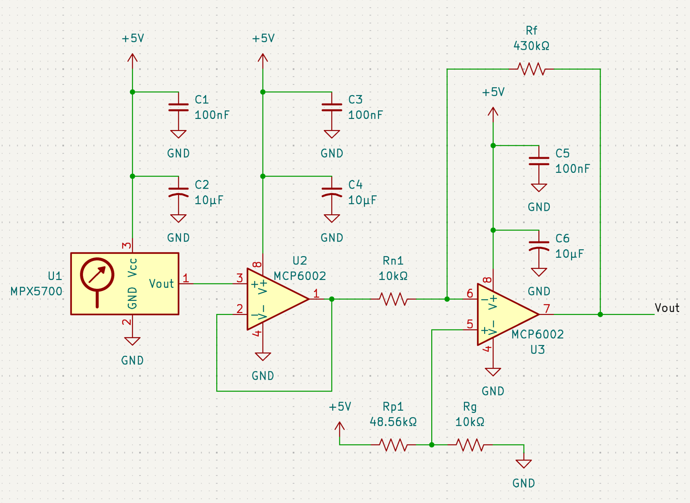

By connecting a tube to the pressure sensor and submerging its other end in a graduated cylinder, the team was able to make a calibration curve of the circuit output voltage to depth. The results were plotted in MATLAB and are shown in Figure x.

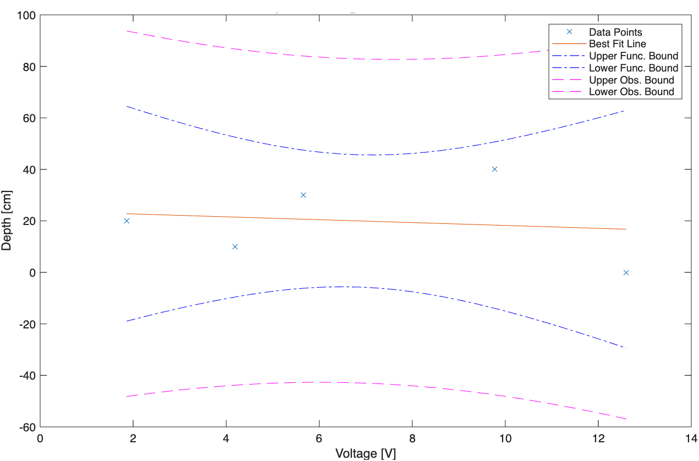

There is some percent error between the predicted and measured voltage outputs because the predicted values were calculated assuming each component (pressure sensor, op-amp, resistors, power supply, etc.) was ideal, but in reality, they all have errors in their values (resistance or output voltage). We also calculated the required resistors and thus output voltage with the assumption that the ambient pressure we recorded was accurate, and that it increased with depth according to Po+ρgh, where ρ = $1000kgm^{-3}$, and g = $9.81ms^{-2}$, but these values could have varied based on the barometer we used, the water we used, and the altitude. There are also errors associated with the multimeter reading for the voltage.

## Temperature Sensors

There are three core temperature sensors, each with advantages and disadvantages. Each sensor was prototyped and tested to determine which would be the best fit for the project. 

### Thermistor

Thermistors change their resistance based on the temperature they are in contact with. The thermistor used was a NXFT15XH103FEAB035, and to convert the thermistor resistance to a Teensy 4.0 readable voltage, a voltage divider circuit was combined with an offset amplifier to shift and scale the output voltage so that temperatures from 0-20°C corresponded to voltages of 0.3-3V. This was calculated using the thermistor datasheet equation $R=R_0e^{B(\frac{1}{T}-\frac{1}{T_0})}$ where the B-constant for 25°C/50°C is 4050K, $R_0=47k\Omega$, and $T_0=298.15K$, as well as voltage divider and offset amplifier calculations. Additionally, a unity gain amplifier was connected to prevent loading from the Teensy 4.0. The schematic of the thermistor circuit is shown in Figure x.

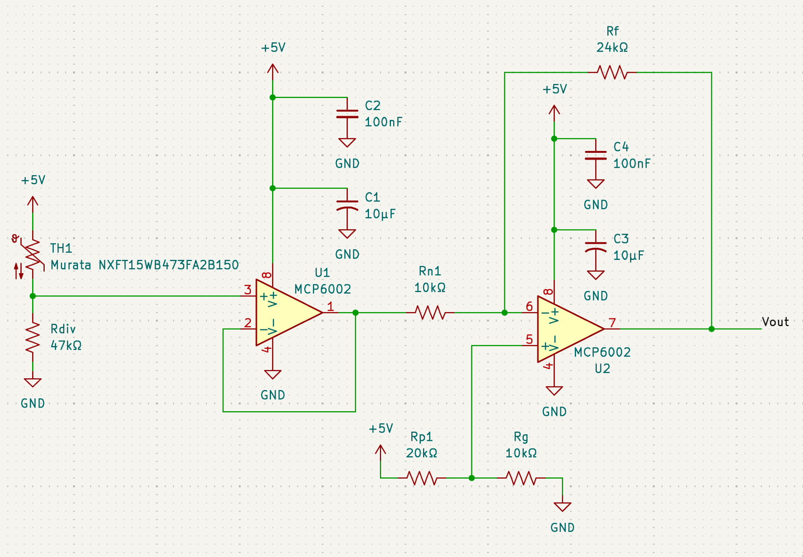

The thermistor was placed in approximately 0° and 20°C water baths, and the output voltage was measured with a multimeter. The results are shown in Table x.

[Table 1. Thermistor Circuit Output Voltage and Resistance Measurements at 0°C and 20°C]{.caption}

|Temp (°C) | $R_{predicted}$ (Ω) | $R_{measured}$ (Ω) | $V_{predicted}$ (V) | $V_{measured}$ (V) | Error (%) |
|----------|---------------------|--------------------|---------------------|--------------------|-----------|
| 0        | 162943              | 150.8k             | 2.980               | 2.971              | 0.46      |
| 20       | 59254               | 56.9k              | 0.359               | 0.300              | 2.93      |

There is a percentage error between $V_{predicted}$ and $V_{measured}$ values because the $V_{predicted}$ values were calculated assuming each component (thermistor, op-amp, resistors, power supply, etc.) was ideal, but in reality, they all have errors in their values (resistance or output voltage). There are also errors associated with the multimeter reading for $V_{measured}$ and added lead/contact resistance from where the thermistor was connected in the circuit, which would affect the output of the voltage divider. Further errors could come from the water temperature not being exactly 0°C or 20°C, even though they were measured to be this temperature by a digital thermometer. This is due to the thermometer measurement error, and the water temperature being non-uniform. The thermistor and digital thermometer cannot measure the exact same region of water, so they would not be reading the same temperature.

To relate the output voltage to temperature, the thermistor circuit was put in water baths ranging from 0-80°C, and the output voltage was measured with a multimeter. Using the circuit resistance values, the resistance of the thermistor was backsolved for each temperature. Then, using MATLAB, the Steinhart-Hart coefficients were calculated and a Steinhart-Hart fit was applied. The resulting plots are shown in Figure x.

:::{layout-ncol="2"}
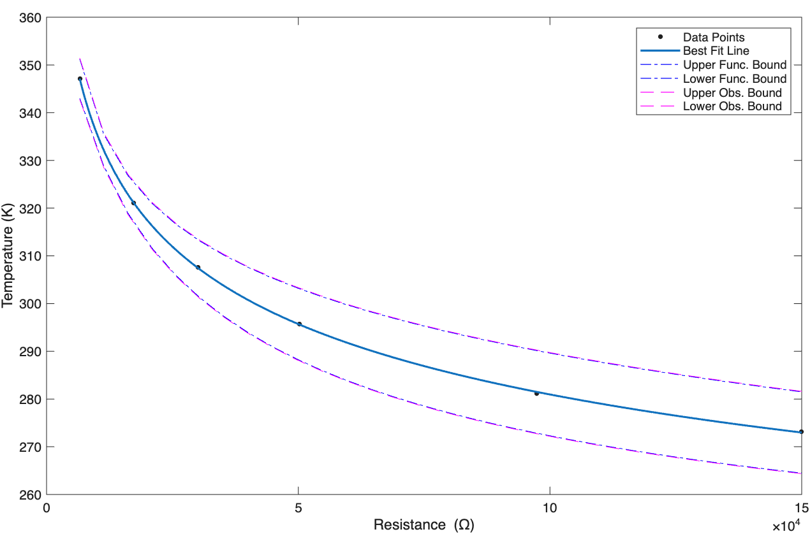

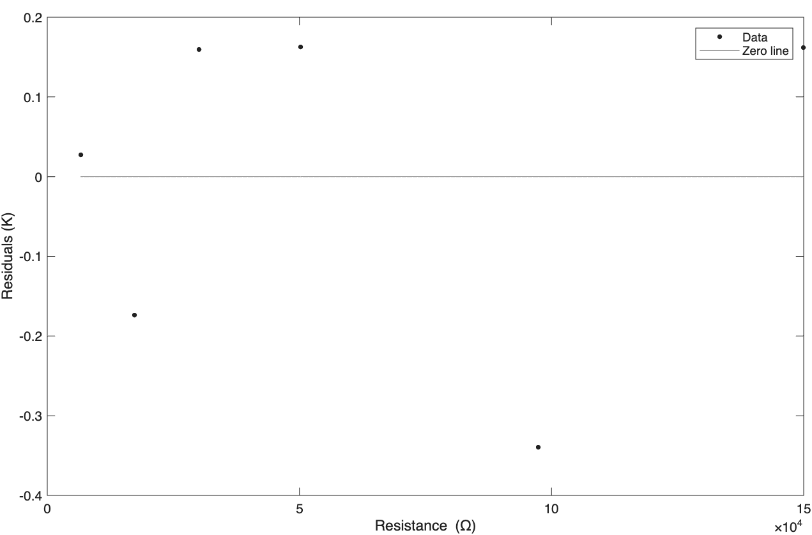
:::

### Thermocouple

Thermocouples are temperature sensors that utilize the Seeback Effect (voltage is generated when two dissimilar metals are connected in a circuit and have junctions at different temperatures) to measure temperatures. The team experimented with a K-type thermocouple (chosen for easy measurement directly with a multimeter) to see if the temperature could be easily and accurately measured from the output voltage.

Using six water baths ranging from 0-80°C (measured with a digital thermometer), the bath temperature was measured using the thermocouple by putting the multimeter in temperature mode, and the thermocouple voltage was measured with a multimeter. Using the principles of cold-junction compensation (since the thermocouple cold junction is at the connection to the multimeter), the temperature could be decoded from the recorded voltage using NIST tables. The results are shown in Table x.

[Table x. Thermocouple Measurement Results]{.caption}

| $T_{thermometer}$ (°C) | $T_{thermocouple}$ (°C) | $V_{thermocouple}$ (mV) | $V_{cold junction compensation}$ (mV) | $T_{decoded}$ (°C) |
|-----------------------|-------------------------|----------------------------|----------------------------------------|---------------------------|
| 0.2 | -1 | -0.74 | 0.0178 | 0 |
| 8.9 | 8 | -0.41 | 0.3478 | 9 |
| 22.6 | 21 | 0.1 | 0.8578 | 21 |
| 34.6 | 34 | 0.62 | 1.3778 | 34 |
| 52.8 | 50 | 1.36 | 2.1178 | 52 |
| 72.7 | 70 | 2.17 | 2.9278 | 72 |

$T_{thermometer}$ and $T_{thermocouple}$ do not exactly match because the digital thermometer has errors associated with its reading (affecting $T_{thermometer}$), and the multimeter has independent errors associated with its reading (affecting $T_{thermocouple}$). Also, the temperature in the bath was likely non-uniform, and the thermocouple and digital thermometer cannot measure exactly the same point in the water, which contributes to discrepancies between them. In addition, the thermocouple measurements depend on cold junction compensation (even though the multimeter essentially does the NIST lookup), and any difference between the multimeter’s assumed cold-junction temperature and the true junction temperature introduces systematic error. 

### Integrated Silicon Linear Sensor

The IC sensor required no special circuitry besides wiring up $V_{DD}$, $V_{OUT}$ and GND. Since the output voltage is linearly dependent on temperature with an equation in the datasheet, there was no calibration necessary. 

### Comparing the Sensors

The settling time of the three temperature sensors were compared. Each sensor was directly connected to a multimeter and dipped in a ~0°C bath until the output reading was stable, then transferred to a ~80°C bath. The time it took for the reading to stabilize was recorded. The K-type thermocouple had the fastest settling time of 2.62s, the thermistor had a medium settling time of 16.79s, and the IC sensor (MCP9701A) had the slowest settling time of 42.49s.

Since the thermocouple had the fastest settling time, the team thought it could be a good option for the AUV, especially if the robot would be travelling at high speeds and need near-immediate temperature readings. However, it would need a second temperature sensor to measure the cold junction temperature as it would be unrealistic to keep it at a constant temperature while the AUV is deployed.

The thermistor was also seen as a good option for the AUV because its settling time was still pretty fast, and it would be easier to integrate with the AUV. It also gave more accurate readings than the thermocouple, and even though it had a smaller temperature range than the thermocouple the AUV would not be going in regions that exceeded its limits.

The IC sensor was not considered because its settling time was too slow, even if the AUV were just drifting in water.

## Underwater Acoustics

Acoustics are helpful for a variety of sensors, such as sonar and radar. To investigate the feasibility of underwater acoustic measurements, the team used acoustic measurements to locate relative position in a tank with multiple speakers emitting set frequencies. 

### Getting Familiar With Signal Processing Using Fast Fourier Transforms

Fast Fourier Transforms were applied using the FFT function of an oscilloscope to 11kHz and 12kHz sine and square waves with 1.5V amplitude and 0V offset.

:::{layout-ncol="2"}
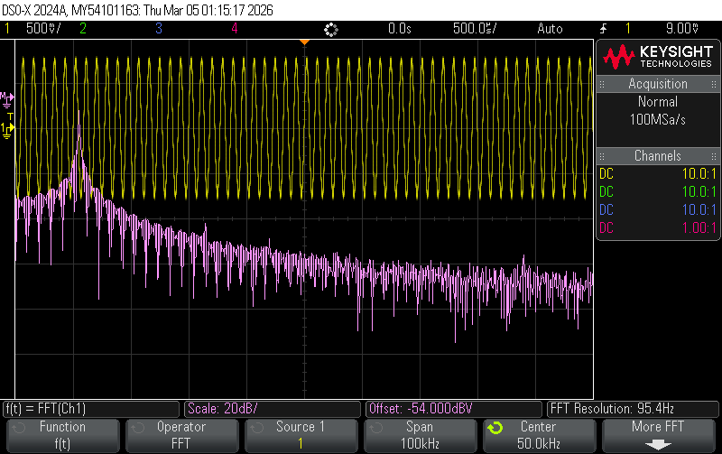

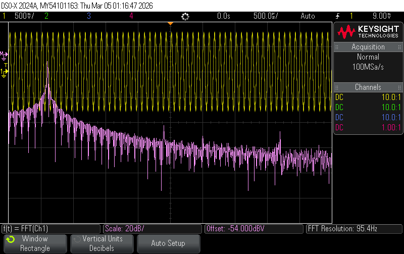

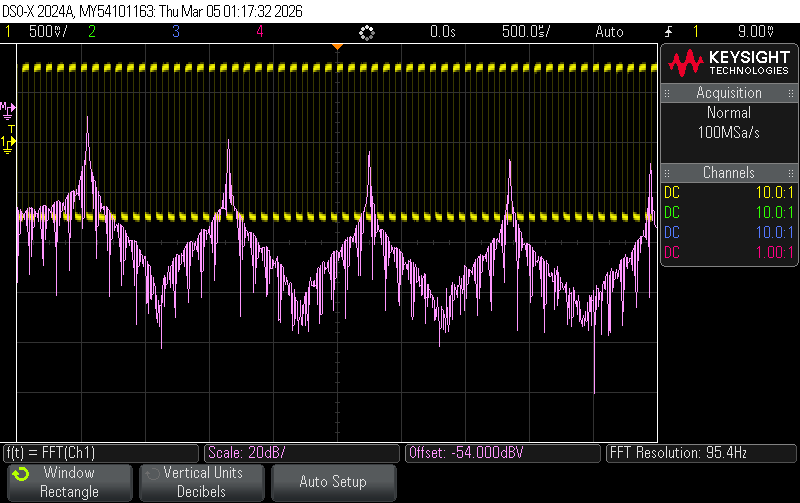

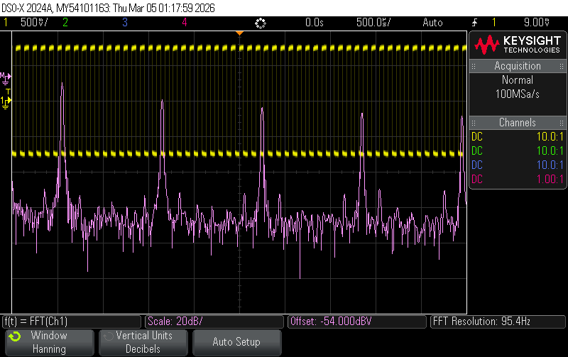
:::

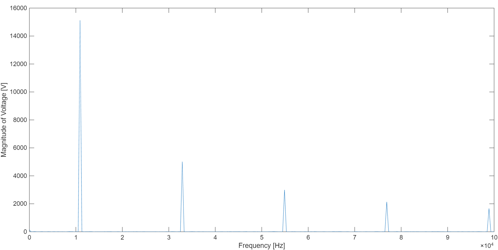

The plots of FFT magnitude show the amplitude of frequencies in the signal. Since Figure Xa shows a 11kHz sine wave and its FFT, we see a single peak at 11kHz, whereas Figure Xb shows a 12kHz sine wave and its FFT, so we see a single peak at 12kHz. 

Figure Xc shows a 11kHz square wave and its FFT, and since a square wave can be represented by the sum of sine waves with odd integer multiples of frequencies, we see multiple peaks, each at an odd integer multiple of 11kHz. 

:::{.callout-note collapse="true"}
### Expand for the square wave/sum of sine waves with odd integer multiples of frequencies derivation

The unit step function is given by:
$$
\begin{aligned}
U(x)&=0 \text{ (for }x<0)\\
U(x)&=\frac{1}{2} \text{ (for }x=0)\\
U(x)&=1 \text{ (for }x>0)\\
\end{aligned}
$$

A square wave with period $T=2L$ can be expressed as $f(t)=2(U(\frac{t}{L})-U(\frac{t}{L}-1))-1$.

The Fourier Series representation of this signal is:

$$
\begin{aligned}
f(t)&=a_0+\sum_{k=1}^{\infty}a_kcos(kw_ot)+\sum_{k=1}^{\infty}b_kcos(kw_ot)\\
&=a_0+\sum_{k=1}^{\infty}a_kcos(k\frac{\pi}{L}t)+\sum_{k=1}^{\infty}b_kcos(k\frac{\pi}{L}t)\\
\end{aligned}
$$

Since the square wave is an odd function, $a_o=a_k=0$. Solving for $b_k$:

$$
\begin{aligned}
b_k&=\frac{2}{T}\int_{0}^{T}f(t)sin(k\frac{\pi}{L}t)dt\\
&=\frac{1}{T}\int_{0}^{2L}f(t)sin(k\frac{\pi}{L}t)dt\\
&=\frac{2}{n\pi}(1-(-1)^n)\\
\end{aligned}
$$

Which gives $b_k=\frac{4}{n\pi}$ for odd integers k or $b_k=0$ for even integers k.

Therefore, the sum of sines representation of a square wave is $f(t)=\sum_{n=1,3,5,...}^{\infty}\frac{4}{n\pi}sin(2\pi nft)$.
:::

Since n is a positive odd integer, and we take the sum of the function from n to infinity, the frequency peak locations would be equal to nf = positive odd integer multiples of 11kHz. This is why we see them present at 11, 33, 55, 77, 99 kHz (the x-axis only goes up to 105Hz). If the x-axis extended further, the magnitude of the peaks would eventually become so small that we wouldn’t be able to see them anyway. As more n-terms (and thus frequencies) are included, the sum of sines representation of the square wave gets closer to the shape of a perfect square wave.

Figure Xd also shows a 11kHz square wave, but with a Hanning window applied, and this eliminates the peaks at the non-odd integer multiples of 11kHz due to the Hanning window removing the periodic discontinuities and additional sinusoid component additions to compensate for them.

Figure Xe shows a MATLAB-generated plot of the frequency spectrum of the same signal in Figure Xd. The FFT peak positions match between Figures Xe and Xd, but the magnitude of the peaks is different because the y-axis of the oscilloscope plot is in decibels, while the y-axis of the MATLAB plot is in volts.

Fourier transformations expect all data that is put into it to be periodic, but the collected data is unlikely to be cut off at exactly a period of the real signal, so after the Fourier transform extends the collected data by repeating what is given to it, the FFT algorithm will think there is a periodic discontinuity and add a bunch of high frequency sinusoids to account for the mismatch. Multiplying the data by a windowing function makes sure the data goes to 0 at the sides of the window, and this removes any periodic discontinuities when the signal is repeated. Using a rectangular window would be like using no window at all since the whole signal is multiplied by a constant, so it has an assumed periodic discontinuity, and the Fourier transform will add many high-frequency sinusoids to compensate, whereas using a Hanning window would make the data at the sides of the window go to 0, removing the need for these undesired sinusoids.

### Detecting AUV Position Using Acoustics

To pick up underwater audio signals, the team built a waterproof electret microphone circuit using op-amps.

The gain-bandwidth product is given by $GBWP=f\times g$, where f is the bandwidth and g is the gain. The gain of the circuit would be limited by the gain from this equation at a certain frequency. Since the output of the microphone is very small (~10mV depending on the input), it needed to be scaled to be readable on an oscilloscope. This was done with two non-inverting amplifiers with a gain of 10 in series. The specific op-amp used was chosen by comparing their tolerant frequencies that would allow for this gain.

The OP07 op-amp has a GBWP of 0.6MHz. Using the GBWP equation with a gain of 10, the OP07 will have ideal op-amp behaviour and allow for a gain of 10 for frequencies up to 60kHz. The bandwidth of the OP07 at each stage is 60kHz with a gain of 10.

The TL081 op-amp has a GBWP of 4MHz. Using the GBWP equation with a gain of 10, the TL081 will have ideal op-amp behaviour and allow for a gain of 10 for frequencies up to 400kHz. The bandwidth of the TL081 at each stage is 400kHz with a gain of 10.

The frequencies we used the microphone with were within both these ranges, so using either op-amp was feasible. The TL081 was chosen since it can amplify a wider frequency range. The schematic for the microphone circuit is shown in Figure x.

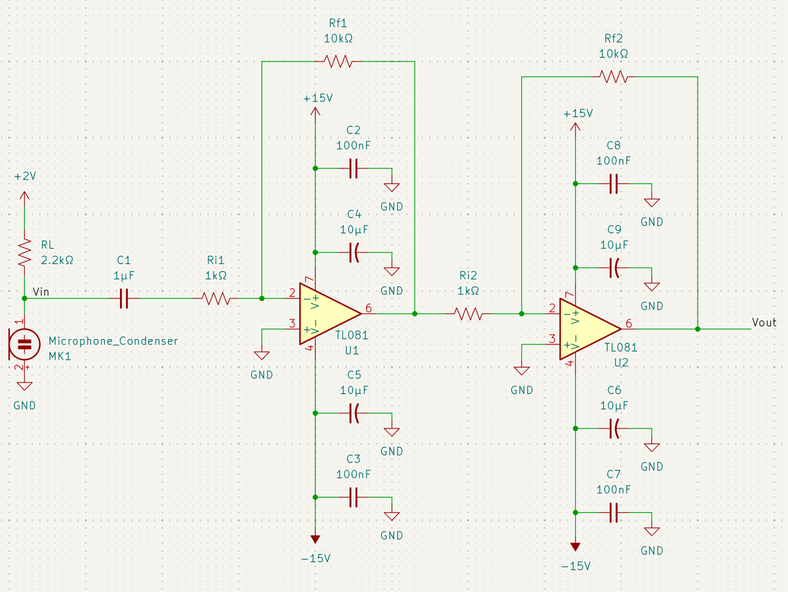

The circuit was tested by reading the output using an oscilloscope while someone clapped (shown in Figure x). The oscilloscope internal FFT function showed that the hand clap has frequencies from 570Hz to 1.1kHz, which are all within the human audible frequency range, which makes sense because we can hear hand claps.

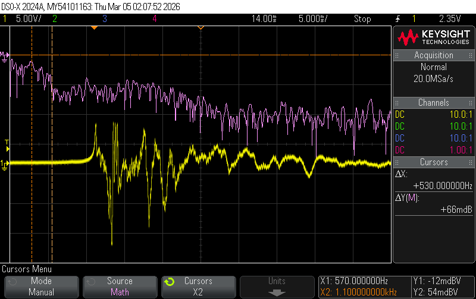

After testing, the microphone was placed in water close and facing to each beacon. Figures Xa-c show the oscillloscope traces obtained.

:::{layout-ncol="2"}
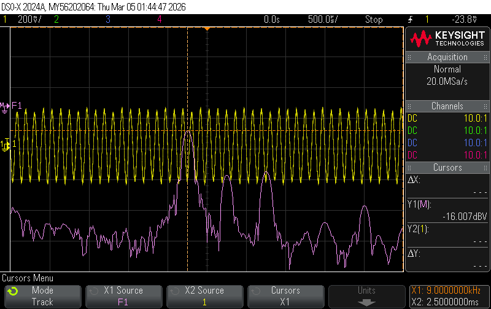

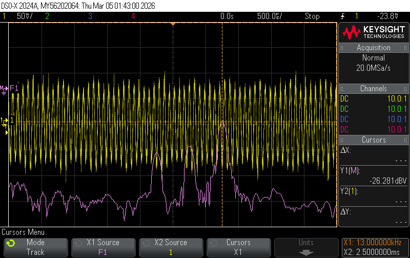

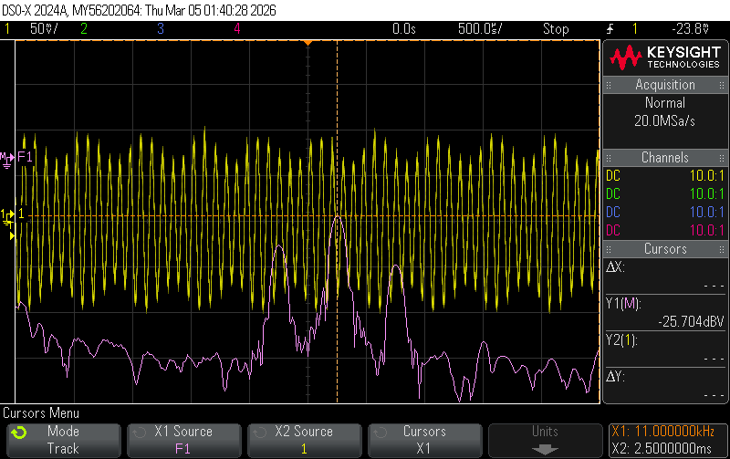
:::

The frequency each beacon was emitting was observed through the highest magnitude FFT frequency read off the oscilloscope when the microphone was next to that beacon. The emitted signal could be recreated by sampling at various distances away from the beacon.

Each beacon emits a signal travelling in the forward direction (call this $P_F$ and represent it as sinusoid multiplied by the power transmitted by the speaker $P_0$), and this gets reflected off a wall in the tank so it travels in the reverse direction (call this $P_R$ and represent it as a sinusoid multiplied by the power transmitted by the speaker $P_0$), which creates [at least 1] multipath. These are functions of time (t), and $t=0$ since we observed a snapshot in time, and we want to know their amplitude at a certain distance away from the source (x), so that we can sum them and get the power the microphone receives.

$P_F=P_0Re(e^{i(t+2\pi fx)}=p_pRe(e^{i2\pi fx}$ and $P_R=P_0Re(e^{i(t-2\pi fx)}=p_pRe(e^{-i2\pi fx}$

Thus, $P_{total}=P_F+P_R=2P_0cos(2\pi fx)$.

The spatial wavelength is the speed of sound in water ($~1500ms^{-1}$) divided by the frequency emitted by the beacons (f = 9kHz, 11kHz, 13kHz), which gives λ=16.67, 13.64, 11.54cm (this is the distance between when each wave will start repeating). From Nyquist-Shannon Sampling theorem, we need to sample at least twice the maximum frequency emitted by the beacons to observe the correct signal, so we get that the x-axis spacing needs to be 5.77cm. To be safe, samples were taken closer together at 2cm apart since because the ideal behaviour assuming one multipath will likely not occur. 

Figure X shows the collected voltage magnitudes when the microphone was held at various distances away from beacon 1 overlaid onto a line of typical magnitude decay behaviour. The collected data points do not exactly line up with the decay because they show a sinusoidal function decaying over time, which lines up with the emitted signal.

### Experimenting with Sample Rates

Using an additional offset amplifier, the microphone circuit was connected to the Teensy 4.0 to sample data. Putting the microphone inside the tank, the first 100 data points of time-scale data and the magnitude of FFTs when sampling at 10kS/s and 100kS/s were plotted, as shown in Figures Xa-d.

:::{layout-ncol="2"}
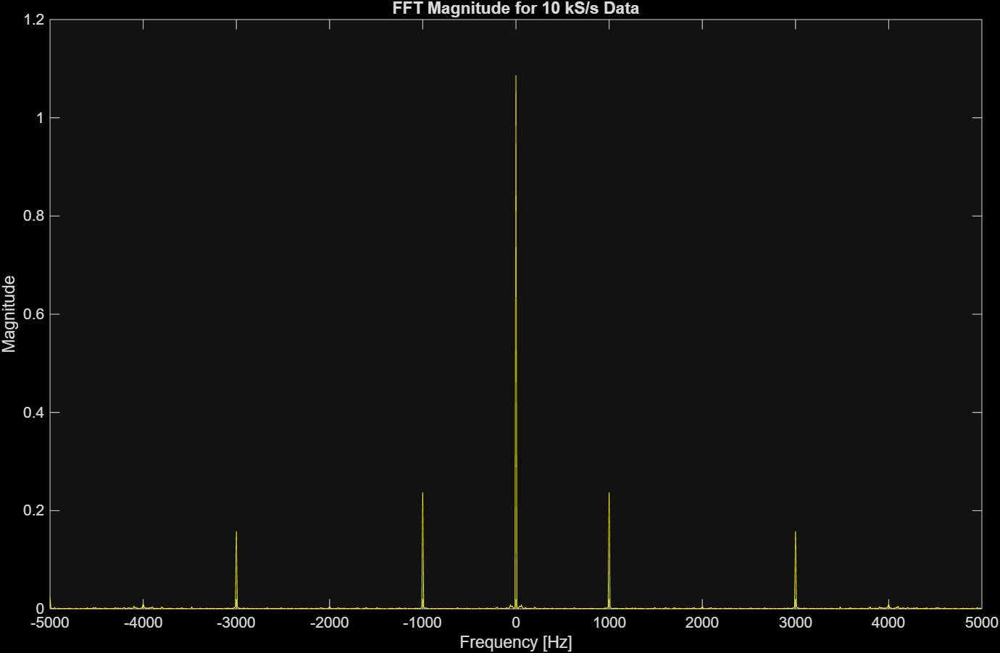

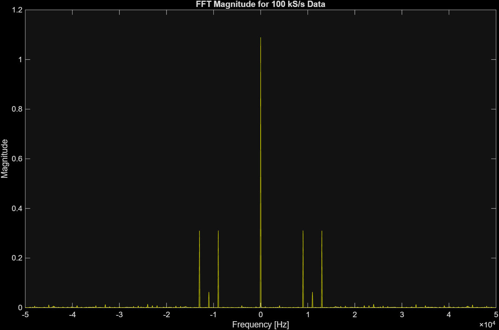

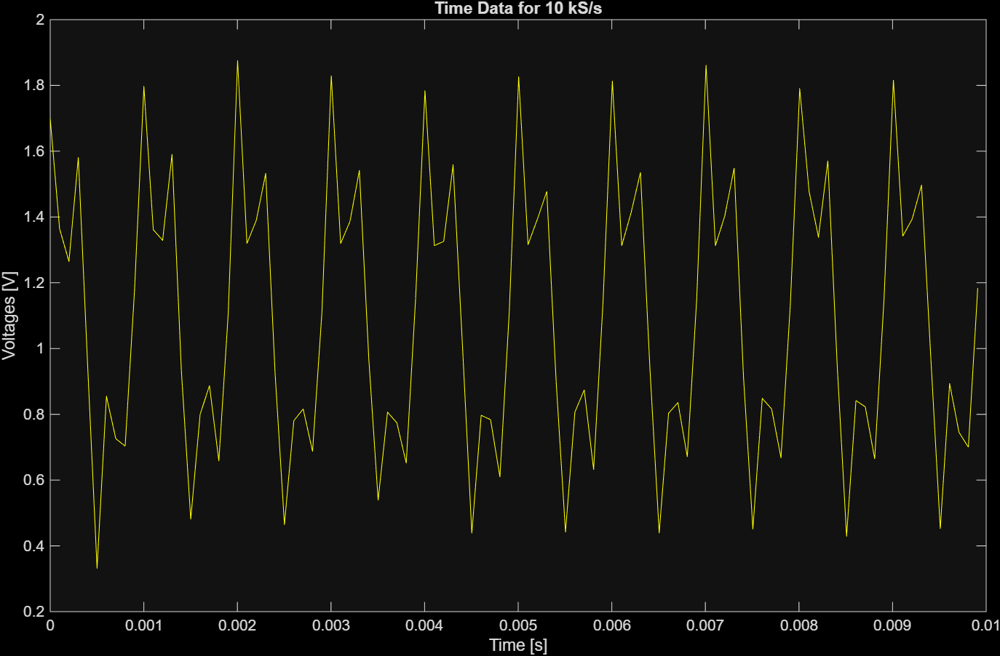

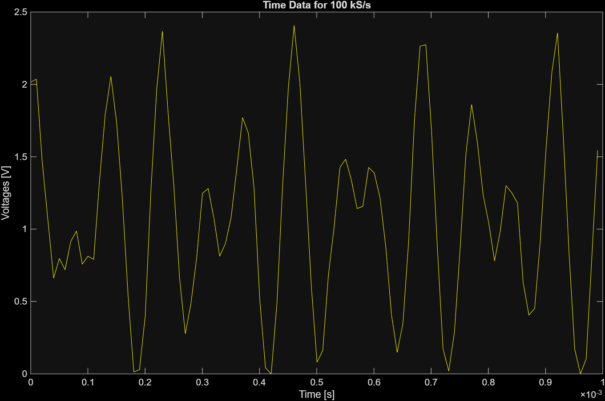
:::

The FFT plots show different frequency magnitude peaks and the time data plots show different sinusoidal behaviour. This is because the maximum transmitted frequency of the sine waves in the tank was 13kHz. From Nyquist-Shannon Sampling theorem, to observe total signal, we need a sampling frequency greater than twice this frequency, so 26kHz or higher. So the 100kS/s (units equivalent to kHz) sampling rate would be enough to fully observe the wave, whereas using the 10kS/s sample rate would result in aliasing. This explains why the data seen in the 100kS/s plots matched the frequencies in the tank whereas the data we see in the 10kS/s plots shows frequencies smaller than expected.

Figures Xa-b show the FFT magnitude plot and time-scale plot when sampling at 26kS/s. They show correct frequency peaks and superpositioned waveform.

:::{layout-ncol="2"}
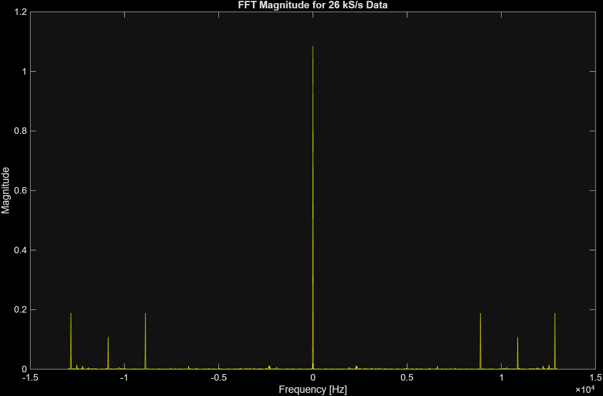

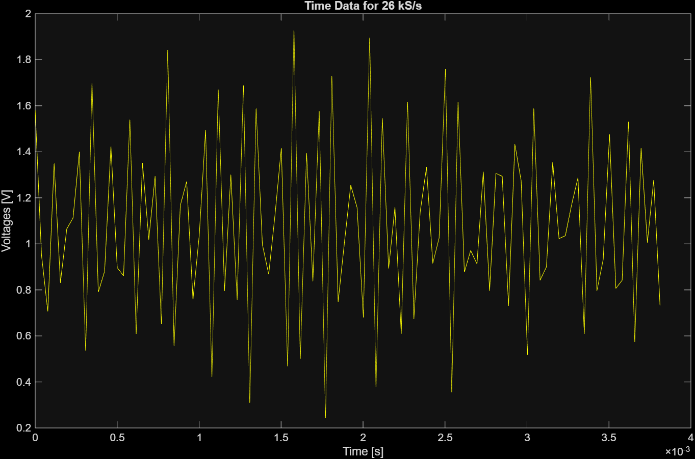
:::

## Magnetometer

The team chose to use a magnetometer to collect magnetic flux density readings on the ocean floor. Magnetic flux density is a quantity that describes the magnitude of a magnetic field. Ferromagnetic materials induce magnetism and change the magnetic field around them when they are placed in an external magnetic field. The Earth has a magnetic field that is downward-angled in the northern hemisphere (which includes the deployment site: Dana Point, CA). Thus, ferromagnetic materials in the deployment area would increase the magnetic flux density around them. This change in magnetic field decreases according to the inverse cube of distance. Magnetic flux density is highly dependent on material composition and object size, and these quantities of the underwater debris were unknown. Therefore, the PNI RM3100 sensor, which converts changes in sensor inductance to magnetic flux density readings, was chosen to detect ferromagnetic materials because of its large range (-800 to 800µT), low noise (15nT), and high sensitivity. 

The magnetometer had both I2C and SPI connection protocols. Since the team did not need particularly high speed data readings (readings would only be taken at the sea floor) and did not need to send at receive data at the same time, the I2C protocol was used. The relevant pins were connected to the Teensy 4.0 as shown in Figure x.

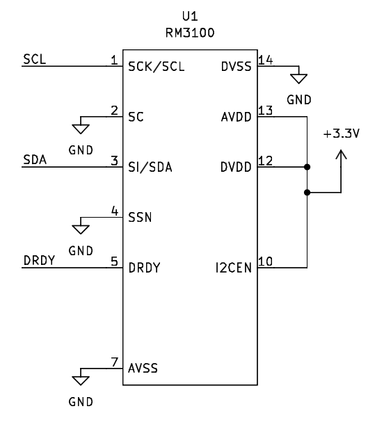

Its functionality was confirmed by holding various magnets at different distances away from it and observing the change in magnetic flux density readings.

## Modifications to the Circuits for Deployment

To prepare the sensors for deployment at Dana Point, the pressure sensor and thermistor circuits were modified to more appropriately scale their predicted output range to the input range of the Teensy 4.0.

### Sensor Justification

The thermistor was chosen over the IC sensor and thermocouple because of its fast response time, higher sensitivity, very low effect of lead resistance on accuracy, and ease of linearising its non-linear relationship between output resistance and temperature.The NXFT15XH103FEAB035 thermistor was chosen to collect temperature data because of its large operating temperature range (-40-125°C), high accuracy (±1% resistance), and easy integration with the AUV.

The team decided that temperature and pressure sensors would be suitable for this project's goals because the concept of geostrophic balance would help us back-calculate debris drop locations.

Geostrophic balance describes the state of fluid flow (currents) in the ocean based on a steady-state force balance between the pressure gradient in the ocean (which is influenced by factors such as surface winds) and the apparent force on particles moving in the water relative to the Earth’s rotating reference frame. The velocity of fluid particles along the Cartesian x and y axes is related to the fluid density, Earth’s rotation rate, and the latitude of the particle. Flows in the ocean occur along lines of equal pressure, so there would be a different set of current vectors at each measured depth. The density of seawater changes throughout the ocean based on the One Atmosphere International Equation of State of Seawater, which is dependent on temperature and salinity. Salinity of ocean water is roughly constant over 10-100m of depth and along the ocean surface. However, temperature in the ocean changes rapidly (10-20°C fluctuation) over the first 400m deep into the ocean, especially in mid-latitude regions (including California). Thus, to characterize oceanic currents according to the above, pressure and temperature readings were collected at various points in the ocean.

### Pressure Sensor

The MPX5700 outputs voltages that are linearly related to absolute pressure. It was expected that the pressure sensor would output voltages of 0.85-1.04V corresponding to depths of 0-3m below the ocean’s surface. The 0-3m range was chosen because Dana Point Harbour has depths between 6-15ft (1.83-4.57m), and the deployment locations were in shallower regions with a 0-3m range. As shown in Figure X, the offset amplifier (U3) was modified to scale this output to nearly fill the 0-3.3V input range of the Teensy 4.0 microcontroller to maximize data resolution. A unity gain buffer (U2) was placed between the pressure sensor and offset amplifier to prevent loading effects.

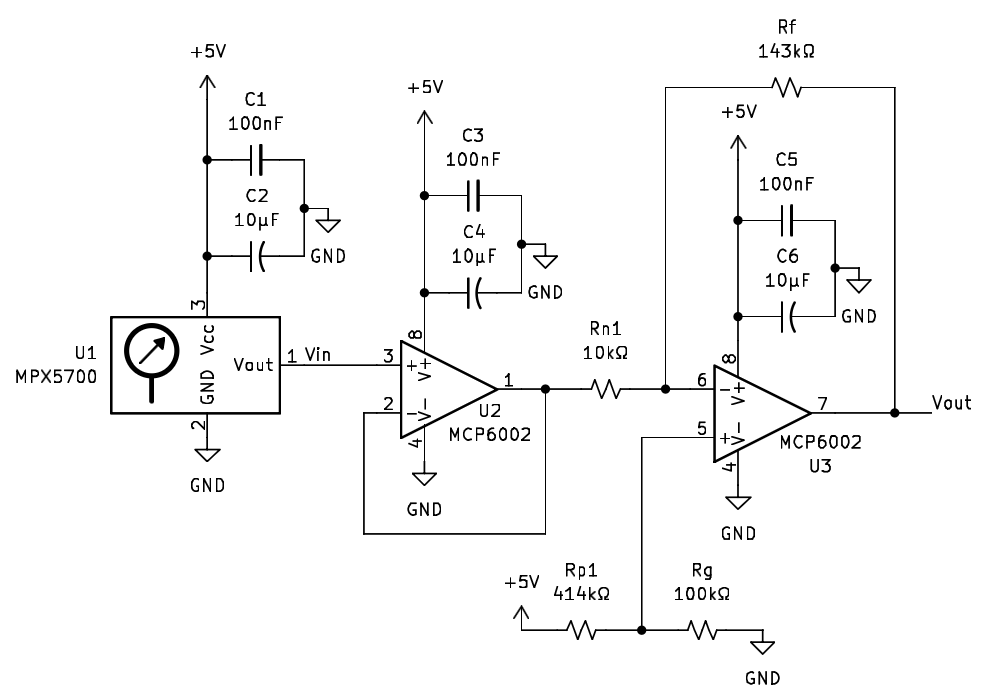

The offset amplifier was designed with an offset of 14.56V and a gain of -14, calculated using the offset amplifier equation $V_{out}=5\left(1+\frac{R_f}{R_{n1}}\right)\left(\frac{R_g}{R_{p1}+R_g}\right)-\frac{V_{in}R_f}{R_{n1}}\label{eq}$. The variable values in this equation for this circuit are as depicted in Figure X. This resulted in theoretical output voltages of 0.01-2.73V for depths 3-0m, which is within the desired range. A small voltage buffer was left on each side of the output to ensure fluctuations from noise and unanticipated depths slightly outside the expected range would not cause the circuit to rail out.

The output of the pressure sensor is DC voltage, so the 10Hz sampling frequency in the code was sufficient. However, as described in the P-control section, the depth control algorithm was modified to allow the AUV to autonomously determine if it had reached the seafloor to isolate magnetometer readings at the bottom of the ocean. The sensor was calibrated to derive an equation relating the output voltage to depth by taping a pressure tube connected to the pressure sensor to a meterstick. The output voltage of the circuit was recorded while holding the end of the tube at depths from 0-0.4m in increments of 0.05m in a graduated cylinder filled with seawater. Figure X shows the resultant calibration curve with 95% confidence level upper and lower observational and functional bounds. The $R^2$ value for the fit was 0.996. After calibration, it was noted that the maximum depth that could be recorded was 3.76m under the surface of the water, which was outside the planned 0-3m range.

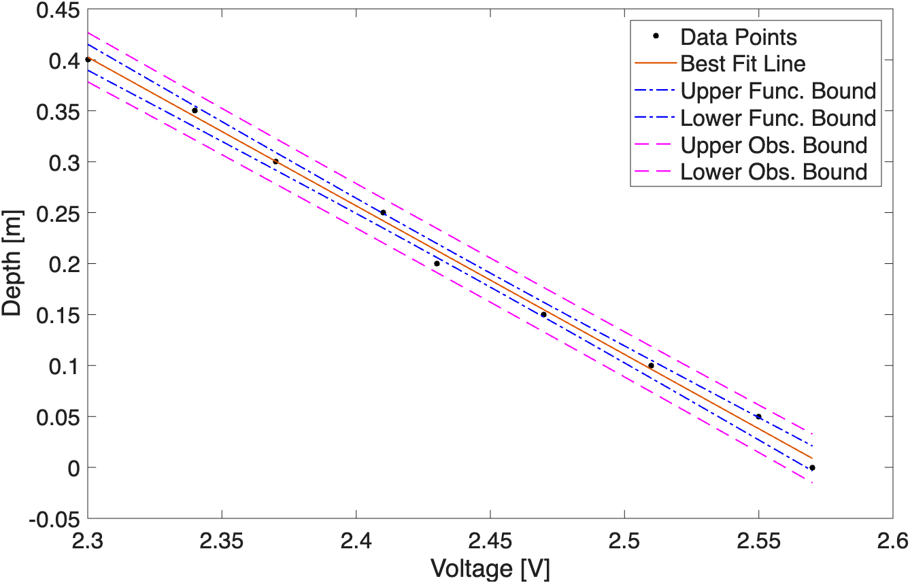

### Thermistor

The NXFT15XH103FEAB035 changes its resistance based on its contact temperature. From its datasheet, thermistor resistances of 95420-47000 $\Omega$ were expected for temperatures of 10-25°C, which is the approximate ocean temperature at Dana Point in April with a 2-5°C buffer on each side. As shown in Figure X, a voltage divider was created with the thermistor to convert this output resistance to an output voltage. A unity gain buffer and offset amplifier were then used to scale this output to 0-3.3V in the same way as the pressure sensor. The voltage divider equation is $V_{in}=\frac{5R_{div}}{R_t+R_{div}}$, with the variable values as depicted in Figure X.

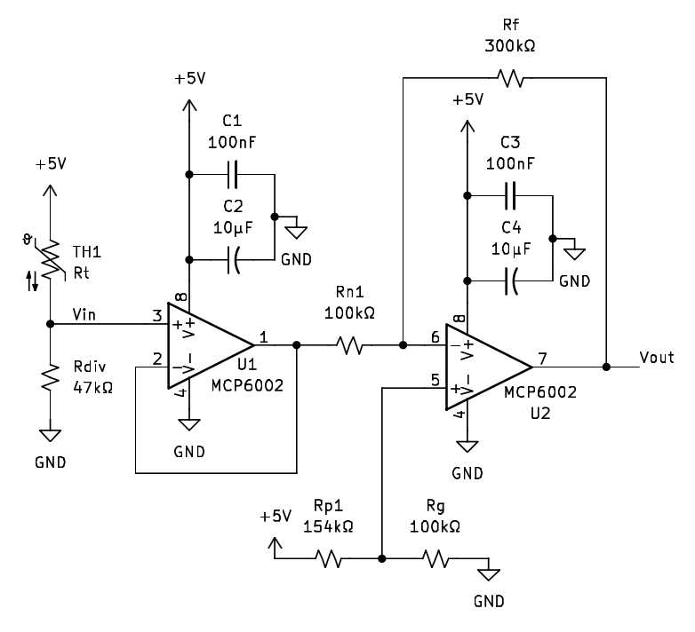

The offset amplifier was designed with an offset of 12.13V and a gain of -3. This resulted in theoretical output voltages of 0.37-2.95V for temperatures 25-10°C, which is within the desired range. Like the pressure sensor, the voltage buffer on each side of the output prevents railing out during deployment.

The output of the thermistor interface circuit is DC voltage, so the default 10Hz sampling frequency in the code was sufficient, and no software modifications were made.

The thermistor resistance is related to temperature based on the Steinhart-Hart equation, where T is the temperature in K, R is the thermistor resistance in $\Omega$, and A, B, C, and D are unitless Steinhart-Hart coefficients. As shown in Figure X, the thermistor was calibrated by measuring output voltages when placing the thermistor in 10-25°C water baths, backcalculating the thermistor resistance using, and finding the Steinhart-Hart coefficients. The coefficients with 95\% confidence bounds were found to be A=0.02348 (-0.1563, 0.2032), B=-0.005701 (-0.05414, 0.04274), C=5.159 $\times10^{-4}$ (-0.003816, 0.004848), and D=-1.487 $\times10^{-5}$ (-1.424×$10^{-4}$, 1.127×$10^{-4}$). Combining the offset amplifier equation and Steinhart-Hart equation determined the relationship between output voltage and temperature.

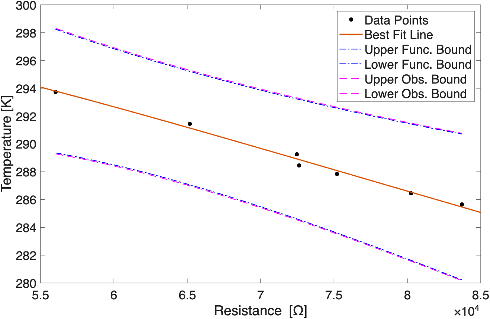

### Magnetometer

The magnetometer interface circuit was not modified after the I2C connection (Serial Clock (SCL), Serial Data (SDA), and Data Ready (DRDY) lines) was tested to work.

The default 10Hz sampling frequency in the code was sufficient for the magnetometer readings. The magnetic flux density was expected to be a roughly constant value at each position, and not a periodic signal, so the sampling frequency producing aliasing was not a concern. Separately, the RM3100 has a data update rate of 37Hz, meaning it would complete a measurement and flag DRDY every 0.027s [13]. If the sampling frequency were more than 37Hz, the Teensy 4.0 could attempt to read data when there is no real output, producing gaps or anomalous values in the recorded data. 

Modifications to the code were made in the form of writing C++ functions and constants necessary for the magnetometer to collect and save separate-axis and total magnitude magnetic flux density readings in µT.

The sensor was re-validated before deployment by using it to collect data in open air and away from any ferromagnetic objects (apart from data collection hardware) for around 10 minutes. Figure X shows the results of this data collection, where readings fluctuated between around 50.25-50.6µT, which falls within the expected range of 22-67µT on the Earth’s surface.

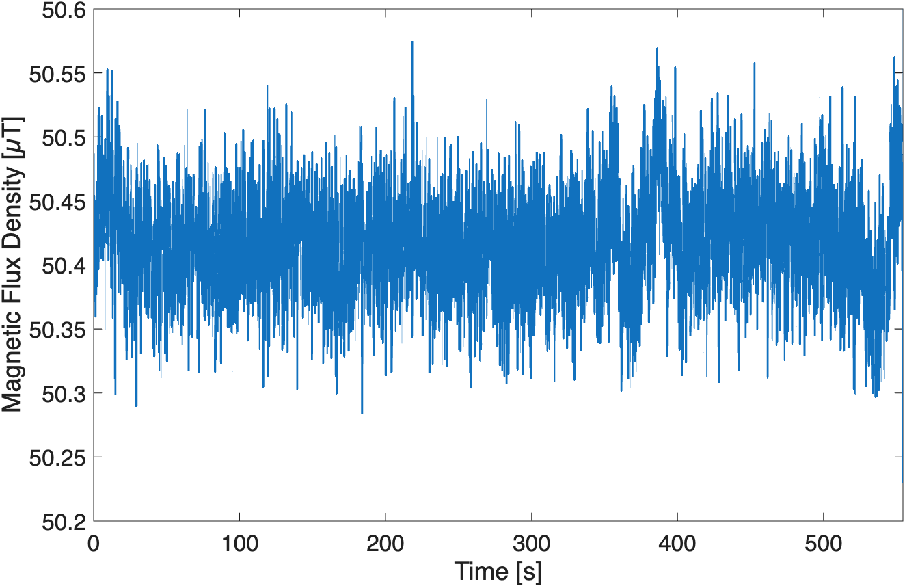

# P-Control
## Depth Control

## Surface Navigation Control

# Mechanical Design
## Buoyancy
## Waterproofing

# Deployment

# Results and Conclusion

# Final Paper

Read through my IEEE-formatted technical report about this project here!

