

  
<strong>Timeline:</strong> 

  
<strong>Skills:</strong> 

# Introduction and Background

The goal of this project was to explore the potential of using an autonomous underwater vehicle (AUV) to map seafloor debris and determine their water surface entry point. The United Nations Educational, Scientific, and Cultural Organization estimates there are three million shipwrecks worldwide, among other catastrophe-induced ocean debris. These wreckages are artifacts of human behaviour and are usually investigated to inform historical and cultural accounts. However, these investigations have historically been difficult because current methods to locate wreckages are complex and inefficient. These methods can be improved by detecting magnetic anomalies that indicate metal wreck pieces due to their material composition underwater and reconstructing their points of entry into the water.

An AUV was constructed to collect pressure, temperature, and magnetic flux density data at Dana Point Pier with a sample rate of 10Hz. Pressure and temperature data can be used to create a 3D vector field map of currents in the ocean. The magnetic flux density data can be used to form a contour plot of the magnetic flux density across the ocean floor. These two plots would enable conclusions to be drawn about ferromagnetic materials, which include most metals, on the seafloor and their possible points of entry on the ocean surface through approximating their trajectory along currents while falling downwards.

# Initial Setup
## Frame and Motor Assembly

## Motherboard Setup

### Assembly

### Validation, Calibration, and Error Measurement

## Open-Loop Control Navigation

# Sensor Development

The team developed several sensor circuits while determining the project scope. We ultimately decided on using the thermistor, pressure sensor, and a magnetometer to achieve our goals. However, this section outlines all sensor circuits prototyped.

## Turbidity Meter

### Getting Familiar with Operational Amplifiers

I had no prior experience with operational amplifiers, so to get familiar with them (as they would be needed to scale the sensor outputs to get a better resolution when read by the Teensy 4.0 ADC), I first built a single rail, non-inverting amplifier with a gain of 2. I applied a 100mV amplitude sine wave with a 1V offset, then with an offset of 0V, catching each input and output on an oscilloscope. 

:::{layout-ncol="2"}
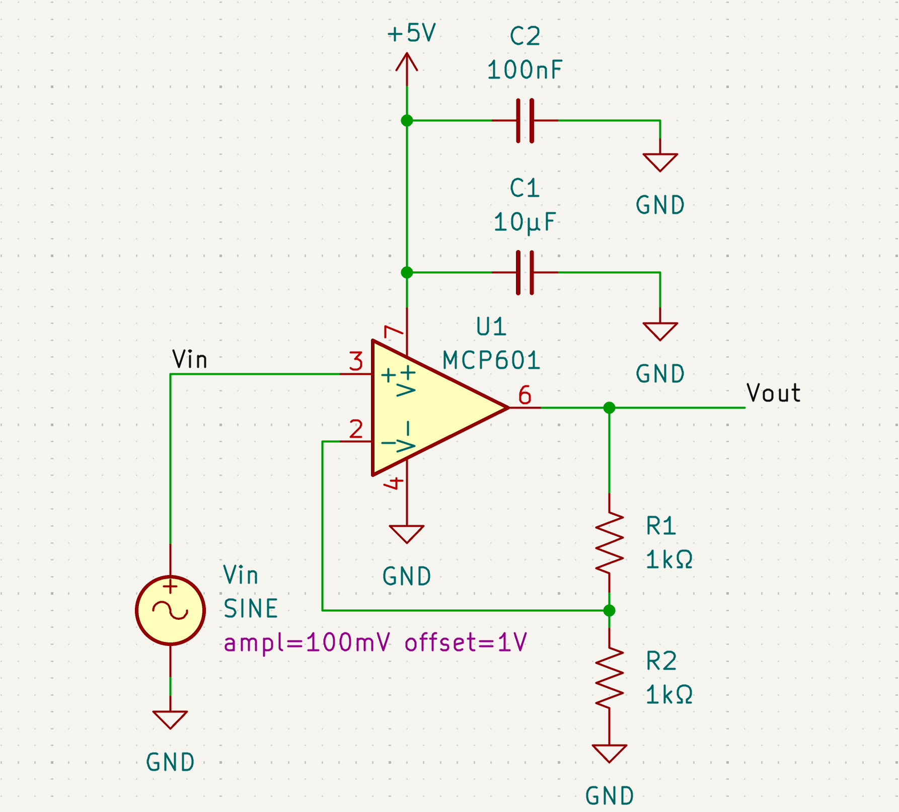

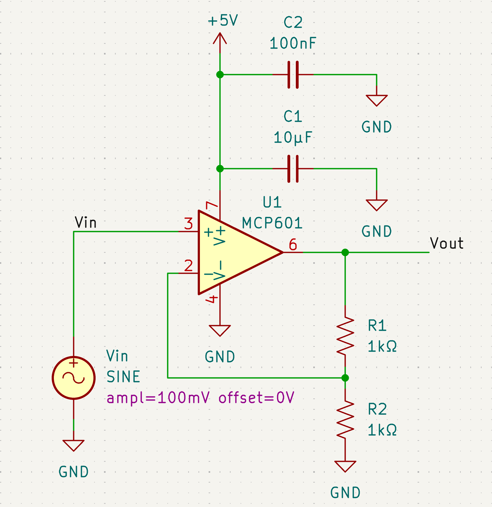

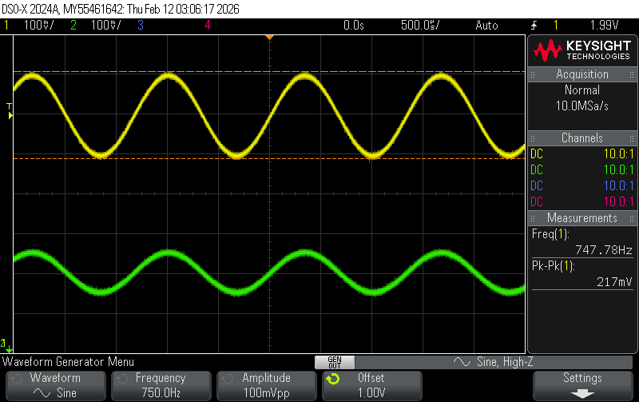

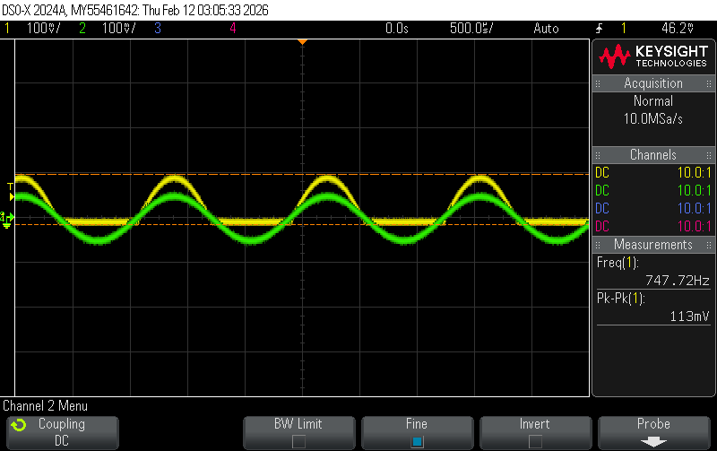
:::

In both traces, the desired gain of 2 was achieved, as seen by the input voltage being scaled by 2 in the output voltage (100mV to around 200mV in the 1V offset one, 100mV to 100mV in the 0V offset one due to clipping). When the signal was sent into the op-amp with a 0V offset, only the positive voltages of the original sine wave show up on the output, with the negative voltages being output as 0V.

The output signal in the 0V offset trace does not obey the equation that describes non-inverting amplifier outputs because I used a MCP601 which is a single supply op-amp, which means it only has +V and GND, so Vout can only be positive. Since the input has a 0V offset, half of the input signal is out of the range of the op-amp (it goes below the minimum possible output), making it look like the op-amp is producing a constant output instead of the ideal sine wave. I learned that this was how op-amps could be used to scale signals, but that I would need to be careful of "railing out".

Next, I build an offset amplifier that could take the same 100mV amplitude sine wave with a 0V offset and output the full signal. I did this by using a gaim of -2 and a 200mV offset. 

Assuming an ideal op-amp (infinitely large input impedance, and $V_+=V_-$ in negative feedback), $V_{out} = (1+\frac{R_f}{R_n1})V_+-\frac{R_f}{R_n1}V_in$ where the gain factor is $-\frac{R_f}{R_n1}$ and the offset factor is $1+\frac{R_f}{R_n1}$. 

If the gain factor is -2, then $-\frac{R_f}{R_n1}=-2$, so $R_f=2R_{n1}$. I used $R_f=20k\Omega$ and $R_{n1}=10k\Omega$ based on resistor availability. 

Since the minimum input voltage would be -100mV, and at this point we want an output voltage of 0V, I substituted these values in to solve for $V_+$.

$$
\begin{aligned}
V_{out}&=(1+2)V_+2V_{in}\\
0&=3V_-0.2\\
V_+&=0.67 (rounded up so V_{out} doesn't rail)\\
\end{aligned}
$$

Using $\frac{R_g}{R_{p1}+R_g}V_{p1}=V_+$, where $V_{p1}=5V$ supplied from the 5V power supply into the op-amp to reduce the need for multiple power sources, 

$$
\begin{aligned}
\frac{R_g}{R_{p1}+R_g}5&=0.067\\
R_g&=\frac{0.067}{5}R_{p1}+\frac{0.067}{5}R_g\\
74R_g&=R_{p1}\\
\end{aligned}
$$

I used $R_g=2k\Omega$ and $R_{p1}=148k\Omega$ based on resistor availability. The schematic is shown in Figure x.

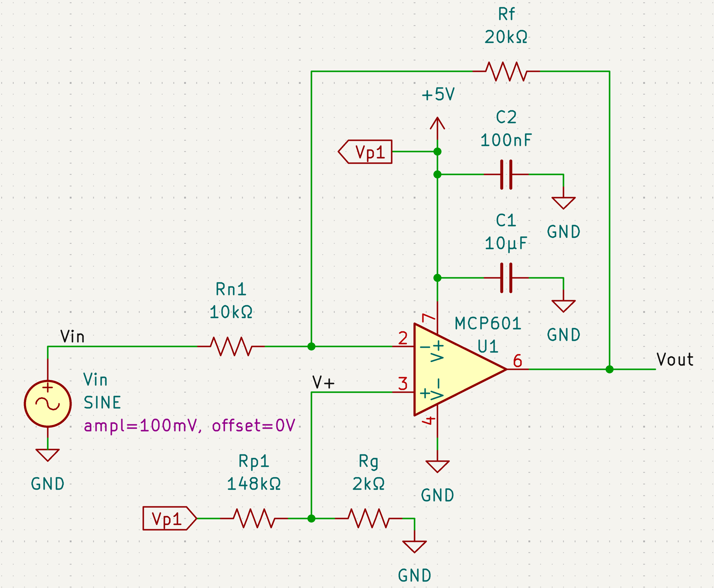

From the oscilloscope trace, compared to the input signal, the output signal has a -2 gain and 200mV offset, which matches the theoretical design.

This design did not have the non-idealities that the non-inverting amplifier has because it included a 200mV offset with -2 gain, so the -100mV input peak can be output as 0V. Since the op-amp is single-rail and cannot handle negative voltages, this prevents the op-amp from resorting to failure mode as seen in the non-inverting amplifier, and the full output sine wave was visible.

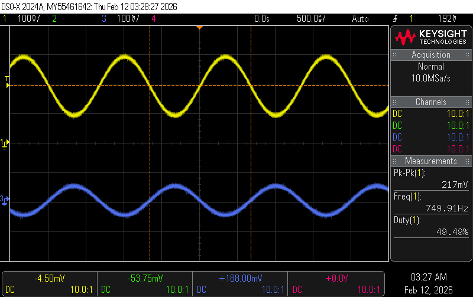

### 555 Timer LED Driver and Transimpedance Amplifier Circuits
Turbidity meters depend on illuminating a water sample and measuring the ratio of light that passes directly through the sample to light that is scattered 90°. We used an IR LED to illuminate the samples and an IR photodiode to measure the transmitted and scattered light. The photodiode was connected to a transimpedance amplifier circuit to convert the diode current into an output voltage. Figure x shows the schematic of the transimpedance amplifier. Note that since the MCP6004 op-amp contains four op-amps, the unused op-amps were connected as unity gain buffers with inputs and outputs grounded to prevent noise from floating inputs.

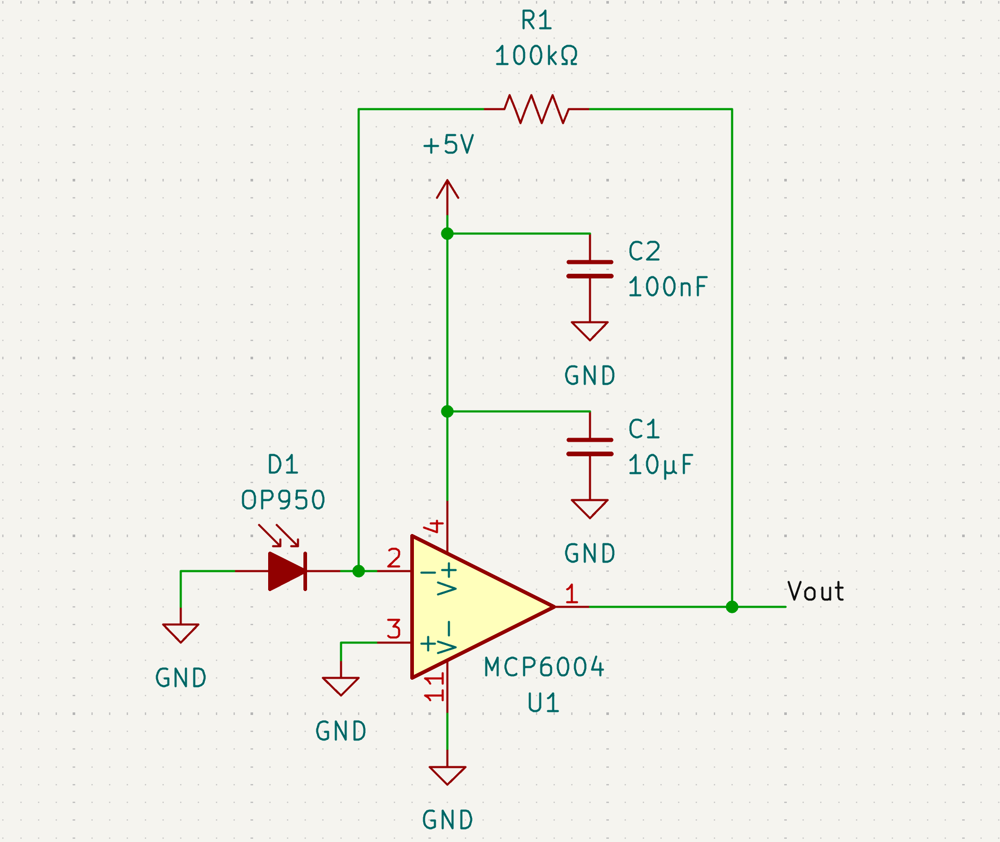

A 555 timer was used to drive the IR LEDs. This was done instead of permanently turning the LEDs high because any ambient light in the water sample would produce an offset voltage in the transimpedance amplifier output. The switching LED would produce oscillatory behaviour so we could measure the peak-to-peak output voltage and thus isolate the voltage caused by the LEDs from ambient light.

We wanted a 500Hz-1kHz square wave with an output waveform duty cycle of about 60% to ensure the LEDs fully illuminated the water sample. From the SE555 datasheet, the output waveform duty cycle was $\frac{R_A+R_B}{R_A+2R_B}$. This was equated to solve for $R_A$ and $R_B$. 

$$
\begin{aligned}
\frac{R_A+R_B}{R_A+2R_B}&=0.6\\
R_A+R_B&=0.6R_A+1.2R_B\\
0.4R_A&=0.2R_B\\
R_A&=0.5R_B
\end{aligned}
$$

So the ratio of $R_A$ to $R_B$ is 1:2. Based on the available resistors, and to use an available and suitable capacitor (as shown below), we chose $R_A=5k\Omega$ and $R_B=10k\Omega$. 

The datasheet also stated the operating frequency was given by $\frac{1.44}{(R_A+2R_B)C}$. This was equated to 500Hz and 1kHz to solve for the minimum and maximum values of the capacitor.

$$
\begin{aligned}
f&=\frac{1.44}{(R_A+2R_B)C}\\
f&=\frac{1.44}{(5000+20000)C}\\
f&=\frac{1.44}{25000C}\\
\end{aligned}
$$

::: {layout-ncol="2"}
$500=\frac{1.44}{25000C}$ gives $C_{max} = 115nF$

$1000=\frac{1.44}{25000C}$ gives $C_{min} = 57.6nF$
:::

Based on the available capacitors, we chose $C=100nF$ to produce a frequency of 576Hz. 

From the IR1503 datasheet, it has a 1.2V forward voltage drop when driving a 20mA current. Since the 555 timer input voltage is 5V, the voltage drop across the current limiting resistor between the LED and ground would be $5V-1.2V=3.8V$. Using Ohm's law, an appropriate resistor value was calculated to produce a 20-40mA current through the LED.

:::{layout-ncol="2"}
$$
\begin{aligned}
V_{cc}-V_F&=I_FR_{Fmax}\\
3.8V&=0.02A*R_{Fmax}\\
R_{Fmax}&=190\Omega
\end{aligned}
$$

$$
\begin{aligned}
V_{cc}-V_F&=I_FR_{Fmin}\\
3.8V&=0.04A*R_{Fmin}\\
R_{Fmin}&=95\Omega
\end{aligned}
$$
:::

Based on these calculations we chose 100Ω as the current limiting resistor. Figure x shows the 555 timer schematic.

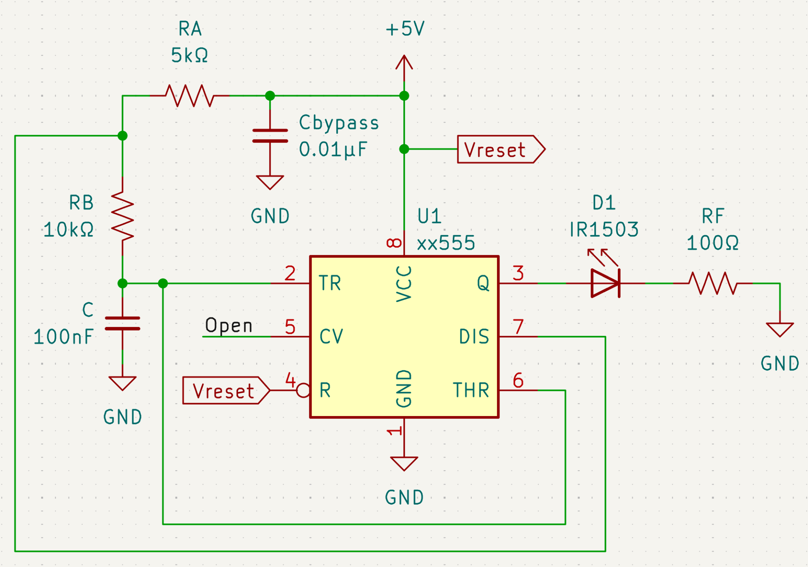

### Circuit Testing and Calibration

To test the circuits were functioning, we first captured an oscilloscope trace of the 555 timer output to ensure the frequency and duty cycle were correct. In Figure x, the three traces show the 555 timer output, the 555 capacitor node, and the voltage in the middle of the diode resistor string.

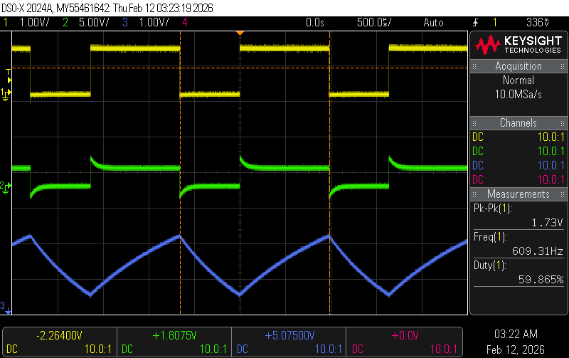

We then captured an oscilloscope trace of the transimpedance amplifier output when the photodiode was illuminated by the switching IR LED to ensure the circuit could be correctly driven (shown in Figure x). 

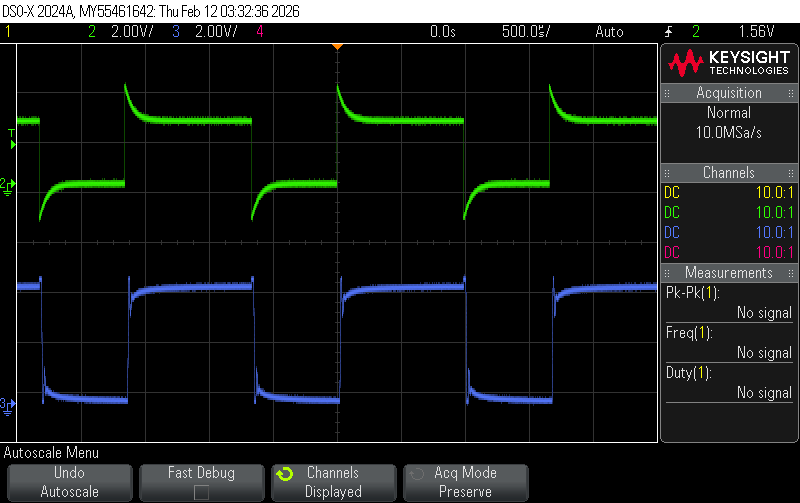

To finalize the turbidity meter, 5 solutions of various turbidities were prepared using milk and water, and checked using the TU-2016 turbidity meter. The solution cuvettes were then placed in a 3D-printed fixture that held one IR LED and two photodiodes in the correct orientation. 

:::{layout-ncol="2"}
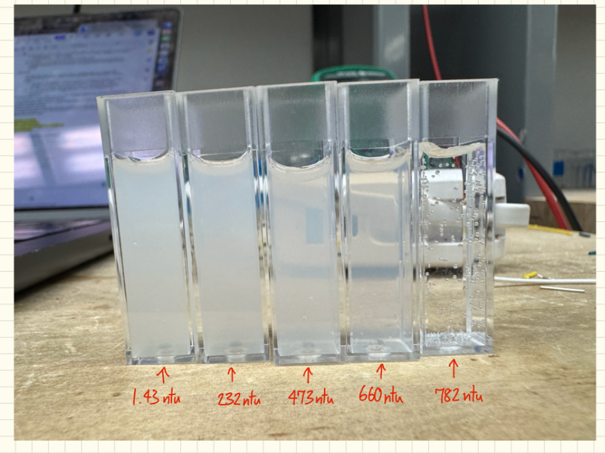

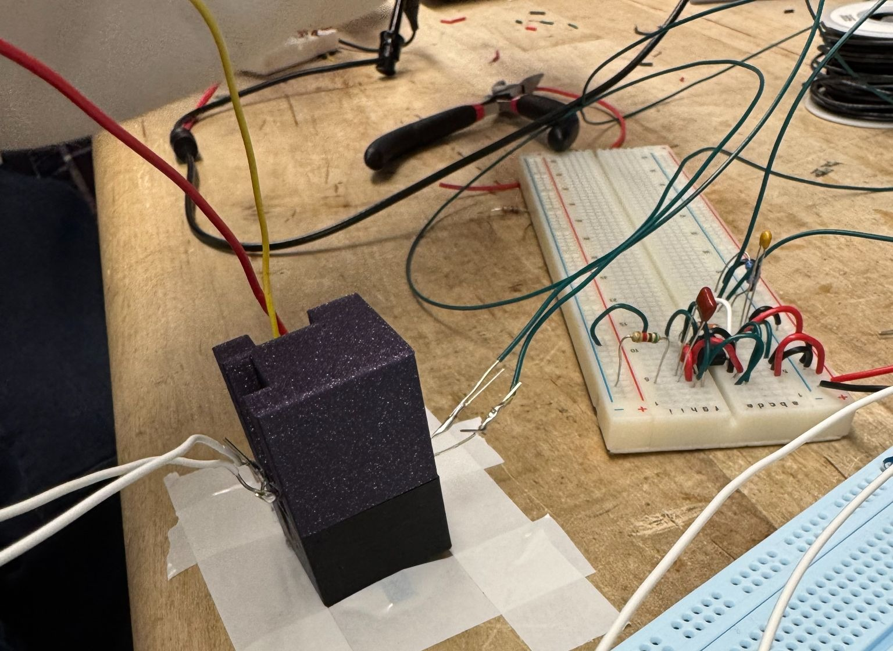
:::

The peak-to-peak voltage of the 90° and 0° transimpedance amplifier outputs were recorded for each solution. The ratio of these voltages were plotted against the calibrated turbidity data to get a calibration curve. The results were plotted in MATLAB and are shown in Figure x.

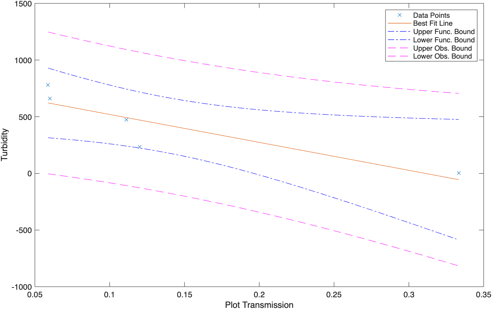

## Depth Sensor

The depth sensing circuit utilized a MPX5700 pressure sensor. This was chosen because of its large operating absolute pressure range (15-700kPa), linear relationship between output voltage and pressure, and easy
integration with the AUV.

## Temperature Sensors

There are three core temperature sensors, each with advantages and disadvantages. Each sensor was prototyped and tested to determine which would be the best fit for the project. 

### Semiconductor-based IC Sensor
### Thermistor
### Thermocouple

## Underwater Acoustics

## Magnetometer

# P-Control
## Depth Control

## Surface Navigation Control

# Mechanical Design
## Buoyancy
## Waterproofing

# Deployment

# Results and Conclusion

# Final Paper