

  
<strong>Timeline:</strong> 

  
<strong>Skills:</strong> 

  
<strong>Roles:</strong> 

:::{.columns}

::: {.column width="49%"}


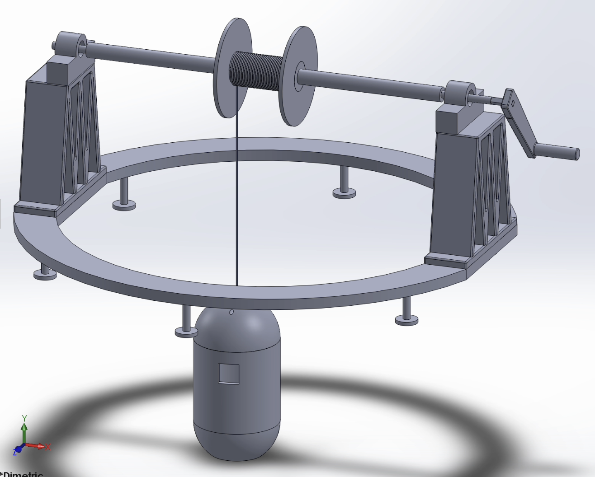
:::

::: {.column width="2%"}
:::

::: {.column width="49%"}
**Overview of Work:**

Worked in a team of 5 to design and manufacture a system to raise and lower sensors through a ~600ft radioactive mine shaft (shrinking to an unknown diameter) for data collection without direct human contact.

Key outcomes:

- **Designed a protective sensor payload** (≤6" diameter) **and lowering mechanism** capable of traversing 600ft at ≥1ft/s while withstanding 70-90% humidity, 20-110°F temperatures, and shock impacts
- **Authored full industry-standard manufacturing deliverables,** including technical drawings, SolidWorks Pack and Go, Bill of Materials (BOM), and process routers for future client reference, fabrication, and field-testing
- **Iteratively prototyped** from low to high-resolution prototypes and designed experiments to clarify project scope and requirements
- **Utilized structured decision matrix tools** (Pairwise Comparison Charts, Morphological Charts, and Best of Class Charts) to downselect design alternatives
- Translated vague client requirements into quantifiable functions, constraints, and objectives to **prevent scope creep and ensure client needs are met**

:::
:::

# Introduction and Background
Our client owned two mining claims in Utah, aiming to clean them up and protect them from federal land protection reversals. One of these mining claims (active from the 1950s to 1980s) was one of the largest uranium producers in the Red Canyon District. 

Since its closure, human exploration has been impossible due to low oxygen levels, high concentrations of radioactive materials, and the risk of structural collapse. Furthermore, at the time of this project, the mine interior was only accessible via two ventilation shafts at least 532ft in depth. One shaft was only 4 inches in diameter, while the other shaft was 24 inches in diameter but narrowed to an unknown diameter further down. Both shafts had potential sudden narrows or shifts, and obstacles within them.

Our client wanted a solution to safely explore the mine interior without sending humans into the hazardous environment. This project's goal was to design a system to lower a payload filled with various sensors, cameras, and lights to the bottom of the mine, collect data, and return safely. The system needed to correctly report the depth of the payload at all times. It also needed to be lightweight and portable, as the client would be driving to the mine site in a 2019 Subaru Crosstrek with limited cargo space, and hiking up to the mine shaft with the system.

# Problem Framing
Through interviewing the client, my team reframed the problem to focus on the key challenges and requirements for the design.

## Problem Statement
This revised problem statement concisely defines the project scope and eliminated errors, biases, and implied solutions.

"The client is trying to explore an old mine site. However, the interior of the mine is hostile to human entry. The main section of the mine can only be accessed through a narrow ventilation shaft that gets smaller during descent from 24 inches to an unknown diameter. The client needs a way to lower a variety of sensors, cameras, and lights into the mine’s interior through the shaft to determine the inside nature of the cave and its environmental conditions while monitoring their depth in real time, as well as retrieve them without damage."

## Functions
Functions are capabilities that the design must perform to meet the client's needs. The following are the constraints for the design:

- Raise and lower a platform
- Support the lowering mechanism and payload
- Protect the client's hardware
- Navigate potential obstacles
- Convey the depth of the payload

## Objectives
An objective is a property of the design that has a preferred or target direction. The following are the objectives for the design:

- Minimize the weight of the device (payload and lowering mechanism)
- Minimize the device’s volumetric footprint while being transported
- Minimize the horizontal area of the payload
- Maximize precision of depth tracking
- Minimize environmental contaminants sticking to the payload
- Maximize the reusability of the device

## Constraints
A constraint is a requirement that the design must fully satisfy, or else it is unacceptable. The following are the constraints for the design:

- Must **fit within half the space of a 2019 Subaru Crosstrek** for transport
- Must be light and compact enough to **take only one trip to carry up to the shaft with at most two people**
- Must **hold a sensor payload that fits within an 8-inch diameter** 
- Must **protect the sensors in a potentially hazardous environment** (humidity 70-90%, temperature 20-110°F, and being submerged in up to 3" of water) so that they can continue to record data after retrieval
- Must **descend to at least 600 ft** down
- Must have a **vertical speed of at least 1 ft/s** 
- Must provide control over ascent and descent at all times by being **able to hold its position and resume movement at any point**

# Ideating and Selecting Alternative Solutions
## Prioritizing Objectives
The team used a pairwise comparison chart to rank the priority of each objective.

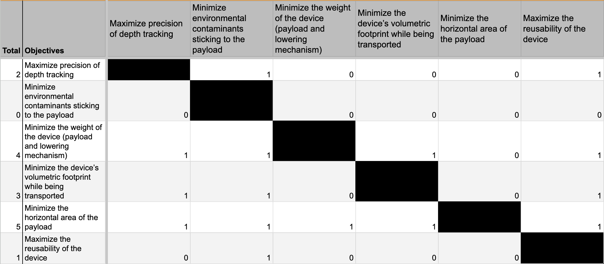

From Figure 1, the prioritized order of objectives is as follows:

1. Minimize the horizontal area of the payload
2. Minimize the weight of the device (payload and lowering mechanism)
3. Minimize the device’s volumetric footprint while being transported
4. Maximize precision of depth tracking
5. Maximize the reusability of the device
6. Minimize environmental contaminants sticking to the payload

Objective 1 outranked the other objectives since a smaller top-down area footprint would increase the likelihood of the payload completely making it down the shaft, given the unknown smallest diameter and potential obstacles. Objective 2 ranked second, since the client is
operating on a tight schedule of one day and needs to get the device up to the shaft in one trip to run it through the shaft multiple times. Objective 3 ranked third, because the client has limited space in his car to transport both teams’ devices, and the dimensions of the other team’s design are unknown, so minimizing the volumetric footprint would increase the client’s chances of getting the device to the site. Objective 4 ranked fourth, since the client specified he wanted to know the depth of the payload to an ideal, but not necessary, precision of 1ft. Objective 5 was placed above objective 6 as the client expects to lower and raise the payload through the full length of the shaft at least five times, and as long as the attempts are made on the same day, he will only remove contaminants once at the end of trials.

## Possible Solutions to the Functions
Various means were generated as possibilities to fulfill each function. These means were organized through a morphological chart. Note: the functions listed in Figure 2 are slightly different from the functions listed earlier, as they were refined during later stages of the design process. The functions as described earlier combine and clarify some of the functions listed here.

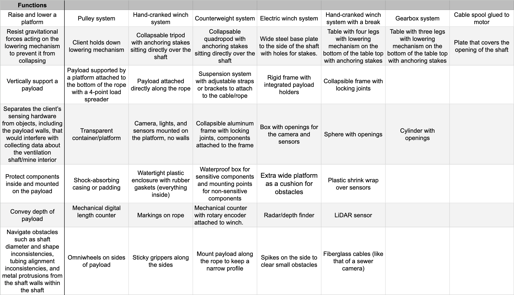

In Figure 2, Function 1 refers to what would allow the lowering mechanism to shorten or lengthen the rope attached to a platform. Function 2 refers to what would prevent the lowering mechanism from falling into the ventilation shaft or falling on its side, considering forces applied from the client and means for function 1. Function 3 refers to how the payload would be attached to the hypothetical rope. Function 4 refers to how the payload should be constructed to allow the sensors to operate, including the shape and structure of the payload. Function 5 refers to how the components could be shielded or cushioned from the harsh environment and obstacles. Function 6 refers to how the client will tell how deep the payload has gone into the shaft. Function 7 refers to how the payload would avoid, move around, or destroy obstacles within the shaft.

## Design Alternatives
From the morphological chart, five design alternatives were developed as outlined in Figure 3.

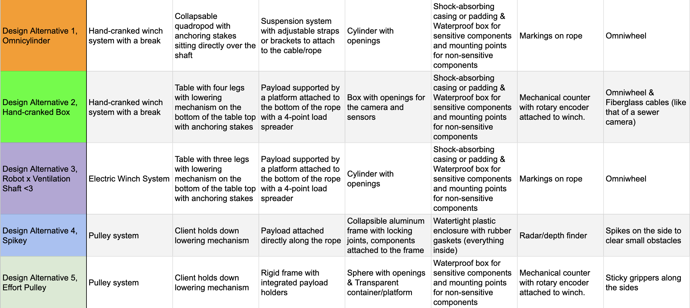

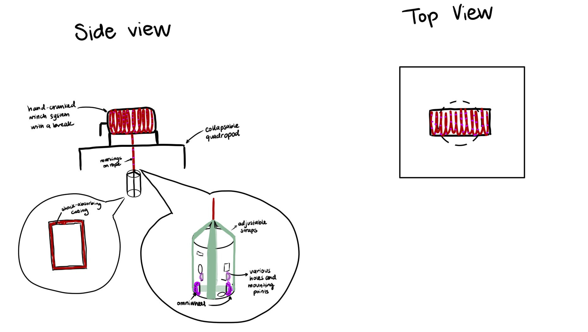

For design alternative 1, the hand-cranked winch with a brake was selected to balance cost-effectiveness and space-saving capabilities. The collapsible quadropod would provide further stability for the lowering mechanism, as the client may not apply force evenly to the winch. It would also help fix the winch in place relative to the shaft opening. The collapsible element would help reduce the volumetric footprint of the overall device. The suspension system was chosen as a light method to distribute the weight of the payload evenly over the lowering mechanism and secure the payload to the cable by reducing sway. The cylinder with openings was paired with a shock-absorbing casing and waterproofing as this would allow relevant sensors to gather environmental data without obstruction, while protecting more sensitive electronics from impact and moisture. The hand-cranked winch is slightly expensive, so the markings on the rope were selected as a low-cost but reliable depth measurement method. The omniwheel would help navigate obstacles inside the shaft by allowing multidirectional movement, as the client pointed out that unrounded parts of the payload could get caught on parts of the shaft.

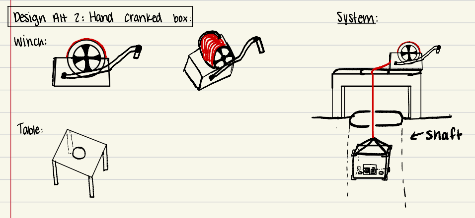

Design alternative 2 followed most of the same logic as design alternative 1, except it utilized the table with four legs to provide a surface for the winch to rest on for additional stability in case the winch could not be fixed to the stand. The 4-point load spreader was selected with the box, as it would be easier to determine where the load spreader would be attached since the box has four distinct sides. The mechanical counter and rotary encoder were selected to provide a more accurate depth measurement compared to the rope markings at the expense of cost. Fiberglass cables were added since the box’s corners are more likely to catch on shaft inconsistencies compared to the cylinder. Since fiberglass cables are strong, they would be able to help the client push the payload through any obstacles.

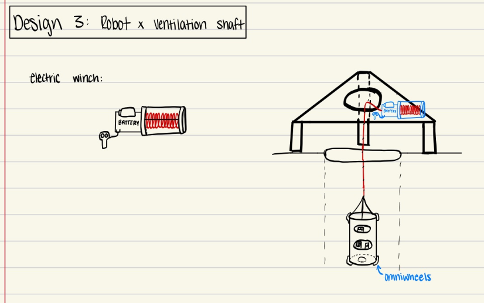

For design alternative 3, the electric winch was chosen to save the client effort when raising and lowering the payload at the expense of cost. The three-legged table was selected instead of the four-legged one since electric winches produce strong horizontal vibrations. If the four-legged table were used, it would shake horizontally, knocking the payload into the shaft, which could destroy the payload or make the lowering mechanism collapse. A modified 4-point load spreader that accommodated the cylinder was selected as it is more stable than the suspension system, and this was needed due to the possible additional speed or movement from the electric winch. The cylinder was still chosen to reduce the likelihood of the payload catching on an obstacle, as the client may not be able to stop the winch in time to prevent destruction of the payload. The logic for the last three means follows design alternative 1.

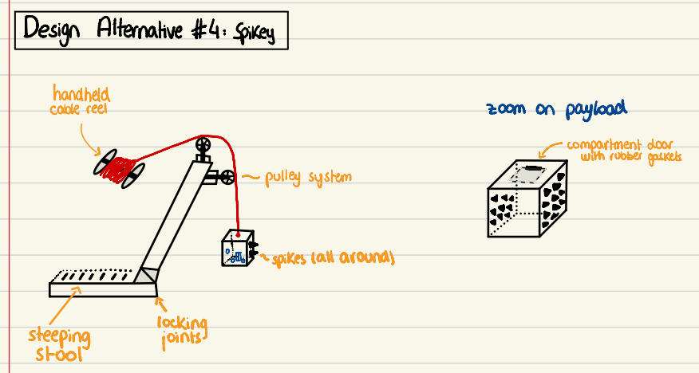

For design alternative 4, the pulley system would not exert as much force as the winches, so having the client stand on a platform holding the pulley would be enough to keep it stable. Attaching all the components along the rope or cable would reduce the area footprint of the payload and ensure it can make it through the shaft. To ensure the components are protected, the individual components would be enclosed in a watertight container. As the components are fixed along the rope or cable, the payload would not have much structure, and the components are exposed, so a collapsible aluminum frame would act as a protective boundary with spikes pointing outward that would help clear small obstacles if needed along the shaft wall. The relatively low cost of these components allows for the use of an expensive radar or depth finder for maximum precision while remaining within the budget.

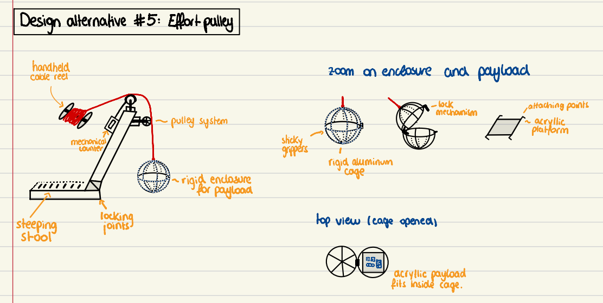

Design alternative 5 followed the same logic as alternative 4 for the pulley system and stability for the lowering mechanism. The rigid frame would allow robust components to be mounted externally on the payload while fragile components that may or may not need to be exposed would be kept in a waterproof sphere with openings within the frame. The sphere was chosen and paired with sticky grippers to allow the payload to stick to and then roll around potential obstacles. The relatively low cost of these components allows for the use of an expensive mechanical counter and rotary encoder to improve precision while remaining within the budget.

## Downselection of the Alternatives
The team used a best of class chart to evaluate and select the most promising design alternative.

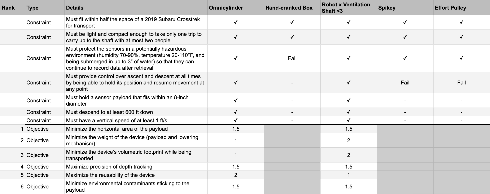

The “Hand-cranked Box” alternative failed constraint 3 as the sharp 90° edges and corners of the box could easily catch on obstacles within the shaft. This would cause a lot of jostling, putting stress on both the payload container and the lowering mechanisms, which could destroy both components and expose or damage the sensors. The alternatives “Spikey” and “Effort Pulley” failed constraint 4 as the pulley system does not have a brake system and would rely on the client holding the rope or cable in position, which the client specified he was unwilling to do.

Both the “Omnicylinder” and “Robot x Ventilation Shaft <3” alternatives received an equal ranking for fulfilling objectives 1 and 6 because they both utilized the mean “cylinder with openings”, so the area spanned by the payload and the environmental contaminants sticking to the surface of the payload would be the same for both alternatives. “Omnicylinder” fulfilled objective 2 better than “Robot x Ventilation Shaft <3” because the suspension system used in “Omnicylinder” is made of straps and cords, whereas the 4-point load spreader is made of metal bars and cables, which would be heavier. Also, having a table like in “Robot x Ventilation Shaft <3” would add to the weight of the design rather than just having the legs supporting the lowering mechanism like in “Onmicylinder”. “Omnicylinder” was also ranked higher for objective 3 because the table would add to the volumetric footprint, whereas the quadropod is fully collapsible and would take up the footprint of a small cylinder. Both alternatives fulfilled objective 4 equally, as they both used markings on the rope to track the depth of the payload, so the level of precision would be the same. “Robot x Ventilation Shaft <3” outranked “Omnicylinder” for objective 5 because the suspension system components are more likely to fray (and possibly rip if used extensively) compared to the 4-point load spreader if they rub against the shaft wall during descent or ascent. 

Overall, because the “Omnicylinder” alternative satisfied all the constraints and fulfilled more high-ranking objectives better than the other alternatives, it was the chosen design alternative.

# Prototyping
## Design Review and Changes to the Design Alternative
The team formally presented the project outline and design alternative to a class of ~20 students for feedback and further refinement. One concern the team brought up was that using omniwheels at the top and bottom of the payload would only be beneficial if they were larger than the diameter of the payload, otherwise they would not come in contact with the mine shaft walls. The client was also concerned that a flat-top payload could catch on pipe edges when being pulled up from the bottom of the mine shaft. The team thought adding cones to the top and bottom of the payload could be viable alternatives, but since there would be openings for the sensors to interact with the shaft environment, water and contaminants may easily get into the payload interior when the payload hit the bottom of the shaft (see Figures 10a-10c). The team also thought about attaching one of the client's cameras directly onto the bottom of the payload to make a flat surface, but the surface are may not have been sufficient to allow the payload to stand upright.

::: {layout-ncol=3}
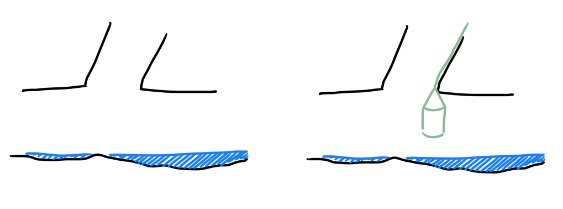

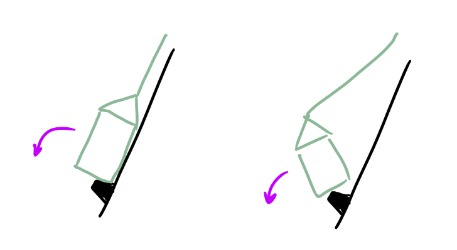

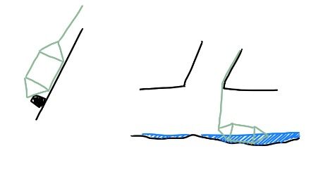
:::

From the ideas that came up during the large-group discussion, the team decided to incorporate some kind of angled top and bottom, with the bottom having a small flat surface for the payload to stabilize at the bottom of the shaft.

## Low-resolution Prototyping
Four low-resolution prototypes were produced to clarify the requirements of the final design and feasibility of each component.

### Prototype 1: Lowering Mechanism Base

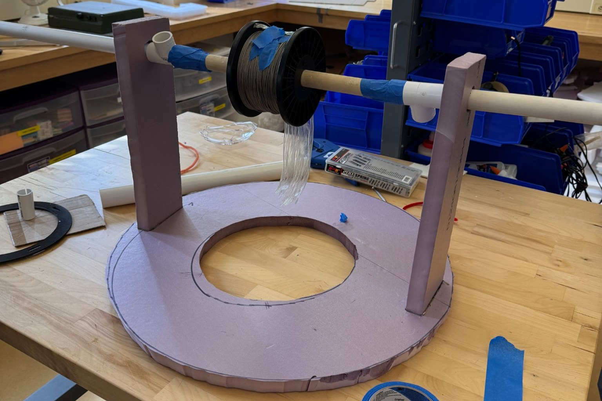{width=80%}

The first prototype was produced to answer the question, “How much will the base of the lowering mechanism lift if the spool cable is lowered and angled at various increments?” After sketching possible designs from the chosen design alternative, one concern was that the quadropod legs would lift if force were applied to the lowering mechanism unevenly. This prototype implemented a circular base made out of foam attached to PVC pipes acting as an axle holding the spool of cable, to determine if a circular platform would distribute force evenly enough to prevent lifting. The cable from the spool was pulled along the length of the axle towards the base at angles of 0°, 15°, 30°, and 45° from the vertical axis. The base did not lift at any point around the circle for all angles. This indicated the circular base could distribute the force of the cable being pulled evenly at any possible pulling angle, so it was a suitable design choice and could be further tested in the checkpoint prototype with the planned final materials.

### Prototype 2: Payload Angle

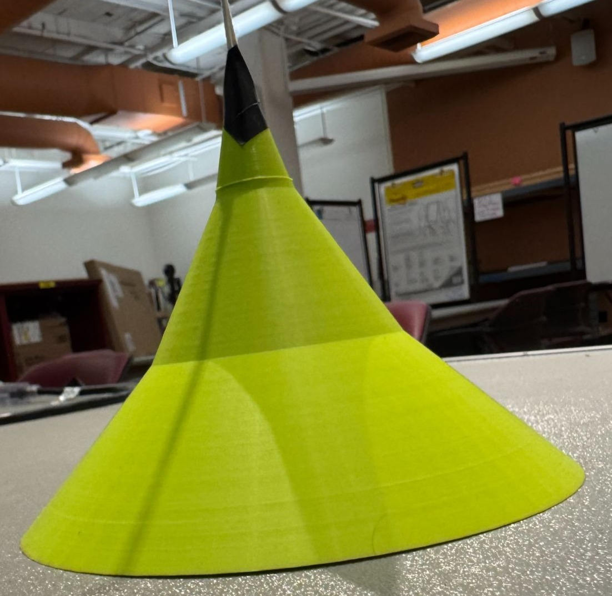{width=60%}

The second prototype was produced to answer the question, “What angle of the payload top will run through a slanted pipe edge with the least force?” From the design review, the team decided on an angled top and bottom for the payload. However, using a cone-shaped payload would decrease the payload volume and make the payload heavier. A cone with side lengths angled at 15°, 30°, and 45° from the vertical axis at 5cm height increments was 3D printed. When the cone was vertically pulled up along a pipe edge by a string, the measured force required to just get the cone sliding was about 3N, 4N, and 4N, respectively. As there was no significant difference in the force required, the angle used would likely depend on the volumetric constraints of the payload size, such as how the sensors inside could be rearranged. This influenced the payload in the checkpoint prototype as the dimensions and shape of the payload could be determined solely based on the volume and arrangement of the client’s sensors, such as whether the sensors could be arranged to fit in a cone shape while minimizing volume. 

### Prototype 3: Payload Interior Dimensions

::: {layout-ncol=2}
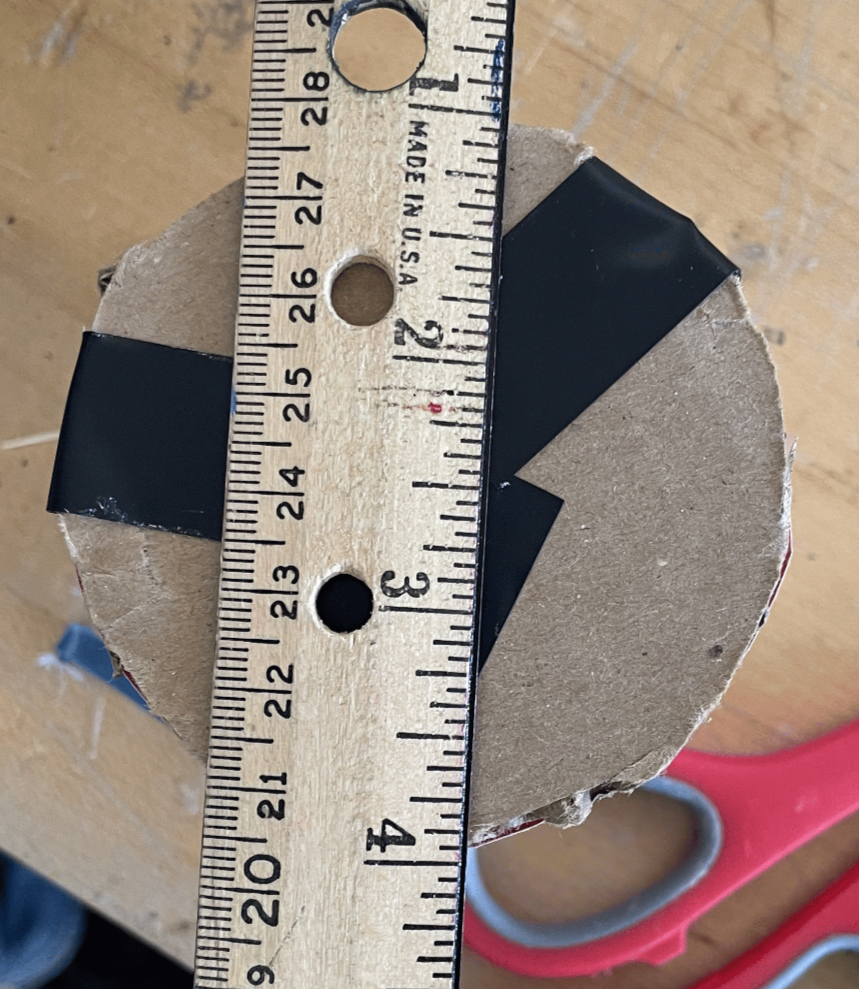{width=80%}

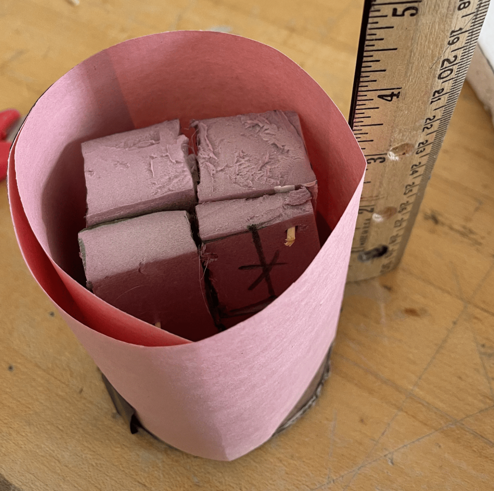{width=93%}
:::

The third prototype was produced to answer the question, “What are the minimum dimensions and shape of the payload?” Since the angle of the payload top did not significantly affect the force required to pull it through an angled pipe overhang, the deciding factor for which angled slope to use would be the interior volume required to fit all sensors. The average dimensions of the client’s planned sensors were found online and modelled using foam. The client specified the inner components would likely take up a 2” x 3” x 5” rectangular prism, so the components were stacked and arranged to fit within these dimensions. With this constraint, the components were only able to be arranged as a rectangular prism and comfortably fit in a cylinder with a 3” diameter and 5” height, with about 0.75” of height remaining at the top and 1” of space from one side of the cylinder to the most protruding component. So, the payload interior would be a 3” diameter x 5” height cylinder with a 45° angled cone added on top, as a 45° angled cone uses the least material from the three angle options. From this, the weight of the payload could be approximated for the checkpoint prototype, as shown in the next prototype.

### Prototype 4: Payload Structure

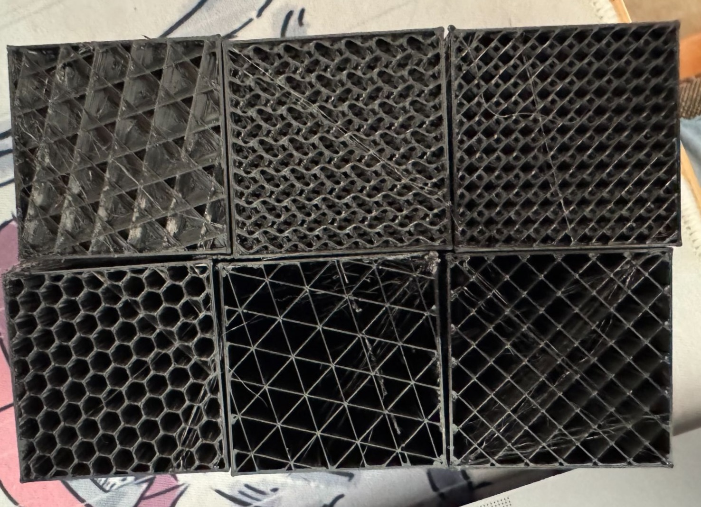{width=70%}

The fourth prototype was produced to answer the question, “What pattern of TPU infill will dissipate the most energy due to collisions?” Given TPU’s lightweight and elastic properties, it was decided to be a good material for padding within the payload. 6 TPU rectangular prisms with dimensions 5cm x 5cm x 2.5cm were printed with infill patterns of cross hatch, gyroid, honeycomb, triangles, cubic, and grid. When a 3-liter bottle of water was placed on top of each model with the infill facing sideways, the triangle and grid infill prisms both vertically compressed and warped (produced divots in the sides), with the triangle model compressing by 2 millimetres and the cubic model compressing by 1 millimetre. The gyroid and cross-hatch models both compressed by about 0.5 millimetres, but did not warp. The hexagonal and cubic models did not compress or warp. More plastic deformation means increased energy dissipation, so the triangle infill model performed the best. Using a triangle infill pattern to make a 3" diameter x 5" hollow cylinder (dimensions taken from prototype 3) with a thickness of 0.5” would take about 120 grams of TPU filament (as estimated by OrcaSlicer). Accounting for the client’s components and an external housing made of sheet metal, the payload would weigh around 550 grams in total. A substitute payload with this mass would be used in the checkpoint prototype to simulate the force of the payload on the lowering mechanism.

## Checkpoint Prototype

The questions answered by the checkpoint prototype were:

1. Can the payload be lowered 10 feet without the base shifting, shaking or warping?

2. How many cable tangles or points where the cable warps over the spool flange occur when the payload is raised and lowered over 10ft with the cable pulled at 15°? 

These questions work towards the objective of “maximize reusability”. If the base shifts, shakes, or warps once the payload reaches a certain depth, this indicates instability in the lowering mechanism. If cable tangles occur on the spool or there are parts where the cable wraps over the spool flange, the lowering mechanism could be subject to unanticipated force in any direction. Both these situations could lead to the lowering mechanism collapsing when the client lowers the payload into the shaft, or lead to it falling into the shaft. Either way, this would hinder the client’s ability to reuse the device. 

Answering these two questions would determine whether modifications for the lowering mechanism are necessary to achieve the client’s needs. If the base shifts, shakes, or warps at any point during testing, this indicates that the base would need to be made more structurally sound by adding more support beams, legs, or choosing a material that will have more friction with the ground. If cable tangles or points where the cable wraps over the spool flange occur, this indicates that either a traverse drive for the winding system would need to be added to the winch system so that the cable winds on the spool body back and forth with minimal cross paths, or the spool walls would need to be extended. The traverse drive was not implemented in the current design as pre-made ones are costly, and assembly from separate components would require further prototypes. The higher spool walls were not implemented in the current design as they would add weight to the device, so it would be ideal to have only the necessary wall height. Once the results for these questions are determined, the team would be able to decide on future prototype and final product designs.

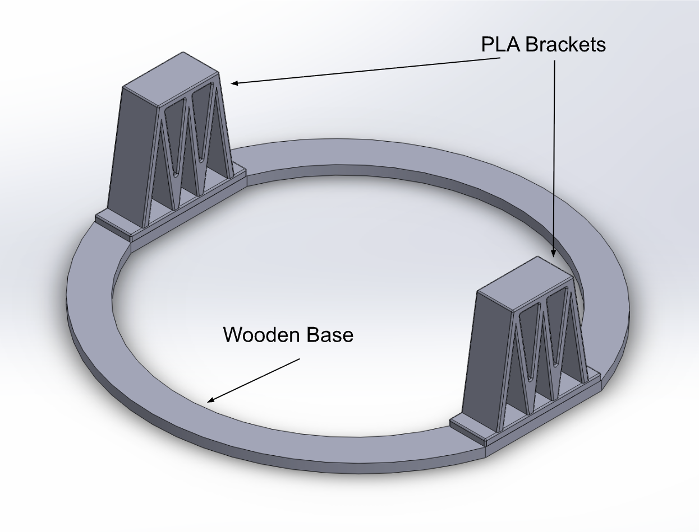

The checkpoint prototype consists of a CNC-routed wooden base designed from a SolidWorks and ShopBot PartWorks model. The distribution of forces in this setup was tested per the first question, as the base would only not shift, shake, or warp if all forces on the lowering mechanism through contact points were evenly distributed. 

Two 3D-printed PLA brackets designed in SolidWorks were mounted to the base to support a wooden dowel acting as a temporary axle. ABS was considered for its greater durability, but PLA was sufficient for this prototype, as the durability of the brackets was not being tested. A spool of aluminum cable was mounted through the axle and connected to a placeholder payload (a 2.5" x 8" bottle of water of mass 550g), approximating the payload shape, size, and weight derived from the prior prototypes. The cable spooling in this setup was tested with approximated forces (gravity on the “payload”) and the lowering mechanism dimensions per the second question. The tension in the cable was dependent on the force acting on the payload, which would influence the slipping of the cable as it winds and unwinds on the spool.

The prototype base was held down onto a flat rail one storey high, such that the rail was parallel to the axle and at the center of the axle supports. A 2.5" x 8" bottle of water filled with water to weigh 550g was taped to the end of the cable to act as the payload. The payload was lowered vertically to the ground floor, where a person pulled the payload at a 15° angle from the vertical axis. More cable than needed to have the payload reach the ground floor was unspooled and held onto by the person on the ground. The spool was manually spun to respool the cable. While lowering the payload, any shifting, shaking, or warping of the base was noted. While raising the angled payload, the number of times the cable tangled or wrapped around the spool flange was noted. This process was repeated for three trials to minimize errors in data.

::: {layout-ncol=2}
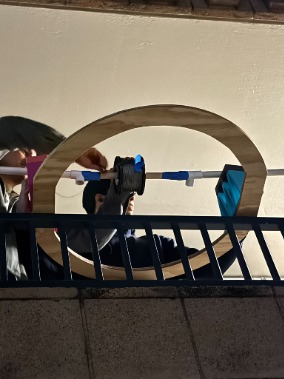

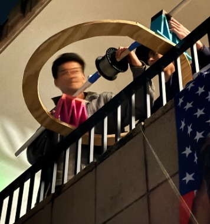
:::

When the payload was vertically lowered from a balcony on the second floor to the first floor, no shifting, shaking, or warping of the base occurred. So, the maximum known depth the payload can be lowered without shifting, shaking, or warping of the base is around 10ft. Although lowering the payload by 10ft is not comparable to the 532ft depth of the shaft, there was no indication of unbalanced forces even though the base was only supported by a beam. Therefore, the lowering mechanism should not have any issues being set up on uneven terrain with minimal points of contact. Using this style of base would help fulfill the objective of maximizing reusability.

When the cable was respooled after angling it by 15°, the cable shifted to the side of the spool and only spooled there. When the payload was let go and allowed to ascend vertically, the cable initially still spooled at the side, but some of the cable started moving closer to the middle at the end of the respooling process. Each trial ended with the difference in diameter of the wrapped cable being about 1”. This suggests that the spool will become more evenly distributed with more cable being spooled. Neither of these tests produced any tangles in the cable or points where the cable wrapped around the spool flange. Because of this, neither a traverse drive nor higher walls was necessary for the final design. Friction that produced slight vibrations in the lowering mechanism occurred when the cable rubbed against the spool walls. However, this was not a substantial enough force to cause movement of the base. Using this spool and spooling mechanism would be sufficient to help fulfill the objective of maximizing reusability.

Since both of these components worked towards fulfilling the objective of maximizing reusability, they were kept in the final design. In subsequent designs, a winch and brake system with bearings and a rotary encoder would be attached to the axle to meet the constraint and objective of having control over ascent and descent and precision of depth tracking. The smoothness of rotational movement and ability to hold a position could be tested by using the winch system to unspool the cable and tracking vibrational movement of the spool. The brake would be used when the cable is unspooled, and any slipping of the cable will be tracked. The precision of depth tracking could be tested by using the brake when the cable reaches a known depth, and the reading of the rotary encoder would be compared with the actual value. Additionally, three adjustable metal legs with swivelling feet would be incorporated onto the bottom of the base to allow adjustment in both height and orientation so that the client could make the lowering mechanism parallel to the ground and reduce multidirectional forces on the device, which would further work towards the objective of maximizing reusability. This could be tested by setting up the base on various terrains, then using the winch system and tracking any slipping, shaking, or warping of the base to ensure the setup is stable on uneven surfaces such that it would not move substantially when the client uses it.

## Final Prototype

Between the checkpoint prototype and final prototype, the payload top and bottom were changed to half spheres instead of the original prototyped 45° angled cones. Even though this took up more volume, the rounded ends would contribute to protecting the payload as they would allow the payload to slide past possible protrusions or shaft inconsistencies within the shaft, instead of getting stuck there and tipping over, which would damage the components as they shift around inside. The team saw the pointed ends of the cone design as being more likely to catch on obstacles on the edge of the shaft.

Since the checkpoint prototype focused on ensuring the base design was sufficient for the system, the final prototype focused on ensuring the payload design was optimal. The questions answered by the final prototype were: 

1. Will a payload of the currently constructed size fully protect the client’s components despite the unknown shaft diameter?

This question related to the top-ranked objective of “minimize the horizontal area of the payload”. A smaller payload size would ensure the client’s components can fully descend to the bottom of the mineshaft, since the shaft diameter narrows to an unknown dimension. By comparing the outer area footprint of the payload with the client’s estimations of the shaft diameter, information about whether the payload could realistically reach the bottom of the mine, or if adjustments to the model were necessary could be concluded. By comparing the inner area footprint of the payload with the client’s estimations, information about whether the payload could be forced up or down the shaft without damaging any components if the shaft diameter becomes narrower than the payload, could be concluded. This information would give insight as to whether the current payload design already had a minimized volume and area or if a larger model is needed. 

The question also related to the function "protect the client’s hardware". The payload's inner and outer volumetric footprint would give information about whether the components can be fully contained and separated from the shaft walls, as well as whether there is ample padding within the payload to protect the components. 

2. When a payload of the currently constructed size encounters objects blocking its path, will it be able to move past them, and how much will the rotary encoder’s measurement of the payload depth be affected?

This question related to the top-ranked objective of “minimize the horizontal area of the payload”. The curved base and top of the payload allowed it to easily slide past possible protrusions and shaft inconsistencies, while still accommodating one of the windows needed for a GoPro camera to visualize the mine interior. By seeing if the payload can move past differently sized and positioned objects, the team could determine if the current payload design already had a minimized top-down area or if it needed to be bigger to accommodate a more gradual bottom and top incline.

This question also related to the functions: “convey the depth of the payload”, and “navigate potential obstacles”. The relation to the second function was explained above. The rotary encoder calculated the payload depth using the base spool diameter and a dynamic adjustment formula. This assumes the cable will spool in the middle and gradually even out. However, it is unknown if the payload hitting obstacles would cause the cable to spool unevenly and cause miscalculations. A larger top-down payload area would allow for a more gradual bottom and top incline, which would reduce jostling of the payload and thus the cable spooling. The payload top-down area could be finalized through seeing the magnitude of possible measurement errors.

### Prototype Components

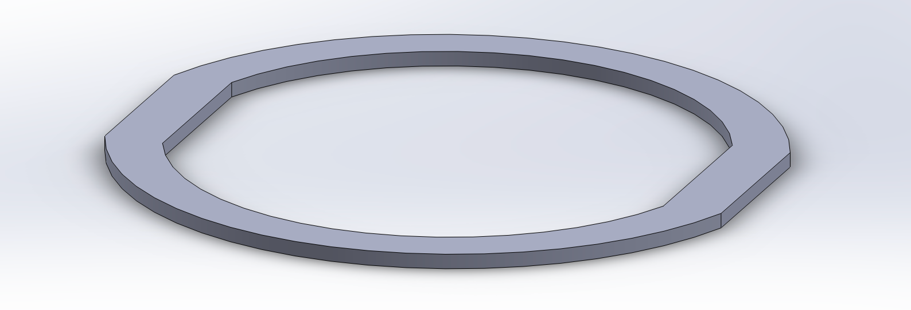

The base of the prototype was machined from a 48” x 48” x 0.75” plywood sheet using a CNC router. A circular shape was chosen to distribute the load symmetrically around the center axis and reduce the risk of warping or tilting when uneven forces are applied through the axle during operation. Two symmetrical flat cuts were milled on opposite sides of the circle for easy alignment of the bearing-supporting legs, ensuring the axle would remain aligned across the midpoint of the base. ¾” plywood was selected as the material to provide sufficient strength to resist flexural forces while remaining light despite the weight of the other components, contributing to the constraint “must be light and compact enough to take only one trip to carry up to the shaft with at most two people”. The full design weighs 20.52lb, which the client specified he can carry comfortably alone.

Additionally, the thickness of the plywood allowed enough depth to install metal threaded inserts securely for the repeated attachment and removal of both the printed legs and the adjustable swivel feet. Since the lowering mechanism can be taken apart in this way, the client can easily carry the design to the shaft by carrying it while disassembled in a bag.

Six purchased swivel foot levelers were installed evenly around the circumference of the base. Each foot mounts to the board via a threaded insert and can be adjusted to various heights, allowing the user to level the entire structure even on uneven terrain. This contributes to the constraint “must descend to the bottom of the mine and ascend to the starting position at least once”. The terrain around the mineshaft is very uneven and shifts frequently, and the feet ensure the lowering mechanism will always be kept parallel to the shaft opening, reducing the chances of the design toppling and failing to ascend and descend through the shaft. 

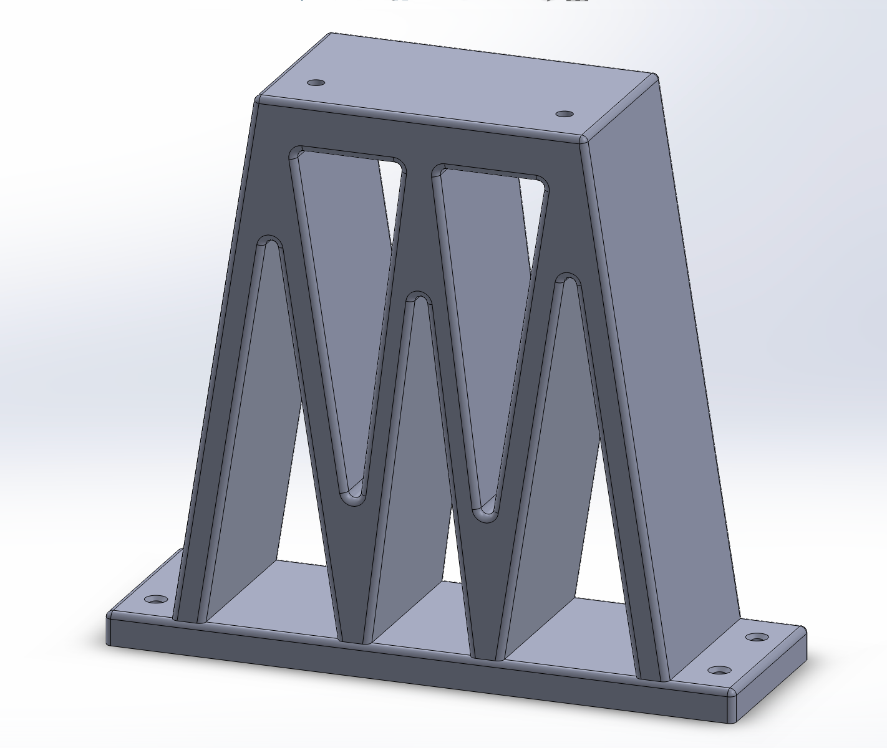

Two legs were printed in PLA at 45% infill. This infill percentage was chosen to strengthen the print. Triangular cutouts were made on the sides to reduce filament usage while still ensuring stability. This contributes to the constraint “must provide control over ascent and descent at all times by being able to hold its position and resume movement at any point”, since if the legs collapsed, the axle would be nonfunctional and the payload would be unable to ascend or descend. The team recognized that this component could have been machined out of wood or metal, which would reduce cost. However, due to time constraints of this project, the majority of time was allocated to parts that could not be manufactured without machining them, such as the base and axle. Furthermore, due to the budget constraints of this project, the majority of money was spent on components that needed specific materials (the base, axle, and payload) whereas the PLA was obtained for free through the Makerspace.

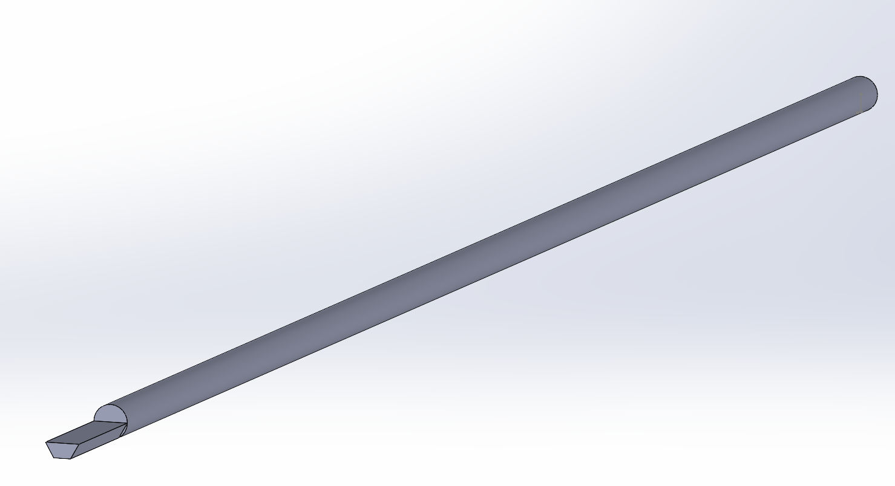

::: {layout-ncol=2}
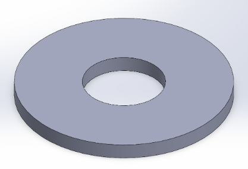

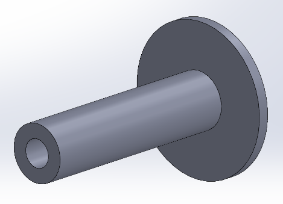
:::

An axle was machined to a 33” length from a 0.5” diameter steel rod, which allowed it to friction fit two purchased 0.5" bore pillow block bearings, one at each end. An adapter that allowed the axle to friction fit with the 800 ft spool of cable was 3D printed in PLA at 30% infill. This helps fulfill the constraint “must descend to at least 600 ft down”, as the cable length is sufficient to descend the payload 600 ft. The adapter was glued using epoxy to the spool and the middle of the rod. The team acknowledges that the weight could have been reduced while keeping the strength of the axle by using other materials such as aluminum, and if the rod was machined to the diameter of the spool, the 3D printed insert would not have been needed. However, difficulties in machining the aluminum version prevented this alternative from being included in the final prototype. The current axle, spool, and cable combination only weighs 7.4lb, which contributes to the constraint “must be light and compact enough to take only one trip to carry up to the shaft with at most two people”.

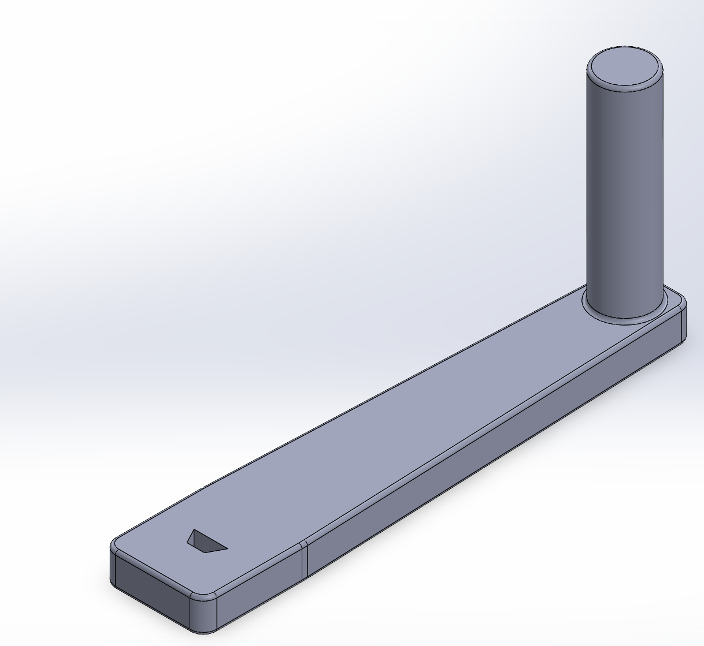

A handle was printed in PLA at 30% infill and freely attached to one end of the axle. A rotary encoder was wired and attached to the other end of the axle (not screwed in place), with the electrical components fixed to the base with a sticky pad for easy disassembly. The handle fulfills the constraint “must provide control over ascent and descent at all times by being able to hold its position and resume movement at any point”, as a trapezoid hole was made on the lever to ensure it could attach to the axle and rotate it without slipping. The client can either hold the handle in place or move the handle inwards along the axle so that it rests on one of the PLA legs to ensure the payload does not ascend or descend, and move it outwards and start turning it in either direction to resume movement. 

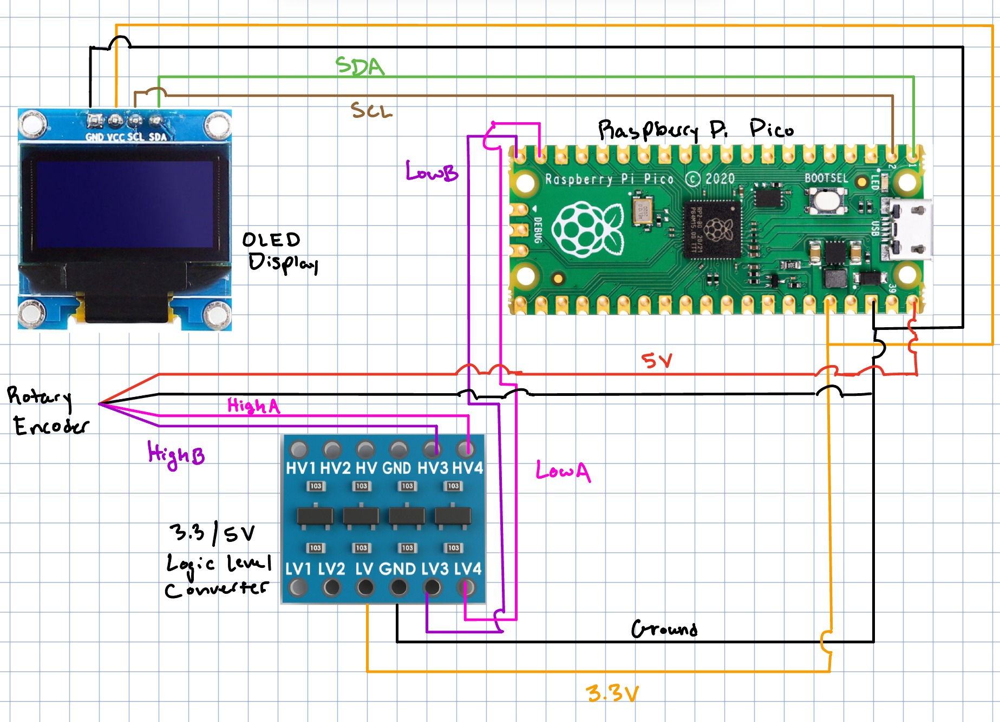

The rotary encoder measures the depth of the payload and the speed of the payload’s descent. At higher axle angular velocities, the rotary encoder loses precision. The team determined that the maximum vertical speed achieved by rotating the handle while keeping depth accuracy to be 1.5ft/s, fulfilling the constraint “must have a vertical speed of at least 1 ft/s”. Higher speeds could be achieved, but depth precision will be lost. During testing , the rotary encoder was off by 10ft when 550 ft of cable was unspooled, which was likely due to slack in the cable. 

The cable does not tangle on the spool when ascending or descending the payload even when the payload is pulled to the maximum shaft diameter, fulfilling the constraint “must descend to the bottom of the mine and ascend to the starting position at least once” since the payload will not get stuck at any point due to the cable not being able to spool.

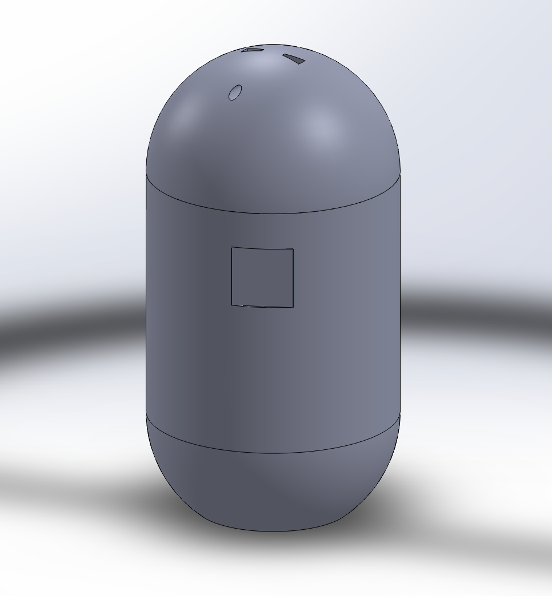

The payload was 3D printed in TPU 95A HF at 15% infill with a triangular infill pattern. TPU and this infill type were chosen to fulfill the constraint “must protect the payload and lowering mechanisms enough to allow sensors to record data and ascend after at least one hour in a hostile environment (humidity 70-90%, temperature 20-110°F and being submerged in up to 3” of water)”. The triangle infill pattern, combined with the flexibility of TPU, dissipates the most energy from the available options, so it was used to help protect the sensors from possible collisions while descending and ascending in the shaft. TPU is a waterproof material and only starts to deform at 200°F, so as long as the payload is sealed, the sensors would be unaffected by the hostile environment. The payload can be sealed due to the two-part locking mechanism integrated on the top and bottom pieces. This utilizes protruding cylinders on the top part offset from cylindrical holes on the bottom, allowing the client to twist open the payload to access components while protecting them from moisture and environmental contaminants when the payload is shut. Two small holes at the top of the payload create an equilibrium inside the payload with the outside environment, allowing sensors inside the payload to collect accurate data. The holes also allow sensor wires to protrude outside the payload if necessary. There are also two windows covered with laser-cut clear acrylic, which contribute to sealing the payload while preventing visual interference with the client’s cameras.

::: {layout-ncol=2}
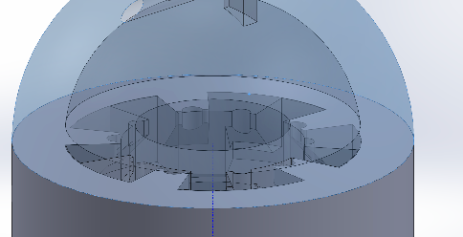

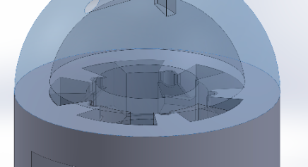
:::

The payload has an outer diameter of 5.75”, an inner diameter of 4.25”, and a height of 11.895”. These dimensions contribute to the constraints “must hold a payload of two GoPro 11 cameras, two lights, and have room for around six small sensors for: Humidity [% RH], Temperature [deg F], Oxygen concentration [%], CO2 concentration [%], Radon concentration [pCi/L], Absolute pressure [Pa]” and “must have a payload size that fits within an 8-inch diameter”. The outer diameter is smaller than 8”. Approximate dimensions for typical sensors of the client’s required types were found to comfortably fit in a cylinder with a 3” diameter and 5” height with 1” of space remaining diameter-wise, and a GoPro 11’s dimensions are 2.8”x2”x1.3". With one GoPro mounted on the side and one at the bottom, the payload will hold the required components.

The outside of the payload was coated in 2-part countertop epoxy to make the outside completely smooth by covering the ridges made from 3D printing. This was done to fulfill the constraint “all surfaces of the payload must be able to be wiped within 15 minutes”. Making the outside walls smooth reduces the amount of environmental contaminants that would stick to the payload when it reaches the bottom of the shaft, making the payload more easily cleanable. Additionally, the epoxy used is waterproof when cured, so the client will not have to prepare additional materials besides water and paper towels to clean it. When testing, the payload was able to be fully wiped down in 5 minutes.

These components work together to help answer the above questions about minimizing the payload area, as the final payload material’s properties can be tested with respect to protecting the components, and the whole system can be tested against sample obstacles and sample shaft materials, simulating how the design will work at the actual mine site.

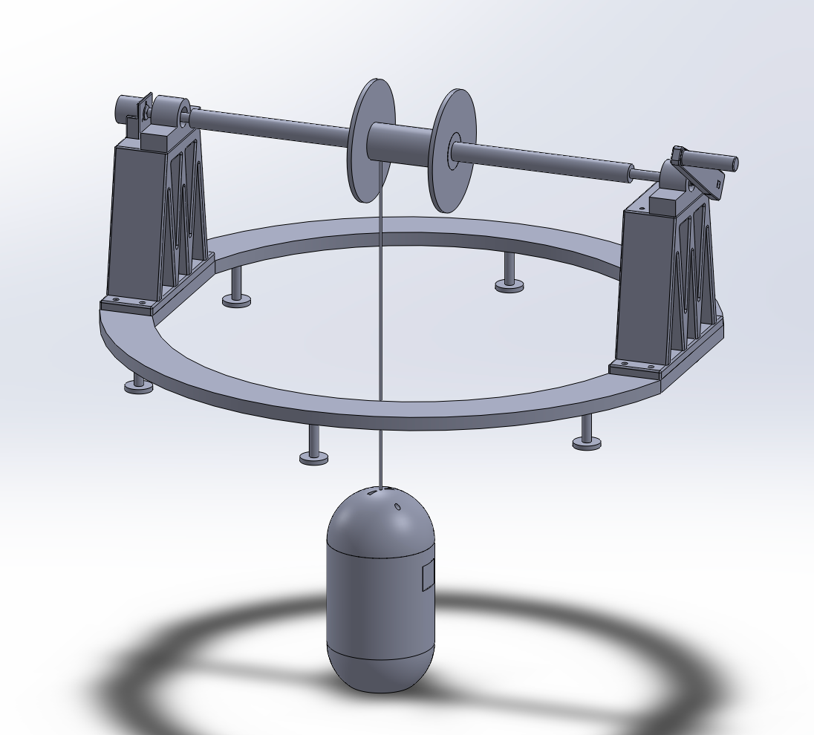

The full design can fit in a rectangular prism with dimensions 38” x 32” x 15.5” when assembled. This fulfills the constraint “must fit within half the space of a 2019 Subaru Crosstrek for transport” as this model of car has a carrying capacity of 55.3 cubic feet, and even when fully assembled, the design takes up 11 cubic feet. The prototype can be disassembled into the axle assembly, the handle, the payload assembly, the two legs, and the base with feet, which further reduces the volume the prototype will occupy, as the client has stated he will probably transport the design while it is disassembled.

### Evaluation Plan

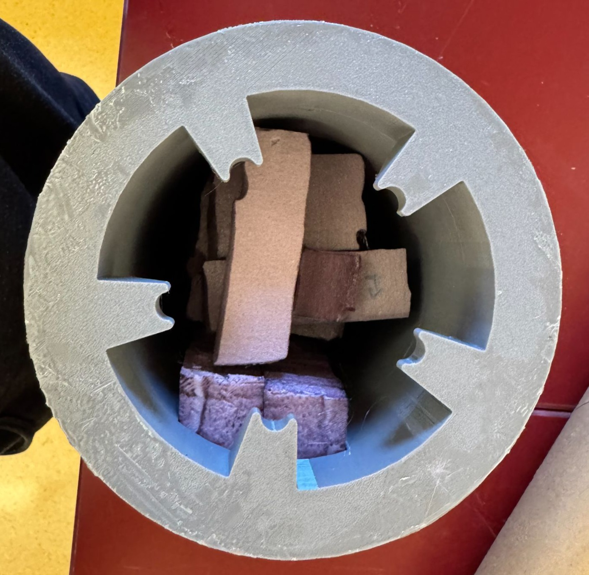

To answer the first question, foam models with approximate sensor and camera dimensions were made. Three different arrangements of stacked sensors were made from these models, given that the cameras must be placed at the windows and the arrangement must fit within the payload. Each arrangement was separately placed in the bottom payload component, and the maximum distance from each arrangement side to the inner payload wall was recorded, then averaged. Then, the payload was squeezed horizontally by someone wrapping both hands around its middle (the same person was used for all trials). The indentation of the outer walls of the payload was measured, and the maximum distance from each arrangement side to the inner payload wall along which the payload was squeezed was recorded, then averaged. This was repeated for each arrangement of sensors. The measurements taken were evaluated using the following metrics, with a higher score indicating the payload size does not need to be further shrunk. 

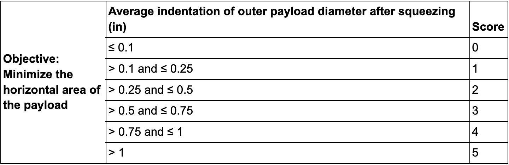

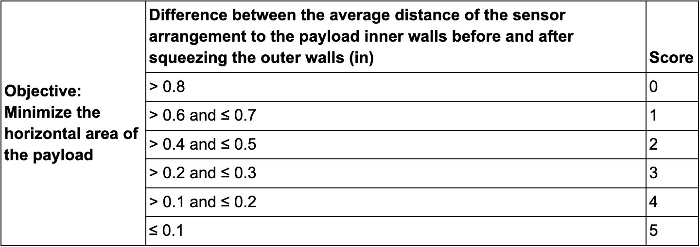

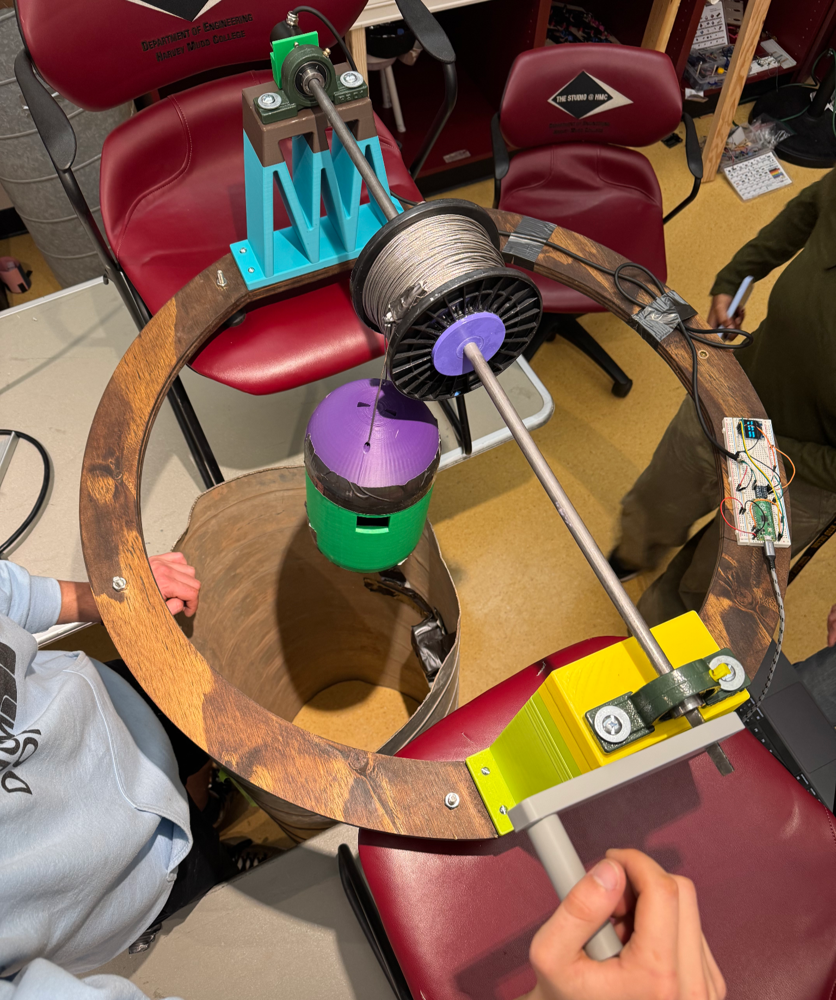

For the second question, the top and bottom payload components were attached together using the locking mechanism, then attached to the lowering mechanism through the cable. The lowering mechanism feet were rested on two chairs on tables with a gap in between them so that the payload could move vertically freely. One of the client’s sample shafts was placed under the lowering mechanism, so the payload could move within the shaft. A short PVC pipe was taped in the shaft above the payload so that it would touch the payload’s center axis. Then, at speeds of 0.3ft/s, 0.7ft/s, 1.2ft/s (as measured by the rotary encoder), the payload was raised by rotating the axle such that it scraped along the payload’s side. Measurements regarding the angle at which the payload tilted relative to the vertical, and any jumping (sudden movement away from the obstacle) or catching of the payload were recorded. The actual vertical distance travelled and the distance recorded by the rotary encoder were compared. This was repeated three times for each speed and again when the obstacles were placed below the payload while it was being lowered. The measurements taken were evaluated using the following metrics, with a higher score indicating the payload size does not need to be further shrunk. 

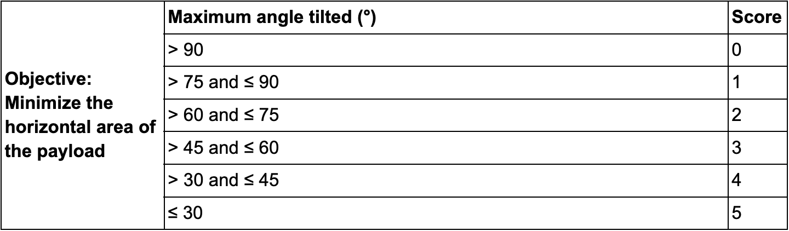

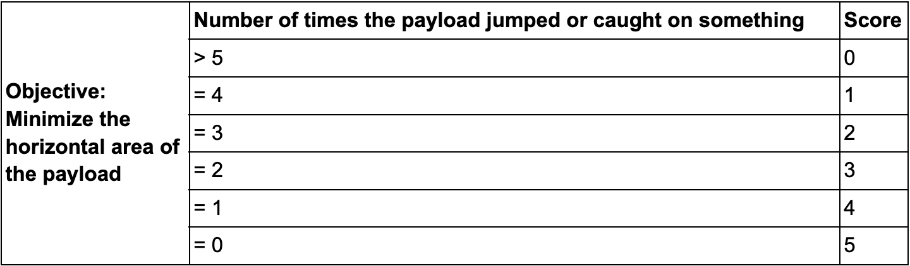

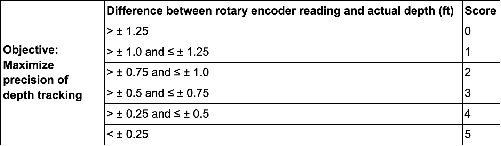

### Results

When the payload was not squeezed, the results gathered were as follows:

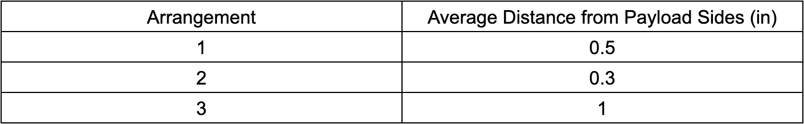

When the payload was squeezed, the results gathered were as follows:

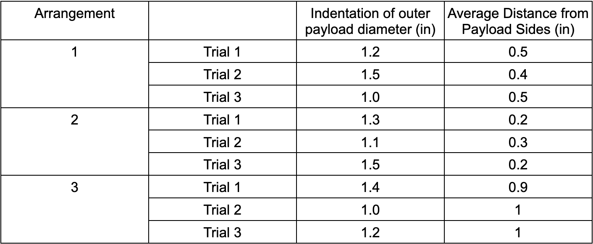

From these results, the average indentation of the outer payload diameter after squeezing its middle was 1.24in, which is greater than one inch. According to the metric in Table 1, this received the maximum score of 5. Also, the difference between the average distance of the sensor arrangements to the payload inner walls before and after squeezing was 0.04in, which is less than 0.1in. According to the metric in Table 2, this receives the maximum score of 5.

When the payload was lowered past the obstacle, the results gathered were as follows:

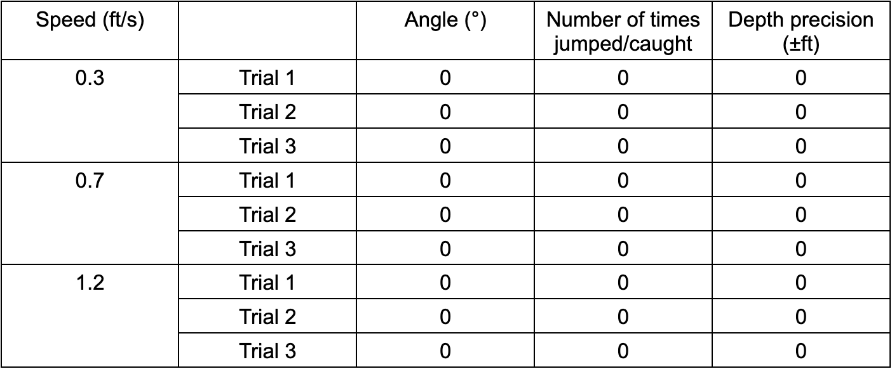

When the payload was raised past the obstacle, the results gathered were as follows:

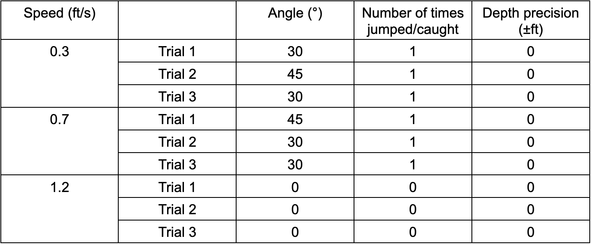

From these results, raising and lowering the payload past an obstacle had no effect on the rotary encoder’s depth precision, so according to the metric in Table 5, the design received the maximum score of 5. There was also no effect on the angle of the payload or catching of the payload against the obstacle when it was being raised, and there was no effect when being lowered at a speed of 1.2ft/s. So, the design scored 5 for the metrics in Tables 3 and 4 when being lowered at a speed of 1.2ft/s, but scored 4 for both metrics when being lowered at speeds of 0.3ft/s and 0.7ft/s. At 0.3ft/s and 0.7ft/s, the payload only tipped at an angle and got caught on the obstacle along the flat bottom window.

In all conducted tests, the design achieved the maximum or second-best score for each metric. This indicates the primary objective, “minimize the size of the payload” was fully satisfied to the best of the team’s ability. Although only the second-best score was attained by lowering the payload at speeds of 0.3ft/s and 0.7ft/s, the client wanted to have the vertical speed of the payload be at least 1ft/s, which was more comparable to the 1.2ft/s that achieved the maximum score. Thus, it would be unlikely the payload would catch on obstacles and tip over while the design is in use. Even so, to ensure the payload had no chance of tipping over, the bottom of the payload could be completely rounded to match the top instead of having a large circular flat base to fit a window. Completely rounding the bottom was considered when designing the payload, but issues were presented when there would be nowhere to fit a window for the bottom camera to look out of. With more time, this could be achieved by creating a pinhole in the rounded bottom and using an optics system to allow a camera positioned elsewhere within the payload to still see out the bottom of the enclosure.

Furthermore, the obstacle tests were conducted with a short PVC pipe, which may not have reflected all potential obstacles within the mine shaft. The pipe mimics a small protrusion within the shaft, but the client specified that shaft pieces that overlap or protrusions spanning the diameter of the shaft could occur. Experiments using differently sized and shaped obstacles should be conducted to see if the payload design needs to be further revised. 

Overall, the design fulfills all the constraints, all the functions, and the primary objective as determined by the team. The design should be fully usable by the client and meet all of his needs.

# Final Product

## Manufacturing Documentation
The following documentation files were presented to the client as manufacturing process references.

### SolidWorks CAD Files
All the SolidWorks CAD parts and assemblies were exported as a Pack-and-Go. Contact me for more information about this!

### Technical Drawings
This full assembly drawing shows how all the components fit together to make the full system.



The individual technical drawings show the relevant manufacturing specifications and 3D shape for each component. With these, I want to highlight my GD&T for particular features, such as the (+0.015/−0.000 in) for the spool and axle slip fit.



### Bill of Materials
The bill of materials outlines the necessary materials to produce the system and their cost. Throughout the project, the team successfully managed a $500 budget.

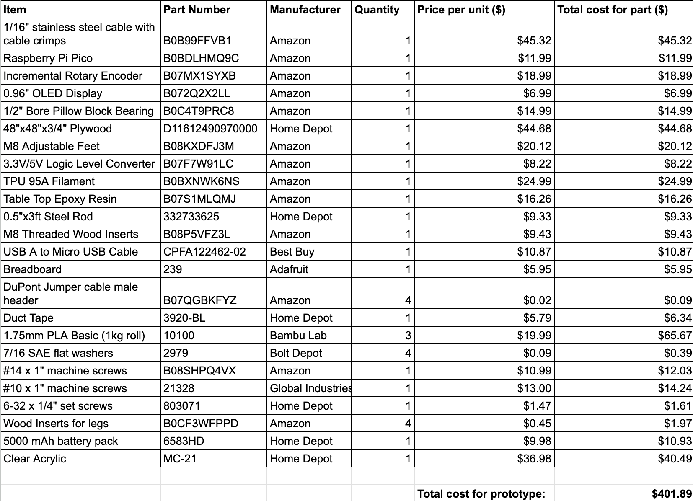

### Process Router
The process router outlines all the manufacturing steps, equipment, and software used.



## Physical Deliverables
The physical product was also handed off to the client for deployment. 

::: {layout-ncol=2}
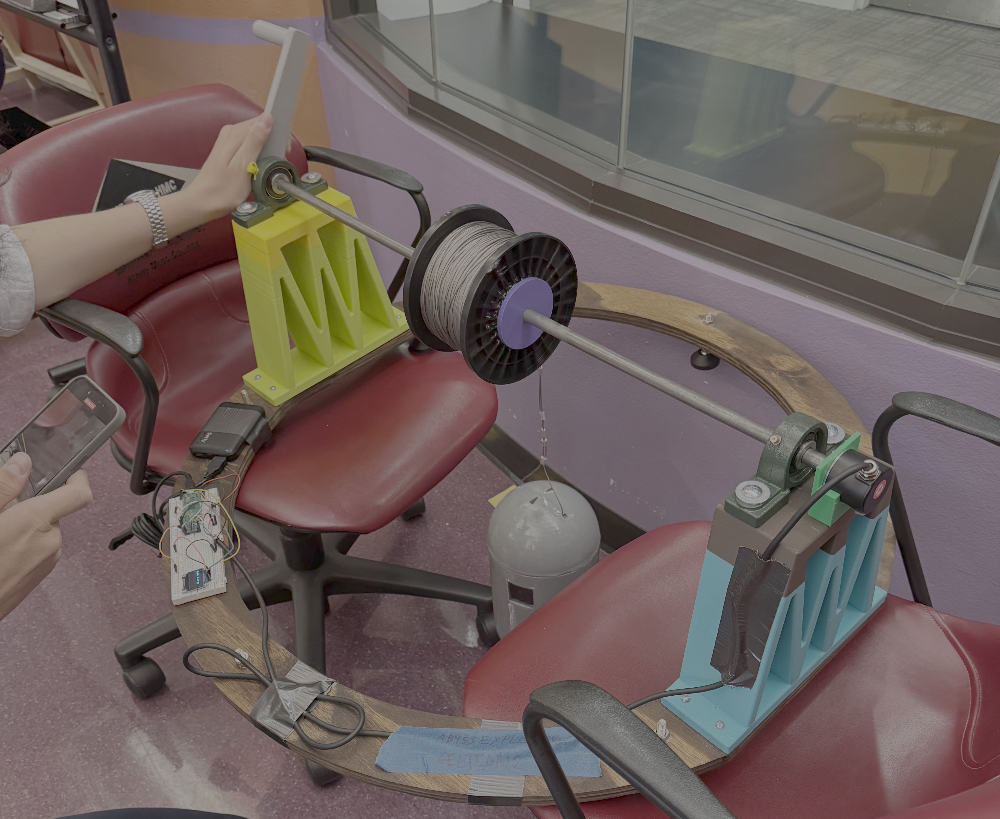

:::
