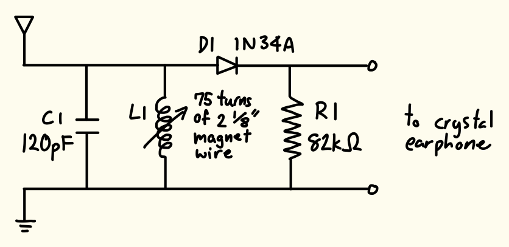
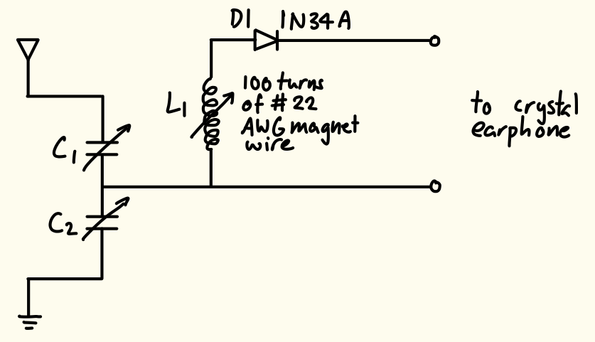
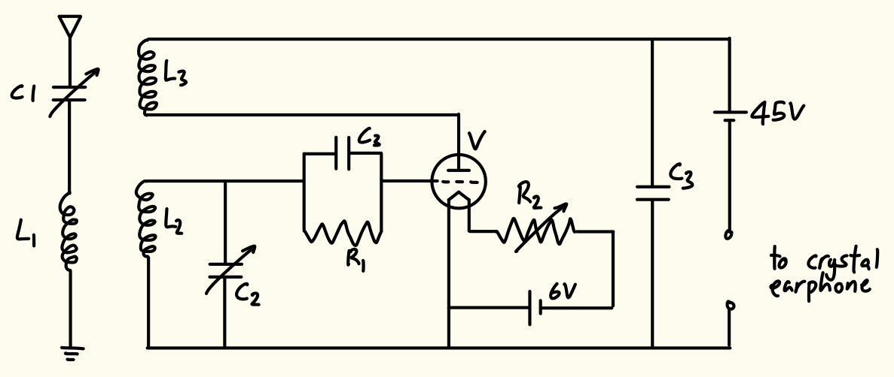

  
<strong>Timeline:</strong> 

  
<strong>Skills:</strong> 

  
<strong>Roles:</strong> 

# Introduction and Background
This started out as a history project analyzing the evolution of different sources of sound and how they affect our perception of the information conveyed. As part of this, my team chose to analyze various radios from the WWI/WWII era, and borrowed the relevant materials from Pomona College's music department to experiment with, even though the professor who owned them claimed students in previous years couldn't get them to work. I was fascinated by how these radios did not need any external power source to work. Seeing an opportunity to apply my skills from my Engineering Systems course, I decided to attempt to debug the radios so we could hear real signals out of them. I didn't have any experience with any kind of radios before, and minimal experience solving for the transient response of RLC circuits only theoretically, so this was a great hands-on experience getting to know analog circuits!

# The Circuits

## Pickard Crystal Radio

I started with the Pickard Crystal Radio, because it looked the simplest. It only had a variable inductor, a capacitor, resistor and diode. Because I knew radios could be tuned to different frequencies, I assumed the variable inductor would be used for tuning. My knowledge of RLC circuits helped me understand that this circuit would resonate at a specific frequency, based on the component values. Since the inductor was variable, I could adjust the resonant frequency to match the desired broadcast frequency. I also knew the basics of diodes, so I assumed it would have to go in a specific direction in order to hear any sound. It turns out this specifically needed to be a germanium diode, as opposed to the more common silicone diodes, because of their lower forward voltage drop. This prevents the diode from absorbing too much of the signal (since the power output of the crystal radio is tiny), which would make most AM signals inaudible. Figure 1. shows the schematic I ended up using.

## Dunwoody Crystal Radio

The Dunwoody Crystal Radio was similar to the Pickard Crystal Radio in that it used similar components. However, it had two tuning capacitors in addition to the variable inductor. This would allow for more fine-tuning of the selected frequency. Instead of the variable inductor being adjustable by a simple conductive slider, the inductor had various coil taps that I first adjusted to select the broad operational frequency. I then adjusted the tuning capacitors to fine-tune the selected signal. Figure 2. shows the schematic of the circuit.

## Armstrong Regenerative Circuit Radio

This circuit was very different. It used a combination of inductors with a tickler coil to feed the output signal back into the circuit. It also used a triode vacuum tube to amplify the signal, which meant it needed two external power sources to work. Figure 3. shows the schematic of the circuit.

I was not able to get this circuit to work, even after replacing all components apart from the vacuum tube, which I could not find a replacement for. This led me to believe the vacuum tube was faulty.

From my research, I believe replacing the vacuum tube with a JFET (Junction Field-Effect Transistor) would be a viable next step for debugging. The vacuum tube works as an electron valve, controlling a current with a tiny input voltage. When the radio signal fluctuates slightly, the current output of the vacuum tube has large fluctuations, which is how the signal gets amplified. JFETs similarly change current flow based on input voltage.

I also think this would be a good substitution to do in general since the vacuum tube needed a really large voltage supply (45V+ battery) to run, while a JFET could function in the same way using a 9V battery. This would make the radio more accessible and cheaper to run as the setup I was using chained five 9V batteries together in series.

# Finding a Suitable Antenna and Ground

Because the crystal radios don't use any external power, the antenna had to be really long and high up in order to capture enough AM broadcast energy. In addition, it had to be far away from buildings and other structures that could absorb the signal. This was difficult to do on campus because of the many buildings around, and none of the trees were particularly tall or easy to climb. The solution I came up with was using the flagpole in the middle of campus. It was further away from buildings than any of the trees, very tall (I estimate about 50 feet), and was fully metal, so I could hold my antenna wire directly to it to form a connection.

For the ground, the guides I read recommended connecting a wire to a cold water metal pipe. This was not possible to achieve while using the flagpole as an antenna. However, just sticking a metal rod into the ground beside the flagpole worked well.

# Hearing AM Radio

My professor had also provided several crystal earphones to use. Upon further research, I discovered that the earphones had an extremely high impedance, which allowed them to function as sensitive detectors for the radio signals. However, even with the correct circuit (and working antenna, as described later), I couldn't hear anything out of the earphones. My circuits already had a load resistor across the terminals of the earphone, do the detector diode wasn't missing any DC path for the detector diode. I also took some online suggestions to tap the earphone on a hard surface which could help realign the piezoelectric material and thin metal disc inside that vibrate to create the sound waves. This didn't work either, and when I squeezed the outer casing, I heard a crackling sound, which meant the inner electrical contacts had like likely broken. From this, I concluded the crystal earphones were unusable.

As an alternative, I found a high impedance speaker that I wired up to the circuits to use.

Here's two video hearing some local radio stations at around 600-640kHz using the Dunwoody Crystal Radio. I was surprised by how clear the sound was!

::: {layout-ncol=2}



:::

To find the frequency of the signal, since we were outdoors, and I did not have a multimeter on hand to measure the component values, my friend taught me how to use SDR++ (software-defined radio), and we pinpointed the frequency to hear the same signal on a laptop.

# Taking Things Further: Hearing Signals from Overseas

While investigating these radios, I read about hearing different signals during the day versus at night because solar radiation changes the structure of the ionosphere, so at night, medium and shortwave signals can travel further. With this in mind, I connected the inductors from the Pickard and Dunwoody radios in parallel to decrease the total inductance and make the circuit have a lower resonant frequency. This made the overall circuit able to accept the original mediumwave as well as some shortwave signals.

Here's a video hearing a radio station (likely from China) at around 2.4MHz using the modified circuit. 



The audio was a lot less clear than using only the Dunwoody or Pickard circuits. I believe this is because the modified circuit had a larger bandwidth, allowing multiple signals to pass through at once and making the output noisy. Also, there could have been an insufficient voltage drop across the modified circuit compared to the forward voltage of the germanium diode, creating a weak audio output with static.