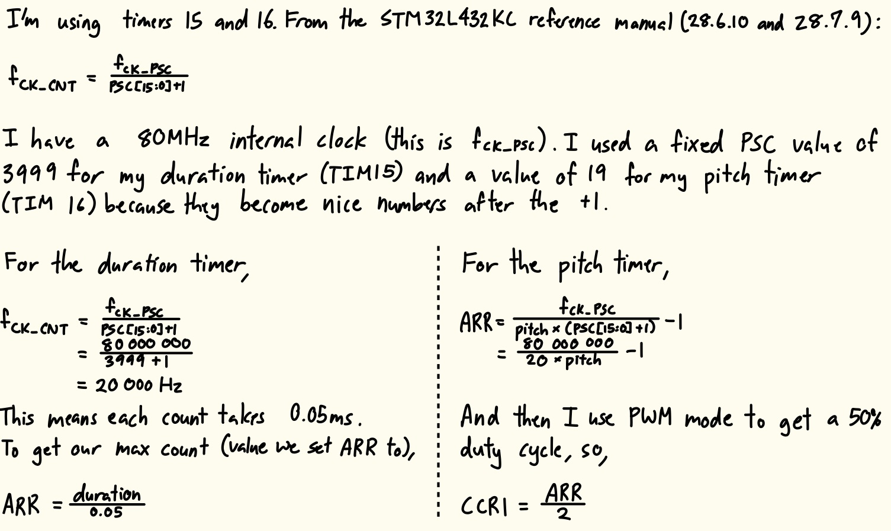
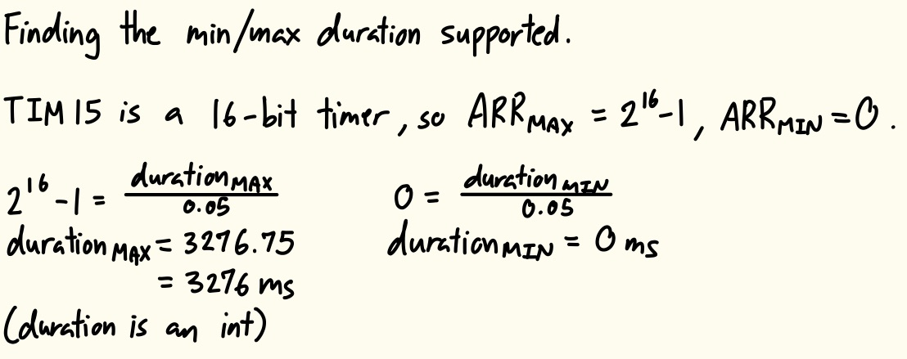
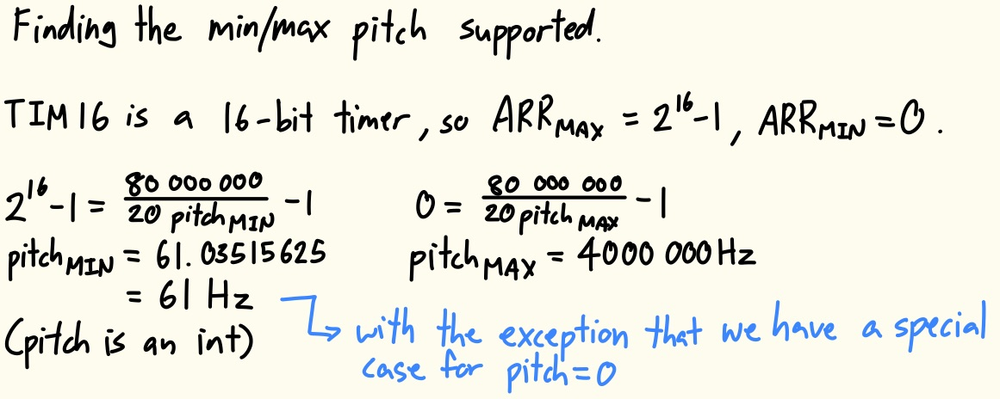
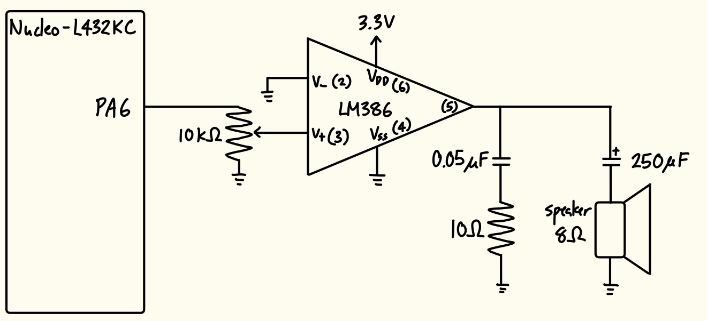
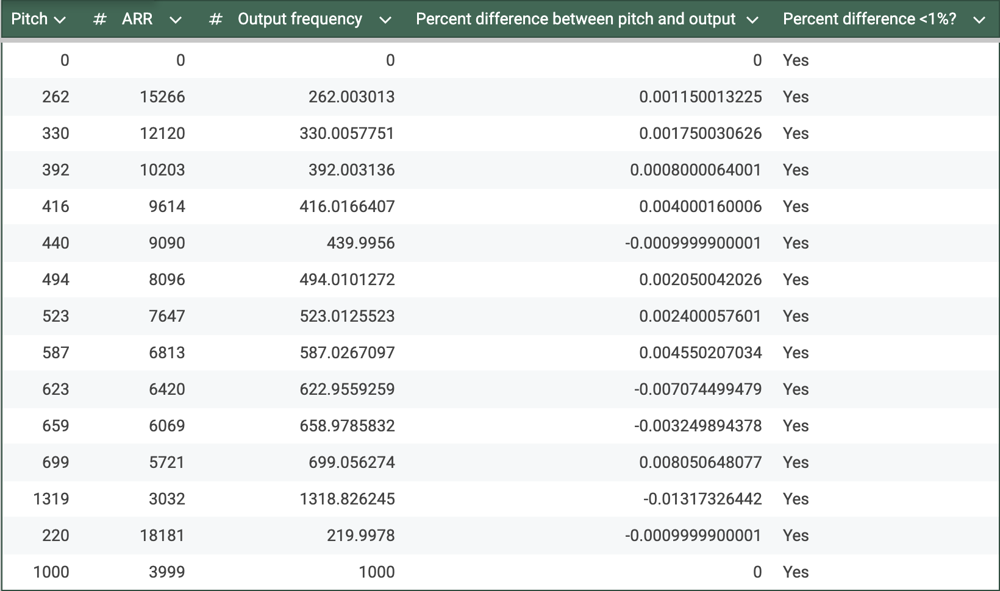

  
<strong>Timeline:</strong> 

  
<strong>Skills:</strong> 

## Introduction
In this lab, a design was implemented on the NUCLEO-32 MCU to utilize timers to generate different pitches and play Für Elise on a speaker.

## Design and Testing Methodology
To design this implementation, two timers were created and linked by main.c. Timers 15 and 16 were chosen over the other timers available because of their PWM generation functionality. The internal clock was set to by 80MHz through using PLL, and this was sent to each timer.

Timer 15 was used to control the duration of each note. I set the frequency and duration of the note through ARR (because PSC was fixed at 3999).

Timer 16 was used to control the pitch of each note. I set the frequency of the note through ARR (because PSC was fixed at 19), then gave the timer a PWM duty cycle of 50% through setting CCR1.

The minimum and maximum duration and pitch are shown in Figures 2 and 3 below.

## Technical Documentation
The source code for the project can be found in the associated [GitHub repository](https://github.com/natalieko2024/E155-Labs/tree/main/E155-Lab4).

### Schematic

The schematic in Figure 4 shows the physical circuit connections outside the PCB. Since the GPIO pins didn't generate enough current to play music directly to the speaker, an LM386 audio amplifier was wired between the pin and speaker to write each note with a gain of 20. A potentiometer was added to control the volume of the sound.

## Results and Discussion
The design met all intended design objectives.

### Calculations

To confirm my design could play all notes in Für Elise accurately, I calculated the percent difference between the intended frequency and the output frequency. As shown in Figure 5, all the pitches, and 220Hz and 1000Hz are under 1% difference.

### Hardware Deployment
This video showcases the design running on the MCU and speaker circuit, successfully playing the Für Elise score.



I also created an additional score, which allowed the design to play the intro to the song "Fireflies".



## Conclusion
The design successfully utilized timers in the MCU to play Für Elise and Fireflies on a speaker.

