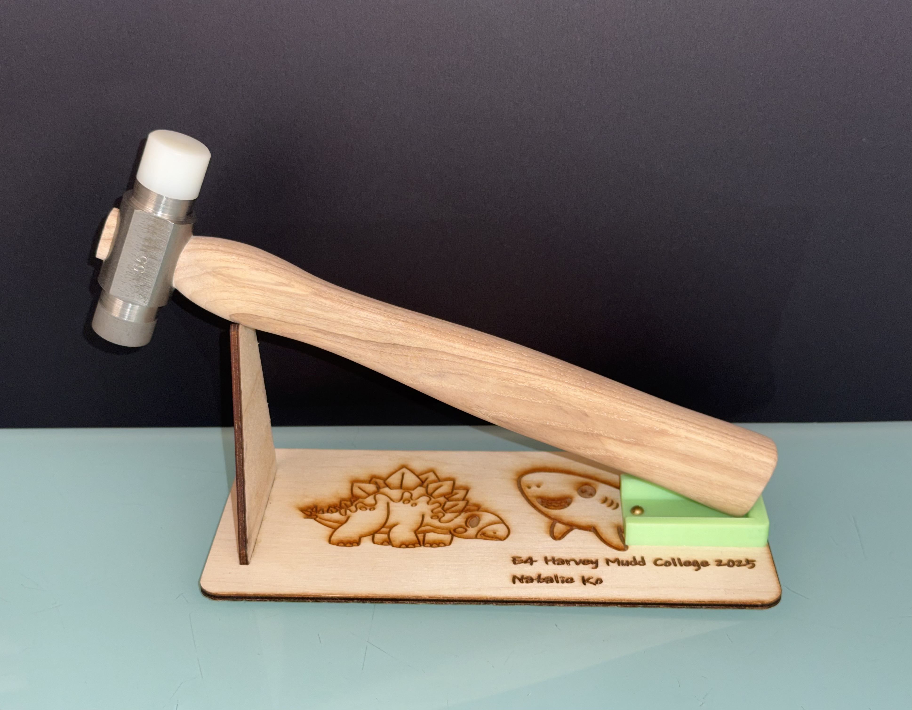
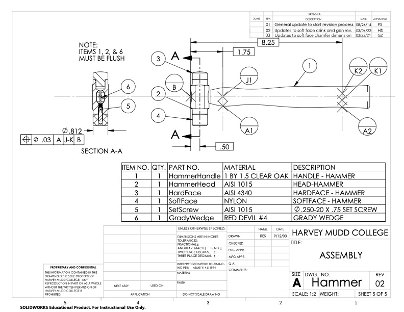
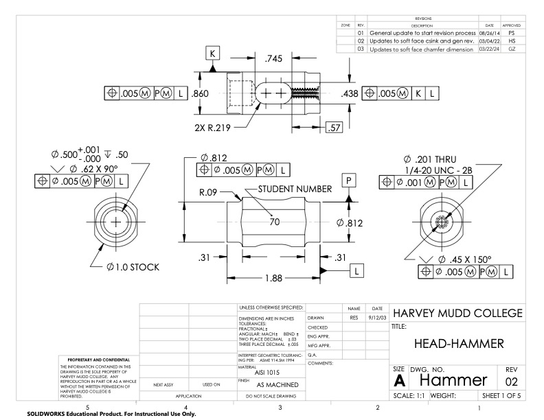
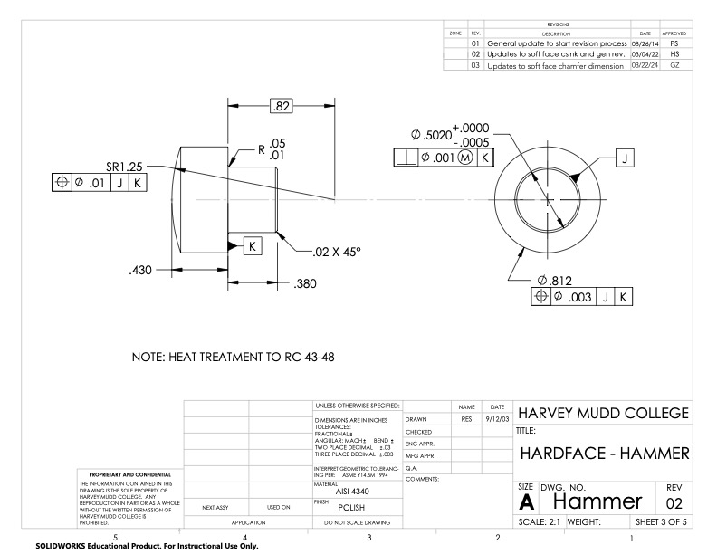
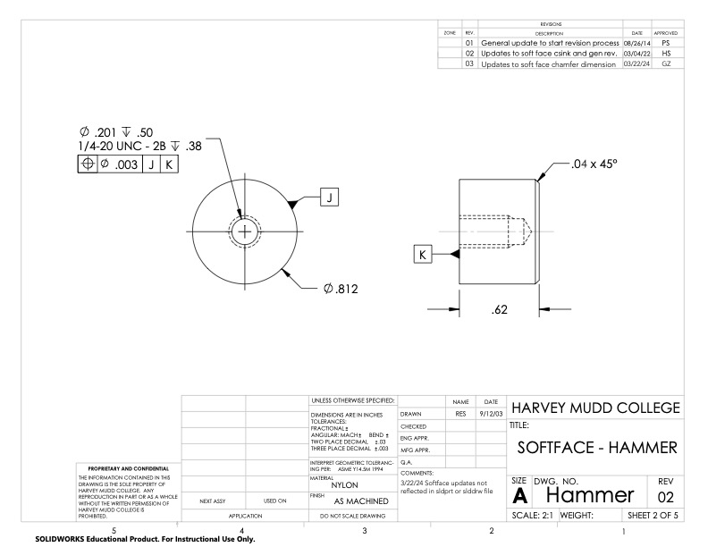
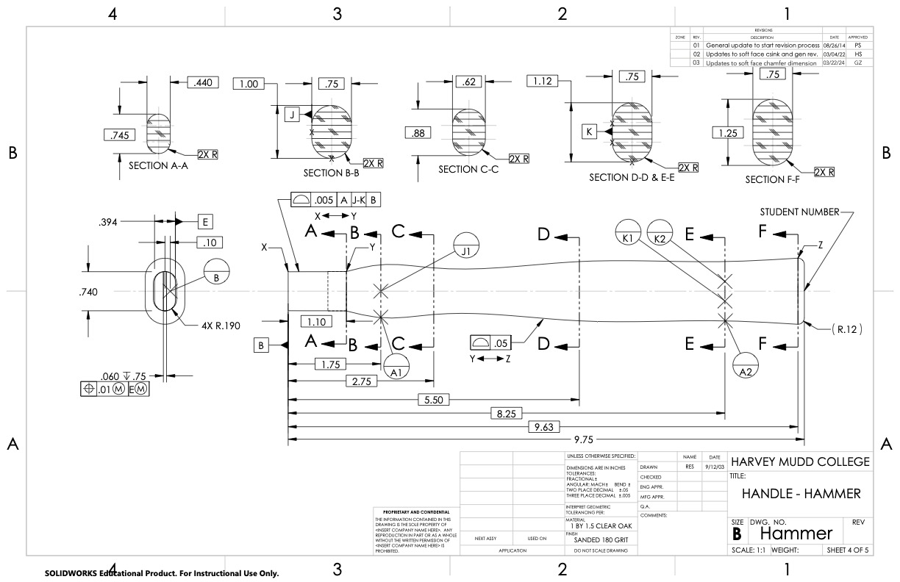

  
<strong>Timeline:</strong> 

  
<strong>Skills:</strong> 

:::{.columns}
::: {.column width="49%"}

:::

::: {.column width="2%"}
:::

::: {.column width="49%"}
**Overview of Work:**

Manually machined a hammer following technical drawings and process routers using equipment such as the mill, lathe, bandsaw, and router table. All dimensions were within specified tolerances.

Key outcomes:

- **Followed technical drawings and process routers** to manually machine all parts to spec
- **Used micrometers, calipers, and pin gauges**, so the hard face could be press-fit into the head without risk of coming loose
- **Utilized metallurgy principles** to heat treat and temper AISI 4340 steel, adjusting its hardness and internal stresses
- **Read material and cutting tool speed specifications for the mill and lathe** to ensure safety while working in the machine shop

:::
:::

# Introduction

This hammer (HMC E4 Hammer) is the engineering "rite of passage" freshmen and sophomore engineers complete to make a custom metal and wood hammer. It involves using conventional manual machining equipment (as well as automated manufacturing equipment such as laser cutters), following technical drawings and process routers, and measuring everything to specification all in each student's own time.

# Stand

The hammer stand is made of laser cut wood and 3D printed PLA. 

## Laser Cutting

First, the hammer stand template was loaded into the Retina Engrave software, with all lines set to vector. The speed and power of the laser were configured so the Full Spectrum PS48 laser cutter could fully cut through 0.125" birch plywood without risking burn marks or a possible fire. I added rasters (text and SVG drawings) to personalize my hammer stand.

A sheet of 0.125" birch plywood was laid down on the laser cutter bed. The cutting lens was focused to the sheet using the provided focusing tool and the bed movement buttons such that the end of the focusing tool was flush with the surface of the sheet. The "run perimeter" option was selected to ensure the design fit on the plywood sheet, and if not, the sheet was moved into a position that fully included the design area.

Making sure the laser cutter lid was closed, I cut my design.

After cutting, I sanded my pieces down and applied wood glue to the mortise and tenon joints to fix them together.

## 3D Printing

The hammer stand STL file was opened in OrcaSlicer, and given appropriate slicing parameters to print on a Bambu X1C printer using PLA. After slicing, the .gcode file was uploaded to the printer via cloud, and the print was monitored for the full duration to prevent spaghetti errors / bed adhesion problems (especially since there was a power outage in the middle of the print!).

## Assembly

The print was attached to the wooden base using a 4 x 0.25" brass round head wood screw.

# Head

## Lathe

Following the head process router and technical drawings, the lathe (with the RH HSS cutting tool, carbide cutting tool, countersink tool) was used to face AISI 1015 (steel) stock, produce shoulders, and countersink holes. Drill bits, taps, and reamers were used with the lathe (either running or static to make the piece concentric in the chuck) to produce holes and threads for the soft and hard face connections.

## Mill

The fly cutter, drill bits, and end mills were used with the mill to cut flats for the head and produce an elongated through hole slot to fit the handle. This slot was deburred with a file.

Afterward, my number was stamped on one flat using an arbor press.

# Faces

## Hard Face

The hard face was first machined in the lathe. To ensure a successful press-fit, pin gauges were used to measure the hard face hole in the finished head. The hard face small diameter was adjusted accordingly with roughing cuts and finishing cuts (I successfully used autofeed!).

To create the rounded end of the hard face, a pneumatic grinder with varying grit sandpaper/polishing disks (starting from 80-grit at 800RPM) was held to the edge until the radius was ground to spec.

The hard face was then heat treated in a small oven. The part was heated to 677°C and spent 45 minutes at that temperature, then the oven was turned up to 875°C. After 50 minutes at 875°C, the part was removed and quenched in oil until no more smoke emitted. The part was set out to cool to 66-51°C. Then, the part was tempered in a large oven. It was gently wiped of excess oil and heated to 338°C for 1 hour. Then it was let air cool.

The heating at 677-875°C generated a uniform austenite sample, which was transformed into martensite during quenching. Cooling it to 66-51°C decreased the internal stresses and prevented cracks from forming. Tempering at 338°C is right below the eutectoid temperature, relieving the material stresses and increasing ductility while retaining hardness. Air cooling as a final step minimized shrinking or quenching stresses.

After the heat treating process, the hard face was sandblasted to remove carbon soot without changing part dimensions, and then press fit into the head using an arbor press. The hardened steel is harder than the head steel, allowing the hard face to slightly deform the reamed hole and ensure a tight fit.

## Soft Face

The soft face (made of nylon) was machined in the lathe using HSS cutting tools, HSS parting tools, drill bits, and taps. It was then secured to the head with a 1/4-20 UNC - 2B screw.

# Handle

The handle rough shape was engraved on to a piece of 1x1.5" clear oak stock using the laser cutter. This contour was cut out using relief cuts on the vertical bandsaw. It was sanded to the rough shape using a spindle sander and belt sander.

The second contour of the handle was cut out on a piece of tape using the laser cutter and stuck to the now uneven side of the handle. This was done because the laser cannot focus its beam on uneven surfaces, and so would be a fire risk. This was also cut out and sanded down with the vertical bandsaw and sanders.

A router table was used to add a 3/8" radius to each corner of the handle. The radii were blended together, and the handle was dimensioned to spec via hand sanding.

I then stamped my number on the end of the hammer with a(nother) hammer and number stamps. The handle was attached to the head by a press fit, and then hammering a wedge through the handle slot.

# Conclusion

My manually machined hammer passed all specified dimension tolerances, material hardness (for the hard face), and component fits (no component security issues, no splintering, no gaps between the head/handle/faces), and had a good quality of manufacturing. The only minor issue was that the head shoulders had very fine lines across them instead of being completely polished. This is likely due to the dull HSS cutting tool used.

You can see my hammer (and stand) here!

# Appendix
[Click here](https://sites.google.com/g.hmc.edu/hmc-machine-shop/courses/e4/hammer?authuser=0) to go to the HMC machine shop website to read up on the hammer documentation!