

  
<strong>Timeline:</strong> 

  
<strong>Skills:</strong> 

# Introduction
In this project, I designed an FPGA implementation to read a 4x4 matrix keypad input and display the last two hexadecimal digits on a dual seven-segment display with the most recent entry always appearing on the right. The design made it so each key press was recorded only once independent of the press length. If multiple keys were held at the same time, only the last key held would be displayed.

Watch this video below to see the final deployment!


The materials I had were 
- motherboard
UPduino v3.1 (Lattice UltraPlus iCE40UP5K) FPGA
- dual 7-seg display
4x4 matrix keypad input

# Phase 1 - Single 7-Segment Display

The first step in building this implementation was to figure out how to use the FPGA's on-board high-speed oscillator (HSOSC), as well as control an external 7-segment display using combinational logic of four switch inputs. To do this, I controlled an on-board LED with the high-speed oscillator, and controlled two additional on-board LEDs and an external 7-segment display using combinational logic of four switch inputs.

## Design and Testing Methodology

To do this, I created two submodules that were linked by a top-level module. The top-level module included combinational logic to convert the four switch inputs to LED on/off states, and called the two submodules and HSOSC to control the oscillating LED and 7-segment display.

One submodule controlled a counter that would "step down" the 24MHz HSOSC clock to a 2.4Hz clock. It did this by counting HSOSC rising edges until some maximum value, then inverting whatever output it generated previously. Since I set up the HSOSC to have an output frequency of 24MHz and the target frequency was 2.4Hz, I divided these to get the delay count (how many clock ticks of the 24MHz clock needed to count up to to equal one 2.4Hz clock tick).

$\frac{24MHz}{2.4Hz} = \frac{24 \times 10^7 Hz}{2.4 Hz} = 10^7$

Each clock cycle has a high and low state that are equal in length, and the oscillating LED should turn on when the clock is high. This means the LED should toggle twice each cycle.

So the LED would toggle every $\frac{10^7}{2} = 5 \times 10^6$ 24MHz clock ticks.

The counter was also given a reset and enable input for additional functionality in case the submodule needs to be used in a future design. The reset, tied to a button input, resets the counter to 0 when pressed. The enable input, tied to a constant high signal from the top-level module, allows the counter to run as expected when high and hold its current value when low. When the counter reached the maximum count value, it reset to 0 and inverted the output signal. This would act as the on-board LED toggle.

The other submodule implemented the combinational logic to control the 7-segment display based on the 4 switch inputs. Because of the large number of output signals, the combinational logic was implemented using a case statement instead of a series of implied logic gates.

The design was tested using waveform simulation of the top-level module and each submodule in QuestaSim through automatic testbenches to confirm the desired behaviour.

The counter submodule testbench instantiated the submodule freqconverter (with parameters WIDTH and MAX set to 4 and 10 respectively) under a test and generated a clock signal with a cycle time of 2ns. To start testing, enable and reset were first toggled so they were high. Then, the output signal was checked at every MAX number of clock signals to confirm the desired ON/OFF frequency. The reset was then toggled after a small delay and the output signal was checked again with the same intervals to confirm the reset put the counter value back at 0. The enable was then set to low and the same tests were performed to confirm the counter stopped running when enable was low.

The 7-segment display submodule testbench instantiated the submodule switch_7seg under a test, then went through each combination of four switch inputs while checking the seven segments were outputting the correct values.

The top-level module was tested in three separate testbenches. First was a testbench to test the clock generated by the HSOSC. The top-level output clk signal was checked at the time it takes to complete half a 24MHz clock cycle twice to confirm the signal is oscillating high/low at the 24MHz.

Another testbench was written to test the combinational logic of the on-board LEDs and the connection to the 7-segment submodule. Similar to the 7-segment display submodule testbench, this testbench instantiated the top-level module lab1_nk under a test, then went through each combination of four switch inputs while checking the on-board LEDs were outputting the correct values and the seven segments were being mapped to the top-level seven segment outputs.

The final top-level testbench tested the connection to the counter submodule. After instantiating the top-level module lab1_nk under a test, the reset signal was toggled high, and the oscillating LED signal was checked every half stepped-down clock signal to confirm the submodule output signal was oscillated at the right frequency and being mapped to the LED. The reset signal was toggled after a small delay and the oscillating LED signal was checked at the same interval to confirm the reset put the counter back at 0 and did not affect the signal mapping.

Finally, the 7-segment display circuit was built and connected to the FPGA GPIO pins, and the full design was uploaded to the FPGA and deployed on the hardware. The design was tested by toggling the switches to account for all cases and observing the LED and 7-segment display outputs to confirm functionality, as well as probing the output oscillating signal with an oscilloscope to confirm its frequency is 2.4Hz.

To implement this design on hardware, the GPIO pins needed to be connected to current-limiting resistors before the 7-segment display diodes. The common anode of the 7-segment display was connected to 3.3V and the forward voltage of each diode within the display is 2V. I provided 5-20mA to each diode to ensure proper operation. Using Ohm's Law,

::: {layout-ncol=2}
$$
\begin{aligned}
V&=IR\\
V_s-V_{fw}&=I_{min}R_{max}\\
3.3-2&=0.005R_{max}\\
R_{max}&=260\Omega
\end{aligned}
$$

$$
\begin{aligned}
V&=IR\\
V_s-V_{fw}&=I_{max}R_{min}\\
3.3-2&=0.005R_{min}\\
R_{min}&=65\Omega
\end{aligned}
$$
:::

Picking a value in between 65Ω and 260Ω would yield 5-20mA, so using what was available I chose 150Ω resistors.

## Technical Documentation
The source code for the part of the project can be found in the associated [GitHub repository](https://github.com/natalieko2024/E155-Labs/tree/main/E155-Lab1).

### Block Diagram

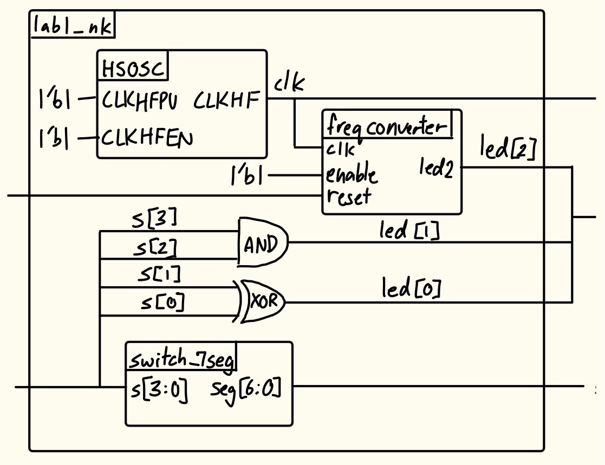

The block diagram in Figure 3 shows the overall architecture of the design. The top-level module lab1_nk includes three submodules: the high-speed oscillator (HSOSC), the counter module (freqconverter), and the 7-segment display module (switch_7seg). The top-level module also contains an XOR gate and an AND gate which determine the combinational logic of the two on-board LEDs.

### Circuit Schematic

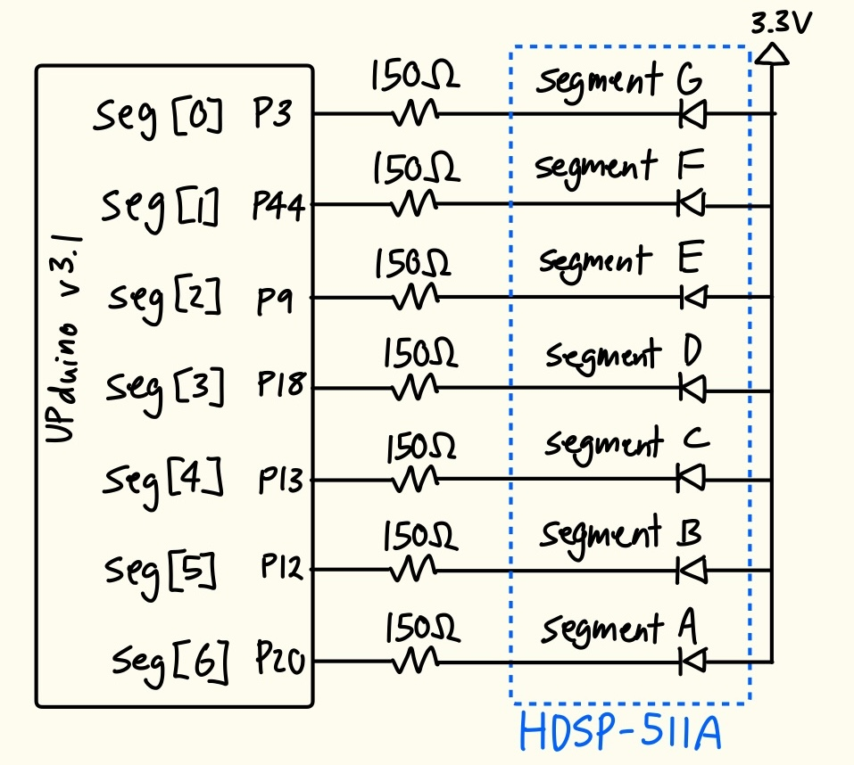

The schematic in Figure 4 shows the physical circuit connections outside the PCB. The specified GPIO pins were connected to current-limiting resistors before the 7-segment display diodes. The common anode of the 7-segment display was connected to the 3.3V supply of the FPGA.

## Results and Discussion

The design met all intended design objectives.

### Testbench Simulation

Figure 3 shows a screenshot of the QuestaSim simulation waveforms for my 7-segment submodule testbench. It behaved correctly because for each switch combination, the 7-segment output was correct (looking at both the individual waveforms and the output of my automatic testbench).

::: {.callout-note collapse="true"}
## Click to view 7-segment submodule simulation waveforms
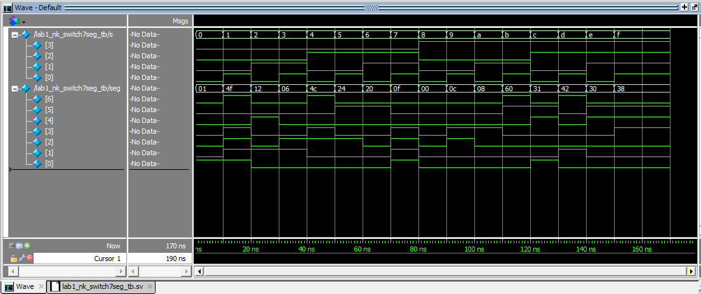
:::

::: {.callout-note collapse="true"}
## Click to view 7-segment submodule testbench outputs
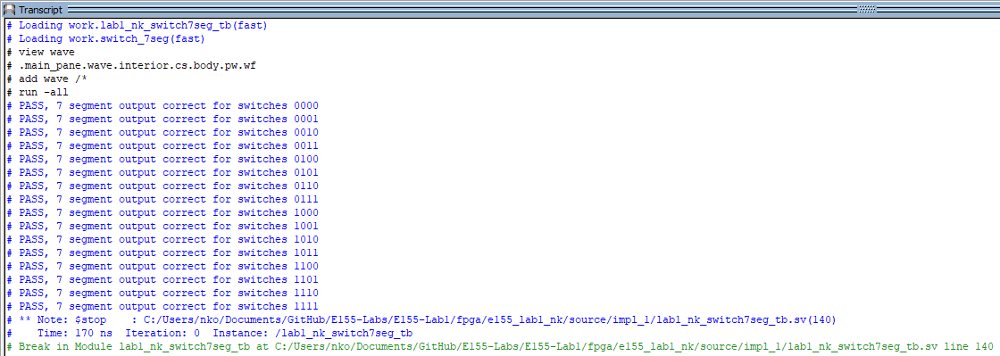
:::

Figure 5 shows a screenshot of the QuestaSim simulation waveforms for my counter submodule testbench. Note that since in my testbench I updated the MAX parameter to 10, so the clock signal conversion does not line up with 24MHz stepped down to 2.4Hz but instead 24MHz to 2.4MHz. The stepped-down output clock signal was high and low for the correct interval of time, even after a reset at an irregular time interval. When enable was pulled high, it functioned regularly as a counter (see first 2.5 clock signals), but when it was pulled low, the counter kept its currrent value of high until the reset was toggled again, resetting the counter to 0. This behaviour was also confirmed by my automatic testbench.

::: {.callout-note collapse="true"}
## Click to view counter submodule simulation waveforms
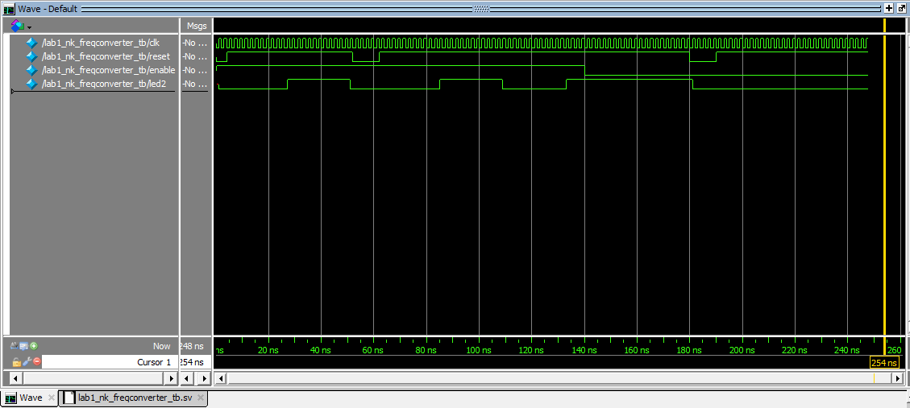
:::

::: {.callout-note collapse="true"}
## Click to view counter submodule testbench outputs
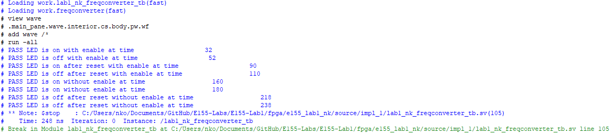
:::

Figure 7 shows a screenshot of the QuestaSim simulation waveforms for the clock generated by the HSOSC in the top-level module. The expected clock cycle was about 41.67ns (from the 24MHz generated), and the waveforms show the clock signal toggling every ~21ns, which is correct. This behaviour was also confirmed by my automatic testbench.

::: {.callout-note collapse="true"}
## Click to view top-level module clock simulation waveforms
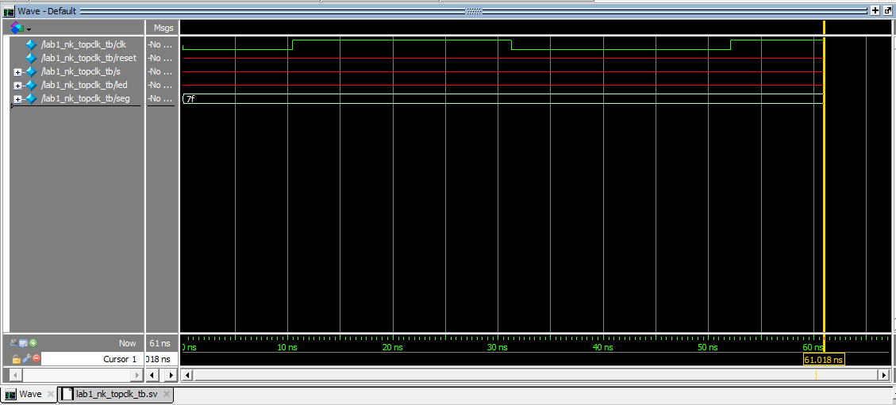
:::

::: {.callout-note collapse="true"}
## Click to view top-level module clock simulation outputs
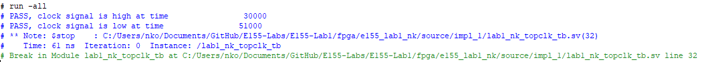
:::

Figure 9 shows a screenshot of the QuestaSim simulation waveforms for the combinational logic LED behaviour and 7-segment submodule connection at the top-level. It behaved correctly because for each switch combination, the LED and 7-segment output at the top-level were correct (looking at both the individual waveforms and the output of my automatic testbench).

::: {.callout-note collapse="true"}
## Click to view top-level module LED and 7-segment logic testbench simulation waveforms  
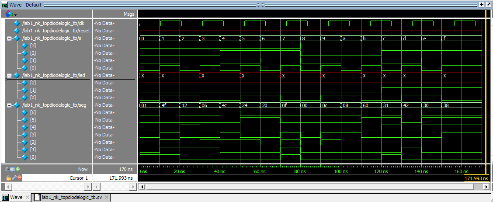
:::

::: {.callout-note collapse="true"}
## Click to view top-level module combinational logic simulation outputs
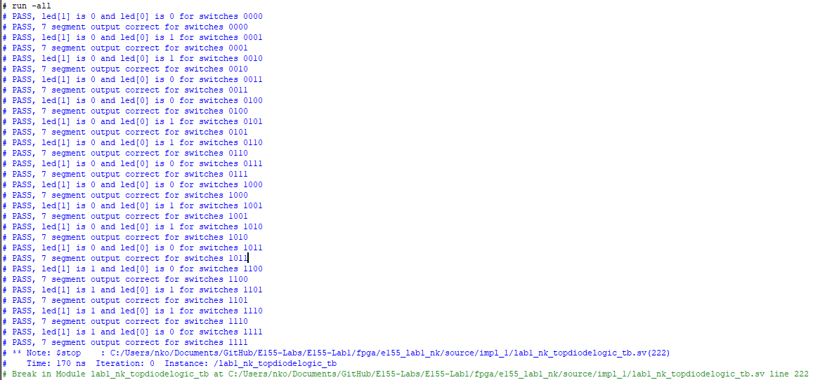
:::

Figure 11 shows a screenshot of the QuestaSim simulation waveforms testing the counter-submodule connection to the top-level. The top-level oscillating LED output was correctly read at half the 2.4Hz clock cycle twice and again after a reset was held to confirm the oscillation was 2.4Hz.

::: {.callout-note collapse="true"}
## Click to view top-level module freqconverter testbench simulation waveforms
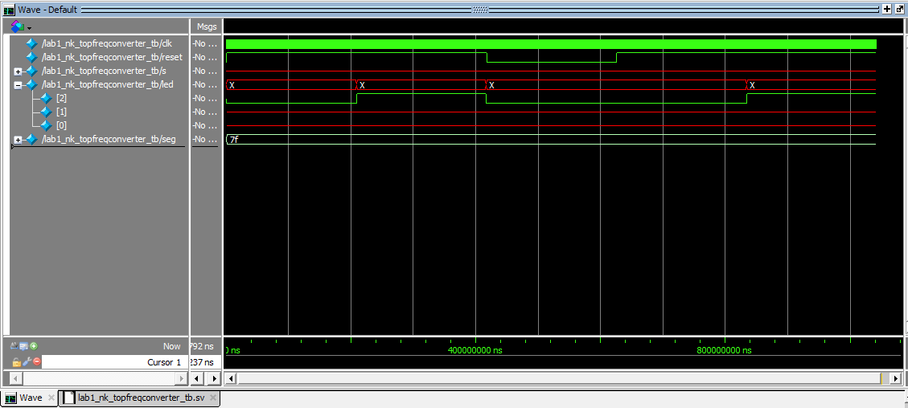
:::

::: {.callout-note collapse="true"}
## Click to view top-level module 2.4Hz simulation outputs
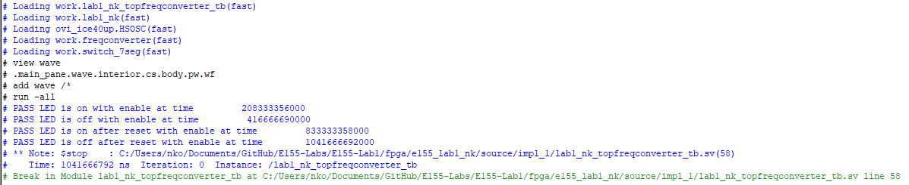
:::

### Hardware Deployment

This video showcases the design running on the completed PCB, with one on-board LED continuously blinking at 2.4Hz, and the other two on-board LEDs and the 7-segment display going through all 16 combinations of four switch inputs.



### Oscilloscope Testing

The 2.4Hz LED toggle was confirmed using an oscilloscope. When the oscilloscope was connected to the LED output pin and ground, the signal was observed as shown in Figure 13.

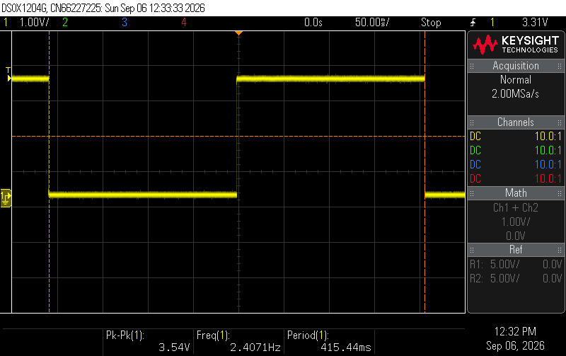

Using the internal oscilloscope frequency measurement tool, the frequency was measured to be ~2.407Hz, which is almost exactly the intended 2.4Hz frequency. The small discrepancy could be due to variations in the clock frequency provided by the HSOSC, oscilloscope measurement errors etc.

# Phase 2 - Time-Multiplexed Dual 7-Segment Display and Keypad Scanning

The second step in building this implementation was to figure out how to control a dual 7-segment display, and read in 4x4 matrix keypad inputs. In anticipation of the limited number of accessible GPIO pins in the complete design, the LEDs for each 7-segment had to be controlled by the same pin. To do this, I used the idea of time-multiplexing: turning on the common anode of only one half of the dual 7-segment display at a time and writing the digit displayed on that side to the LEDs. The displayed digits would be set using 8 switches. In addition, the 4x4 matrix keypad had 8 pins: one for each row and column. This means I could not use pure combinational logic to read in the keypad inputs. I would have to use some kind of scanning system to assert signals on each row and read in the column values to decode the key pressed. I drove 4 LEDs with the row outputs/column inputs such that pressing keys on different columns would drive different LEDs at 2Hz.

## Design and Testing Methodology

I created two submodules and linked them by a top-level module.

The first submodule called the counter module from before to step down a 24MHz HSOSC clock to a 120Hz clock. Based on the positive edge of the new clock signal, it would change which anode output (left vs right side) would be tied high, which determines which 7-segment side to write to. 120Hz was chosen because based on trial and error, this frequency allowed both segments to be perceived as on at the same time without any flickering or bleeding.

The second submodule called the counter module from before to step down a 24MHz HSOSC clock to a 1Hz clock. It then used assign statements to change each bit of the keypad row scanning output, so that only 1 bit out of 4 would be high at a time and they would oscillate at a rate of 2Hz.

The top-level module called on the two submodules and HSOSC. The anode output was connected as the select of a 2:1 mux, so that it’s value determined which set of switches would be fed into the 7-segment submodule and the correct 7-segment pattern can be written. The column inputs were inverted and written to LEDs the LEDs blink at 2Hz when the corresponding row is scanned and column is pressed.

The design was tested using waveform simulation of the top-level module and the scanning submodule in QuestaSim through automatic testbenches to confirm the desired behaviour.

The scanning submodule testbench instantiated the submodule scan under a test. Reset and enable were pulled high. The row outputs were then checked every 0.006s as this is how long it should take for them to toggle. The reset was then pulled low and high and the row outputs were checked to reset to 4’b1000 and start rotating. Then, enable was set to low to confirm the row outputs would stop rotating, and reset was pulled high again to check the row outputs reset and did not continue changing.

The top-level submodule testbench instantiated the module lab_nk under a test. Reset was set high, switch inputs were set and the segments were checked after 8333334ns to confirm that the left/right segments were only written at the corresponding anode values. Then, different column inputs were written and the led outputs were checked to confirm the led bits were inverted column bits.

The dual 7-segment display circuit and keypad scanner circuit were built and connected separately to the FPGA GPIO pins because there were not enough pins to connect all the inputs and outputs at the same time. The design was tested by toggling all 8 switch inputs and observing the 7-segment display outputs, and then pressing keypad buttons individually and multiple in the same row/column and observing the LED outputs.

To implement this in hardware, PNP transistors need to be wired to the anodes of the dual 7-segment display because the required current is greater than what the FPGA GPIO pins can drive and NPN transistors need to be wired to the rows of the 4x4 keypad to prevent shorting multiple row drivers when multiple keys are pressed (functioning as an open-drain/collector output). 

PNP transistors have a base-emitter saturation voltage of about 0.7V. Since I supplied the emitter with 3.3V, the voltage at the base would be $V_B=3.3V-0.7V=2.6V$. The transistor is active when the base is low, so current will flow when the GPIO pin is low (0V). Also, the collector-emitter saturation voltage is about 0.25V, so the voltage at the collector would be $V_C=3.3V-0.25V=3.05V$. Additionally, the forward voltage of an LED is around 2V. The maximum current the GPIO pins can handle is 8mA, so using Ohm's law,

::: {layout-ncol=3}
$$
\begin{aligned}
V&=IR\\
V_B-V_{GPIO}&=I_{B}R_{B}\\
2.6-0&=0.008R_{B}\\
R_{B}&=325\Omega
\end{aligned}
$$

$$
\begin{aligned}
V&=IR\\
V_C-V_{LED}&=I_{pin}R_{C}\\
3.05-2&=0.008R_{C}\\
R_{C}&=131.25\Omega
\end{aligned}
$$

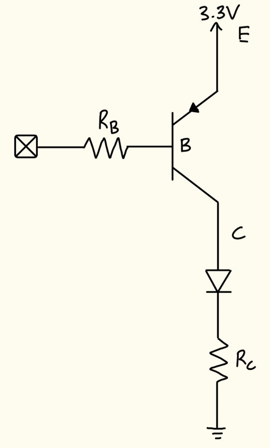{width=75%}
:::

From these calculations, I used a 330Ω resistor for the base because it is slightly higher than the calculated value, which would prevent drawing too much current from the FPGA. I used a 150Ω resistor for the collector using this same logic.

Similarly, NPN transistors have a base-emitter voltage of around 0.7V. Since I supplied the emitter with 0V, the voltage at the base would be $V_B=0.7V-0V=0.7V$. The transistor is active when the base is high, so current will flow when the GPIO pin is low (3.3V). The maximum current the GPIO pins can handle is 8mA, so using Ohm's law,

::: {layout-ncol=3}
$$
\begin{aligned}
V&=IR\\
V_GPIO-V_{B}&=I_{B}R_{B}\\
3.3-0.7&=0.008R_{B}\\
R_{B}&=325\Omega
\end{aligned}
$$

$$
$$

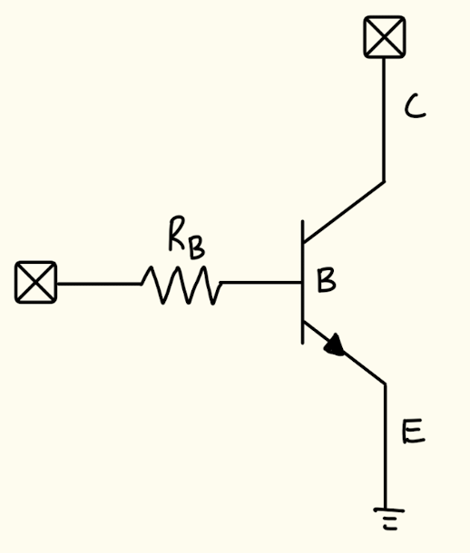{width=75%}
:::

With this I chose a 330Ω resistor for the base because it is slightly higher than the calculated value, which would prevent drawing too much current from the FPGA.

The keypad-driven LEDs also needed current-limiting resistors since the maximum current the LEDs could handle was 20mA. They also had a forward voltage of about 2.2V, so using Ohm's law,

$$
\begin{aligned}
V&=IR\\
3.3-2.2&=0.02R\\
R&=55\Omega
\end{aligned}
$$

This was the minimum current-limiting resistor needed, so I chose a 330Ω resistor.

## Technical Documentation

The source code for the part of the project can be found in the associated [GitHub repository](https://github.com/natalieko2024/E155-Labs/tree/main/E155-Lab2).

### Block Diagram

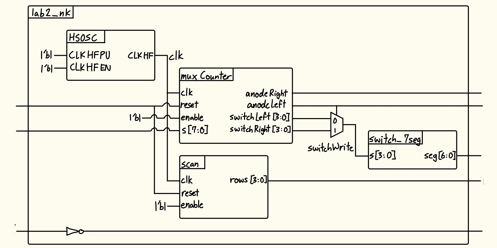

The block diagram in Figure 15 shows the overall architecture of the design. The top-level module lab2_nk includes four submodules: the high-speed oscillator (HSOSC), the multiplexing counter module (muxCounter), the 7-segment display module (switch_7seg), and the scanner module (scan). The top-level module also contains a MUX and a NOT gate to write the correct segments and LEDs.

### Schematic
The schematic in Figure 16 shows the physical circuit connections outside the PCB for the dual 7-segment portion of the design. The specified GPIO pins were connected to current limiting resistors before the 7-segment display cathodes. The common anodes of the 7-segment display were connected to the 3.3V supply and GPIO pins of the FPGA through the 2N3906 transistors.

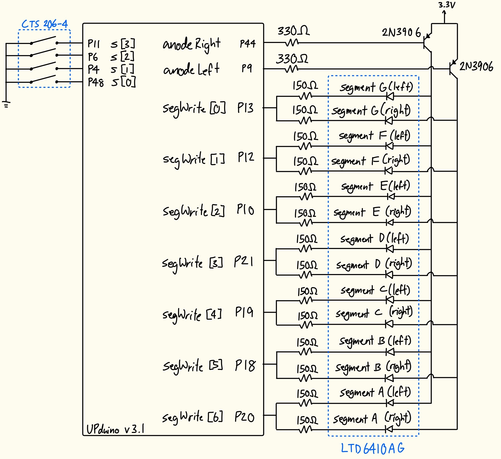

The schematic in Figure 17 shows the physical circuit connections outside the PCB for the keypad scanner portion of the design. The specified GPIO pins were connected to current limiting resistors and diodes for the LED outputs, and 2N3904 transistors connected to the 4x4 keypad to write rows. Pins were also connected to the keypad columns to collect as inputs.

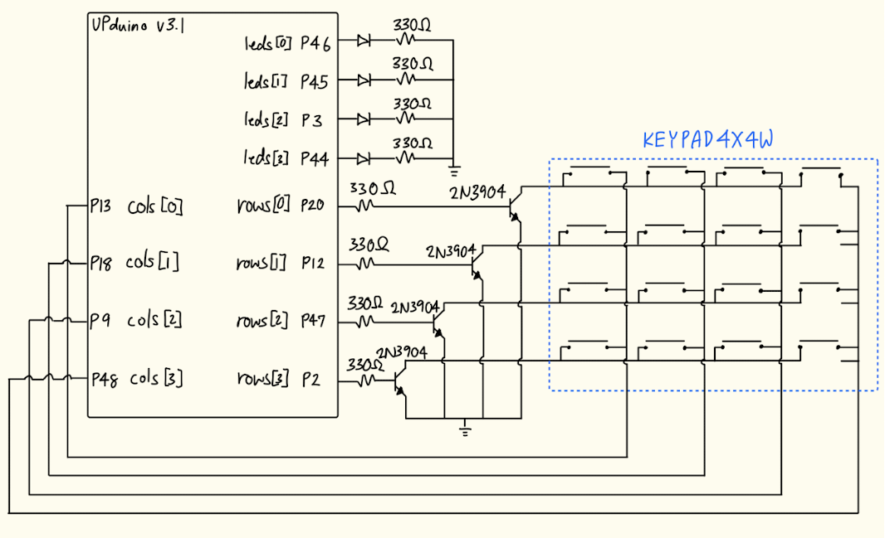

## Results and Discussion
The design met all intended design objectives. 

### Testbench Simulation
Figure 18 shows a screenshot of the QuestaSim simulation waveforms for my scanning submodule testbench. It behaved correctly because after each 1/8 stepped-down clock cycle, the output rows were correct, including after a reset and after setting enable to low and then resetting again. This is also demonstrated by the automatic testbench outputs (see Figure 19).

:::{.callout-note collapse = "true"}
## Click to view scanning submodule simulation waveforms
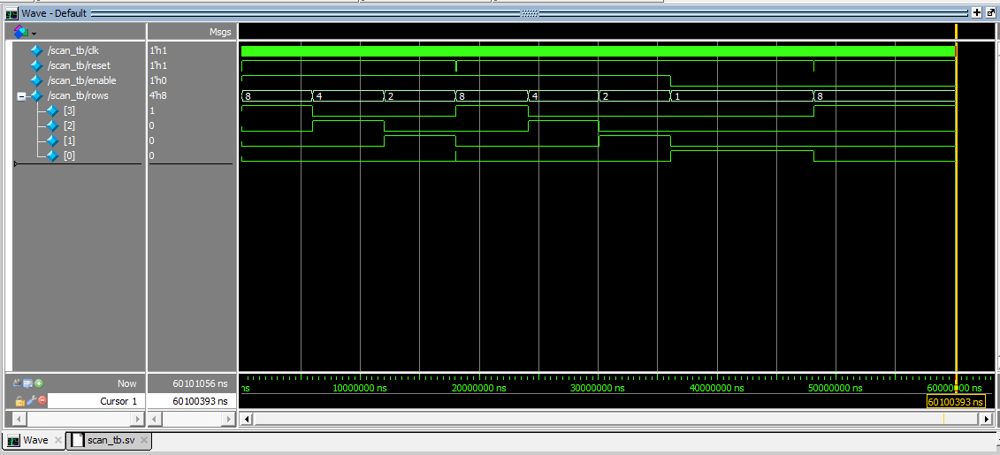
:::

:::{.callout-note collapse = "true"}
## Click to view scanning submodule testbench outputs
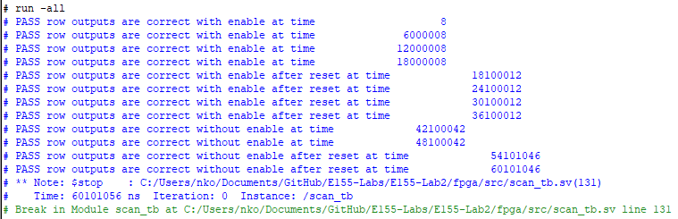
:::

Figure 20 shows a screenshot of the QuestaSim siimulation waveforms for my top module. It behaved correctly because after waiting for the anodes to invert, the segments were written correctly (demonstrating mux behaviour), and the LED outputs were always inverted signals compared to the column inputs. This is also demonstrated by the automatic testbench outputs (see Figure 21).

:::{.callout-note collapse = "true"}
## Click to view top-level module simulation waveforms
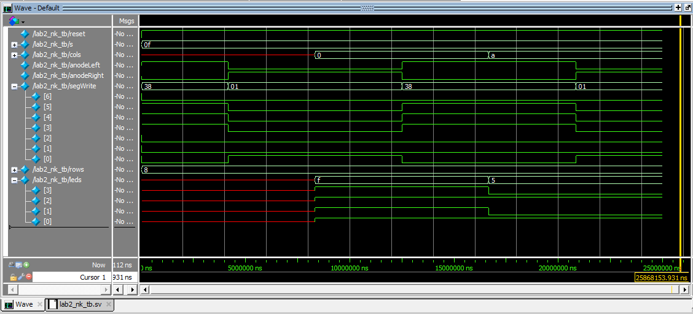
:::

:::{.callout-note collapse = "true"}
## Click to view top-level module testbench outputs
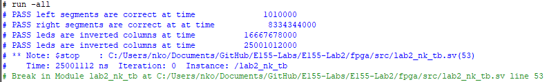
:::

### Hardware Deployment
These two videos showcases the design running on each circuit.




### Oscilloscope Testing
The keypad scanning LED frequency was confirmed using an oscilloscope. When the oscilloscope was connected on each end of the LED the signal was observed as in Figures 22a-c.

::: {layout-ncol=3}

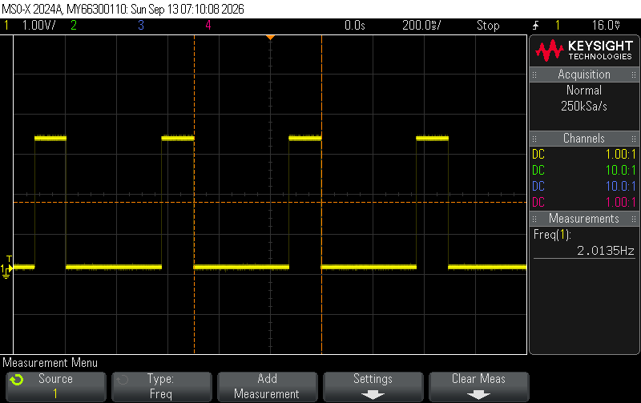

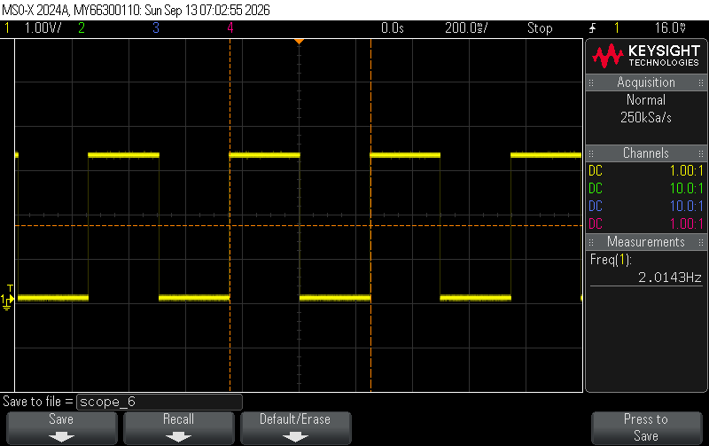

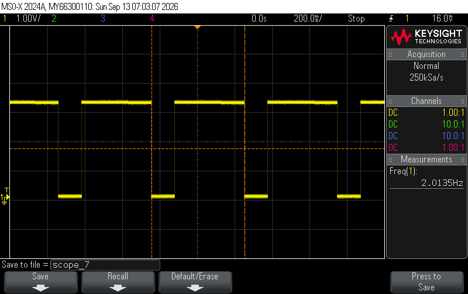

:::

When the oscilloscope was connected to each row output, the signals were observed as in Figure 23.

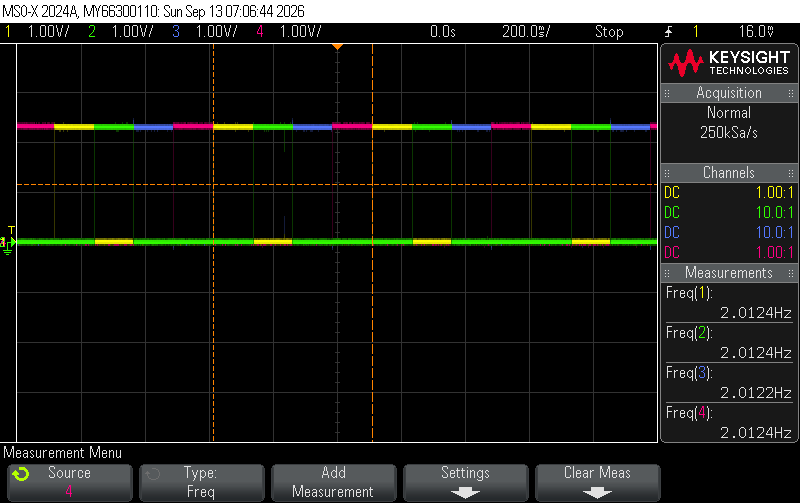

All signals oscillate at 2Hz as expected. For the LED outputs, the width of the high signal increases as more adjacent buttons are added, because the LED is on whenever the column is pressed and the row signal is on. As the row signal moves from row 1 to row 2 while the switch is still pressed, the column output will remain for the duration of both rows "ON"s.

# Phase 3 - Integrated Keypad Scanner and 7-Segment Output

To make the full implementation, all the previous work had to be combined and integrated with a finite state machine.

## Design and Testing Methodology

This design was achieved using a finite state machine (see Figures 24 and 25), where the state would change depending on the collected key inputs. The variable keyMap is the current key inputs, while initialKeyMap is a snapshot of the key inputs during the display state. In the display state, displayEN is set high, which allows writing to the 7 segment display through flip-flops in the top-level module.

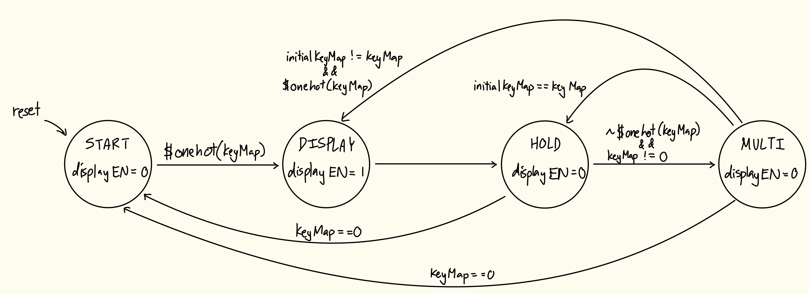

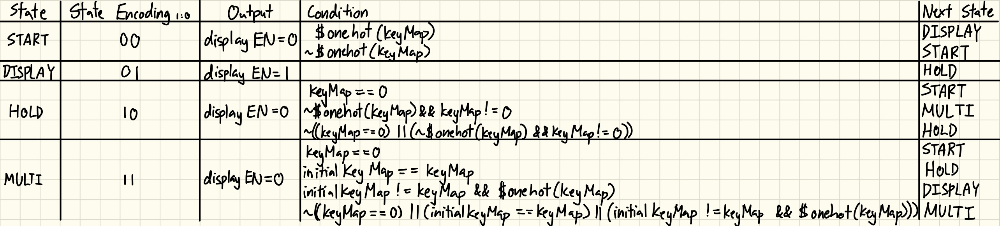

Like in the previous phase, key inputs were determined by "scanning" each row (sending a high bit to one row at a time) and collecting the column inputs. The column inputs were sent through a synchronizer to prevent reading metastable values. Besides the scan module, a keyMap module was developed to convert the corresponding row/column combination to a 16-bit key map.

The keypad switches were prone to switch bounce (the switch makes and breaks its connection repeatedly for up to ~10ms). To mitigate this issue and ensure each key was only registered once, a debouncer submodule was created, which used a shift register to compare the keymap at different intervals and only register the keys when all registers had the same value.

This debounced key map was an input to the FSM, a submodule converting the keys to equivalent switch inputs (which were sent into the 7-segment decoder).

The top level module wired all these submodules together, and had assign statements to compare counter values to provide the switching frequency for the 7-segment anodes, as well as a mux to determine which value to write to the left and right segments.

These modules were all tested using automatic testbenches, waveform simulation, and hardware deployment.

I think my debouncing strategy is more accurate and time efficient than other strategies. One other strategy I can think of is just waiting 10ms (maximum bouncing time) after the first button press before using the keyMap. However, this doesn't guarantee that after you wait, the button is actually debounced - it could slightly fluctuate, or if your count is off by a little bit you would read and use the bounce. Adding a strategy of storing the initial read and comparing at the end of the wait time to confirm debouncing could work. However, if another button happens to activate during the 10ms wait time, that button could still bounce after the first button is done, so then you would have to wait again. Using the shift register method means you don't have to have logic determining the first key press, or wait a specified amount of time. You always read until all registers log the same value.

However, the other strategies are probably more hardware efficient as I do use 9 flip-flops (probably could've used less, I was just being cautious), whereas the waiting strategy would just rely on a counter output that uses 1 flip-flop.

My design technically includes 2 communicating FSMs that evaluates the current debounced keyMap against the saved keyMap. I think another way to do achieve the end goal (with the alternative debouncing strategies described above) is to have a canonical FSM managing the display/scanning states communicate with another canonical FSM to control whether debouncing is active or not, or communicate with a non-canonical FSM which is a counter to keep track of how long to wait for. However, I think this is more complicated and could make the overal FSM structure less reliable since switching or keeping states depend on more conditions that could be unexpected values right when the clock edge occurs, meaning you have to wait for the next cycle to actually transition correctly.

## Technical Documentation
The source code for this part of the project can be found in the associated [GitHub repository](https://github.com/natalieko2024/E155-Labs/tree/main/E155-Lab3).

### Block Diagram
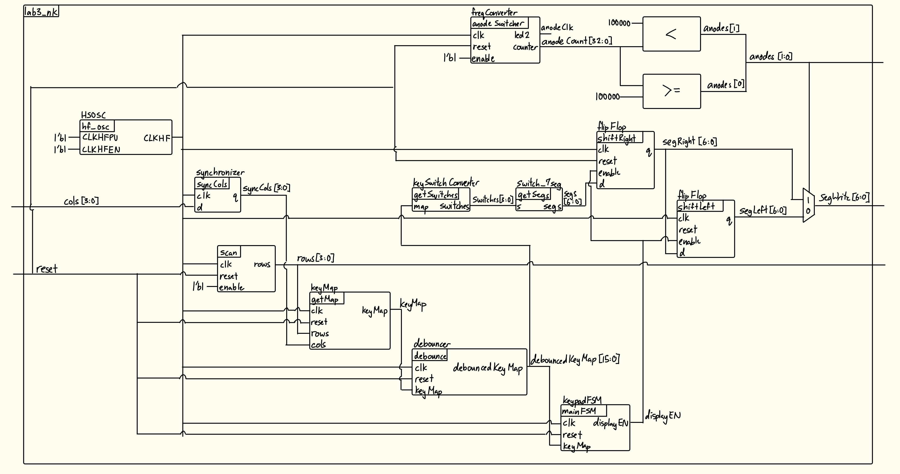
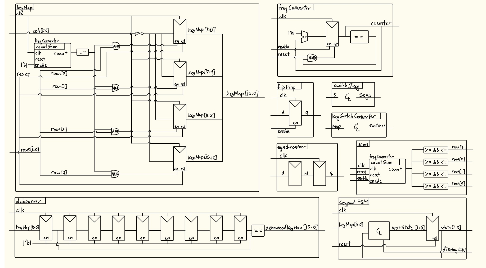

The block diagram in Figures 26 and 27 shows the overall architecture of the design.

### Schematic
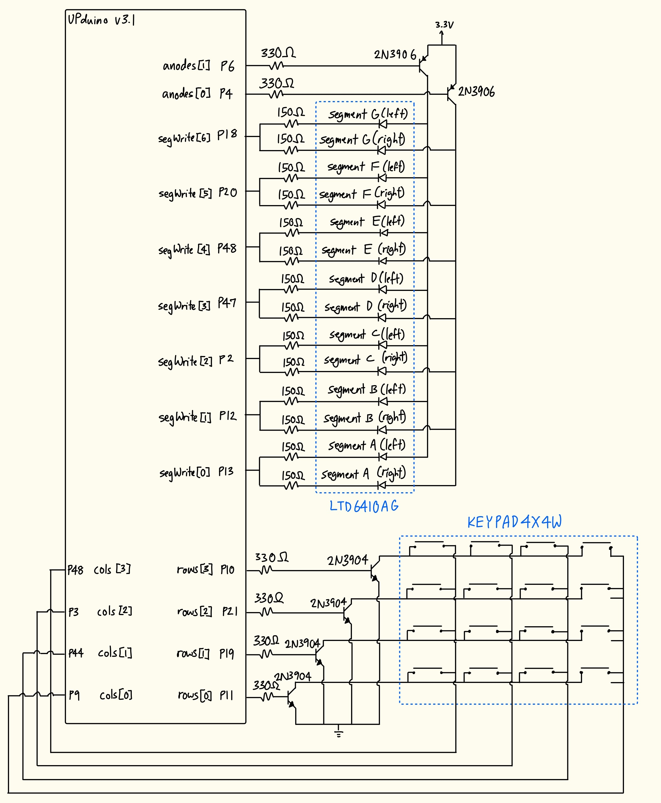

The schematic in Figure 28 shows the physical circuit connections outside the PCB. The only peripheral used on the PCB was the reset button.

## Results and Discussion
The design met all intended design objectives.

### Synthesizer Warnings
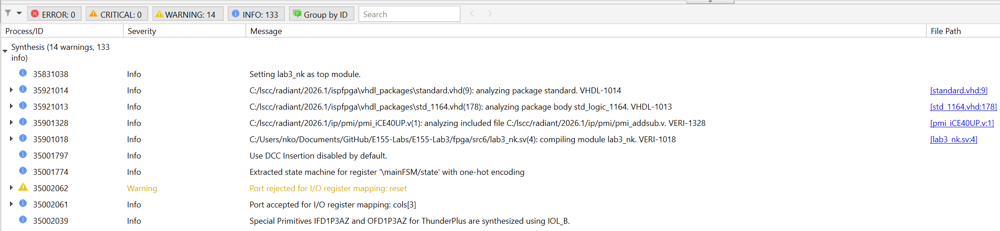

Radiant didn't give me any errors, warnings of latches or tristate buffers etc. The only warning I got was that my ports were rejected, but these do not affect deployment.

### Testbench Simulation
Figure 30 shows a screenshot of the QuestaSim simulation waveforms for my flip flop submodule. It behaved correctly because the output is always 1 clock rising edge behind the input when enabled. When disabled the output stops flowing, and when reset the output is set to 0. This was also confirmed by my automatic testbench (figure 31).

:::{.callout-note collapse="true"}
## Click to view flip flop submodule simulation waveforms
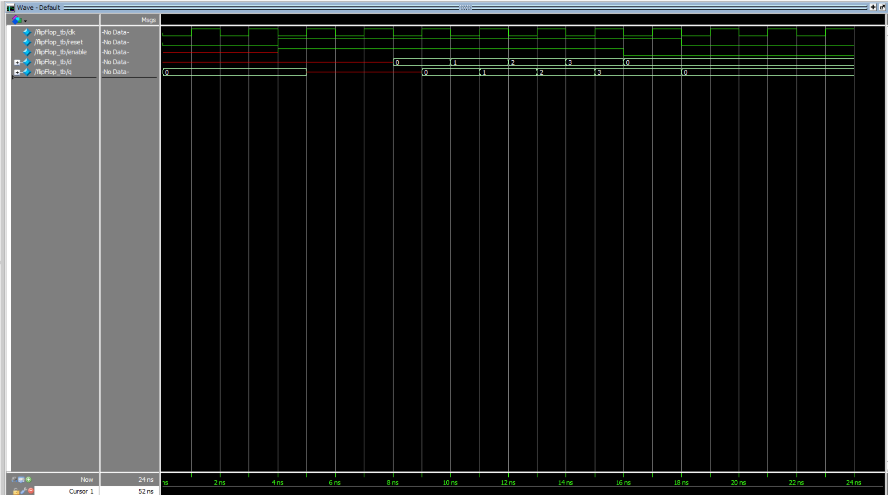
:::

:::{.callout-note collapse="true"}
## Click to view flip flop submodule testbench outputs
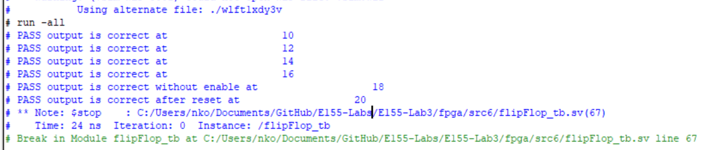
:::

Figure 32 shows a screenshot of the QuestaSim simulation waveforms for my synchronizer submodule. It behaved correctly because the output is always 2 clock rising edges behind the input. This was also confirmed by my automatic testbench (figure 33).

:::{.callout-note collapse="true"}
## Click to view synchronizer submodule simulation waveforms
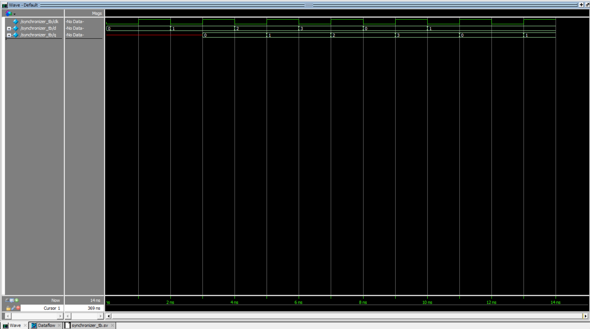
:::

:::{.callout-note collapse="true"}
## Click to view synchronizer submodule testbench outputs
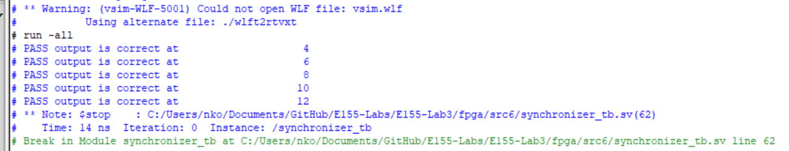
:::

The scanning submodule was retested because it was slightly modified so it could be parametrized instead of only having a fixed scanning frequency. As shown in Figure 34, after each 1/8 clock cycle, the output rows were correct, including after a reset and after setting enable to low and then resetting again. This is also demonstrated by the automatic testbench outputs (see Figure 35).

:::{.callout-note collapse="true"}
## Click to view scanning submodule simulation waveforms
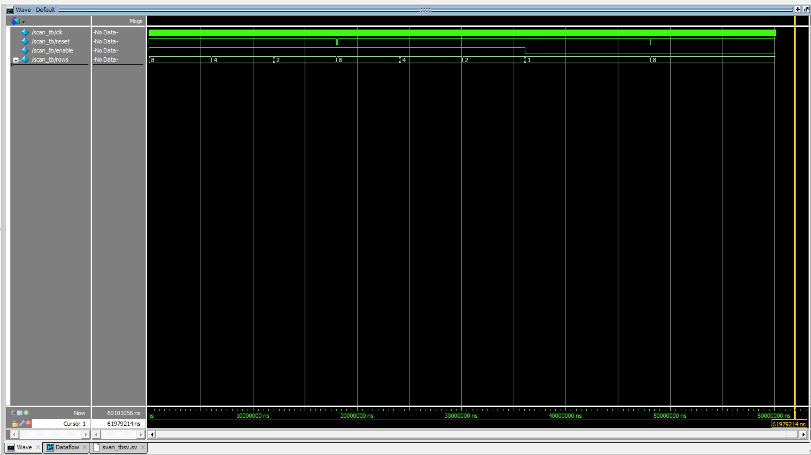
:::

:::{.callout-note collapse="true"}
## Click to view scanning submodule testbench outputs
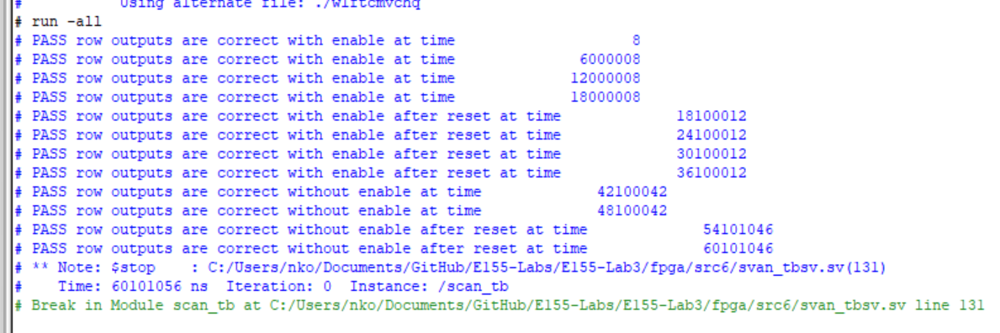
:::

Figure 36 shows a screenshot of the QuestaSim simulation waveforms for my keymap submodule. When each of the rows were high, the column inputs were mapped to the keymap correctly with both single presses and multi presses. When reset was enabled, the keymap reset to all 0s. This was also confirmed by my automatic testbench (figure 37).

:::{.callout-note collapse="true"}
## Click to view keymap submodule simulation waveforms
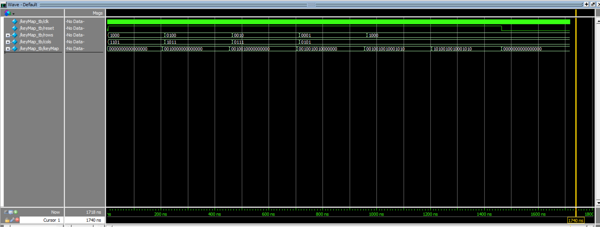
:::

:::{.callout-note collapse="true"}
## Click to view keymap submodule testbench outputs
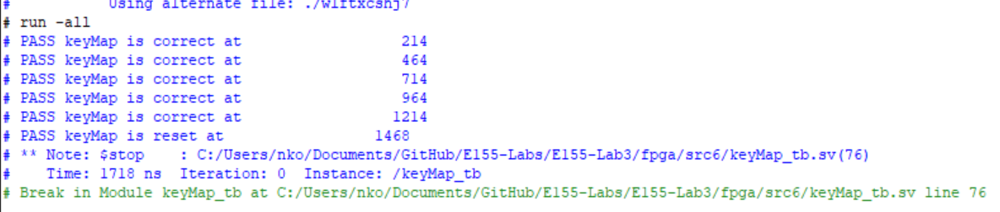
:::

Figure 38 shows the QuestaSim simulation waveforms for the debounce submodule. It behaved correctly because after oscillating the keymap bits repeatedly, the output was only changed value after the input was constant. After toggling the reset, the output would not change. This was also confirmed by the automatic testbench (figure 39).

:::{.callout-note collapse="true"}
## Click to view debounce submodule simulation waveforms
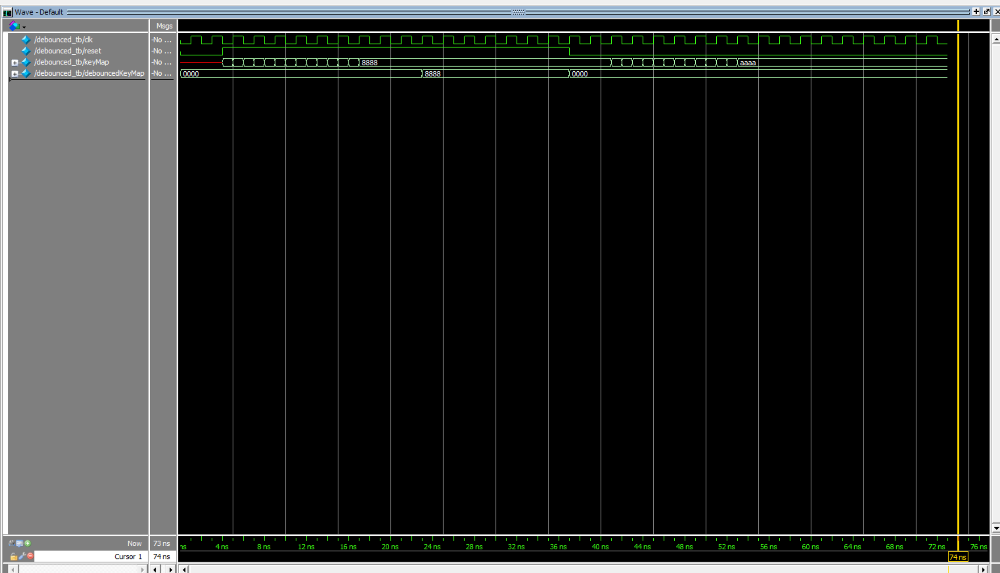
:::

:::{.callout-note collapse="true"}
## Click to view debounce submodule testbench outputs
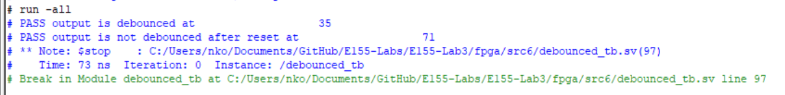
:::

Figure 40 shows the QuestaSim simulation waveforms for the FSM. All state transitions (including the reset) and outputs were tested to work. This was also confirmed by the automatic testbench (figure 41).

:::{.callout-note collapse="true"}
## Click to view FSM submodule simulation waveforms
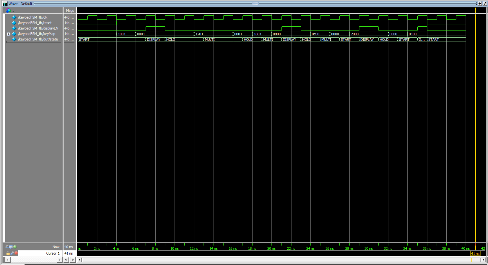
:::

:::{.callout-note collapse="true"}
## Click to view FSM submodule testbench outputs
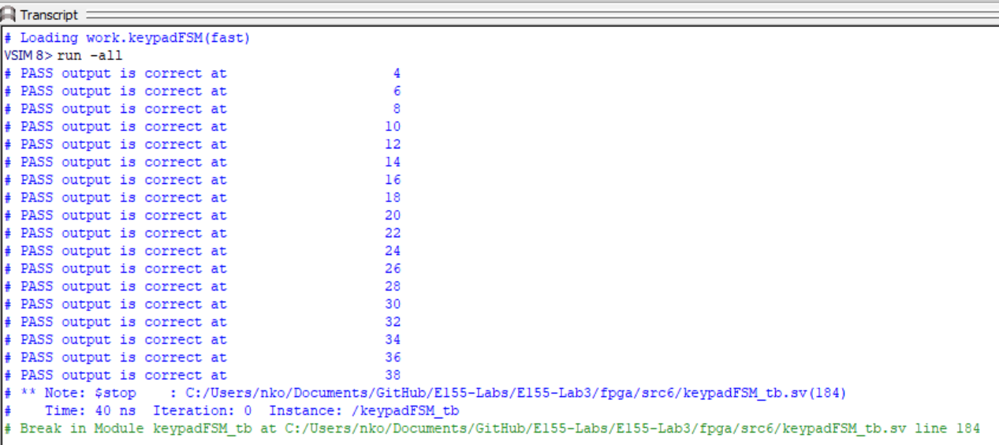
:::

Figures 42 and 43 show the QuestaSim simulation waveforms and testbench output for the keymap to switch input converter. Each keymap combination was converted to the correct switch combination.

:::{.callout-note collapse="true"}
## Click to view map to switch converter submodule simulation waveforms
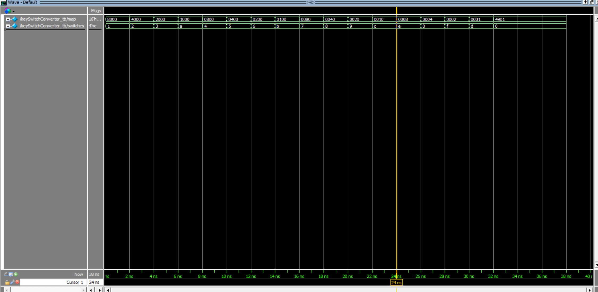
:::

:::{.callout-note collapse="true"}
## Click to view map to switch converter submodule testbench outputs
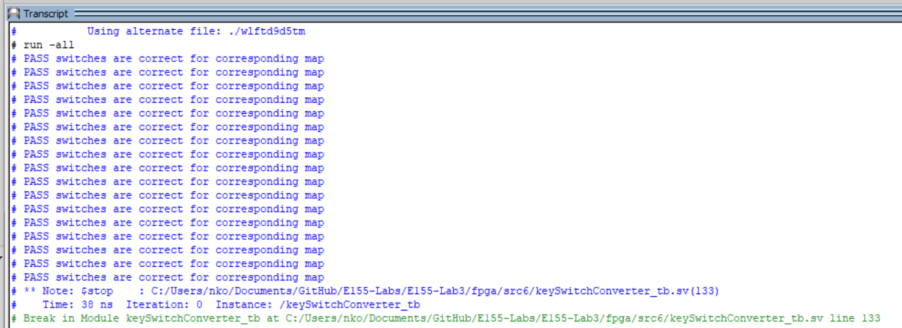
:::

Figures 44 and 45 show the QuestaSim simulation waveforms and testbench output for the top level module. The column inputs were bounced for 10ms, then were held high, only when that particular row was high. The anodes changed at the right time, and the segment outputs matched the column inputs after they were held high. The segments were reset to 0 and the anode reset to 2'b10 when the reset was toggled.

:::{.callout-note collapse="true"}
## Click to view top level module simulation waveforms
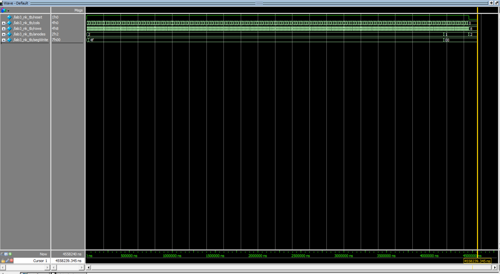
:::

:::{.callout-note collapse="true"}
## Click to view top level module testbench outputs
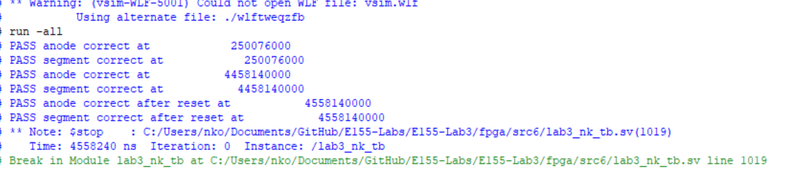
:::

### Hardware Deployment
Here is a video showcasing the design running on hardware.


# Conclusion
The design successfully scanned a 4x4 matrix keypad and mapped the last two inputs to a dual 7-segment display, accounting for single and multi-key presses!