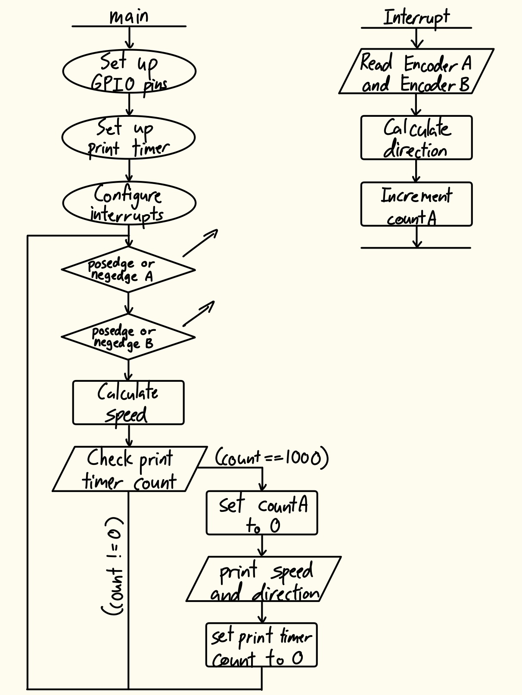
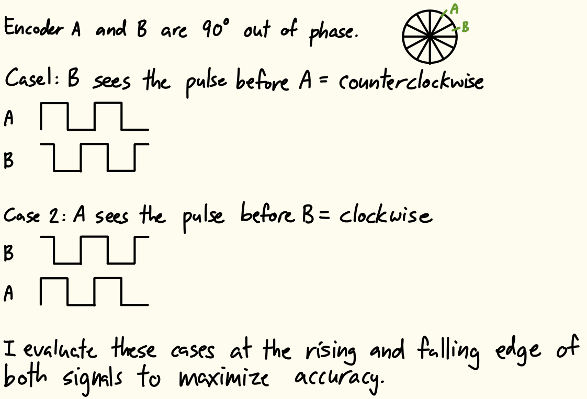
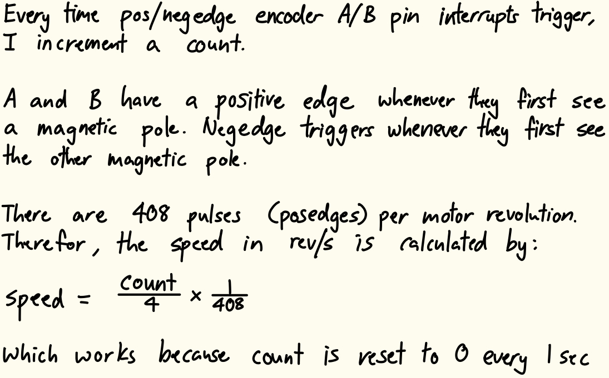
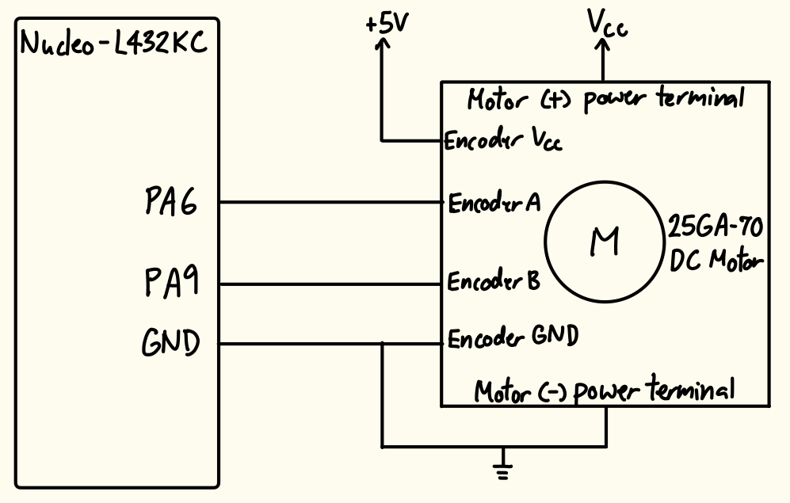

  
<strong>Timeline:</strong> 

  
<strong>Skills:</strong> 

## Introduction
In this lab, a design was implemented on the MCU to accurately determine the speed and direction of a stepper motor through encoder outputs.

## Design and Testing Methodology
The stepper motor has two quadrature encoders with one hall effect sensor each. The sensors are 90° out of phase. To design this implementation, two interrupts were configured to activate at the rising and falling edge of each sensor input. Figure 1 shows a flow chart of the main program and its communications with the interrupt handlers.

Using the collected pin readings, the direction of the motor spin was derived within each interrupt. This was done to maximize the accuracy of the direction at any point in time. The direction derivation logic is shown in Figure 2.

During each interrupt, a count was also incremented. Since the motor has 408 pulses per revolution, Our counter reaches 4*408 every time the motor completes one revolution. The speed (in revolutions per second) was calculated per Figure 3.

The implementation also utilizes a timer to print out the speed and direction at 1Hz. The timer internal clock was configured to run at 10kHz, and when the timer count reached 10000, the speed and direction would print, and then the speed count and print count would both be reset.

Interrupts are the better option compared to manual polling at high speeds, because with this setup, you never miss a rising and falling edge, whereas the polling intervals may not be fine enough, leading to missed edges. Furthermore, polling doesn't guarantee we sample at a rising or falling edge, and we are relying on the fact that the two encoder sensors are 90° out of phase. With manual polling, you could sample within the high/low region of either signal incorrectly assume counterclockwise/clockwise motion. If we spin the motor at its maximum theoretical speed of 2.5rev/s, we would need a minimum polling frequency of 4080Hz to accurately capture all pulses (since A and B are 90° out of phase, there are 408 pulses per revolution, and we want 4 samples per pulse). However, the polling frequency needed to accurately measure the motor speed and direction would change as the motor speed changes, because you would be sampling at not clock edge times. Therefore, using interrupts are better.

One possible tradeoff is that when you use interrupts, everything on the MCU CPU stops running, whereas with polling, nothing stops running while data is being taken. So polling can take samples continuously no matter what, whereas if the interrupt is very long, you might miss signals. However, in our case our interrupt is extremely short, so this effect is negligible.

## Technical Documentation
The source code for the project can be found in the associated [GitHub repository](https://github.com/natalieko2024/E155-Labs/tree/main/E155-Lab5).

### Schematic

The schematic in Figure 5 shows the physical circuit connections outside the PCB. The encoder sensor pins and power pins were connected to the board, while the motor power terminals were connected directly to a voltage source.

## Results and Discussion
The design met all intended design objectives.

### Calculations
The resolution of this implementation is four times the number of pulses in a second, because we each pulse has a rising and falling edge that triggers the interrupt logic, and we have two pins reading the pulses.

The update rate of collecting the motor speed and direction is also four times the number of pulses in a second. However, we only print them out every second (1Hz print clock).

### Hardware Deployment
This video showcases the design running at various motor speeds and both directions.



## Conclusion
The design successfully utilized interrupts on the MCU to perceive motor speed and direction.