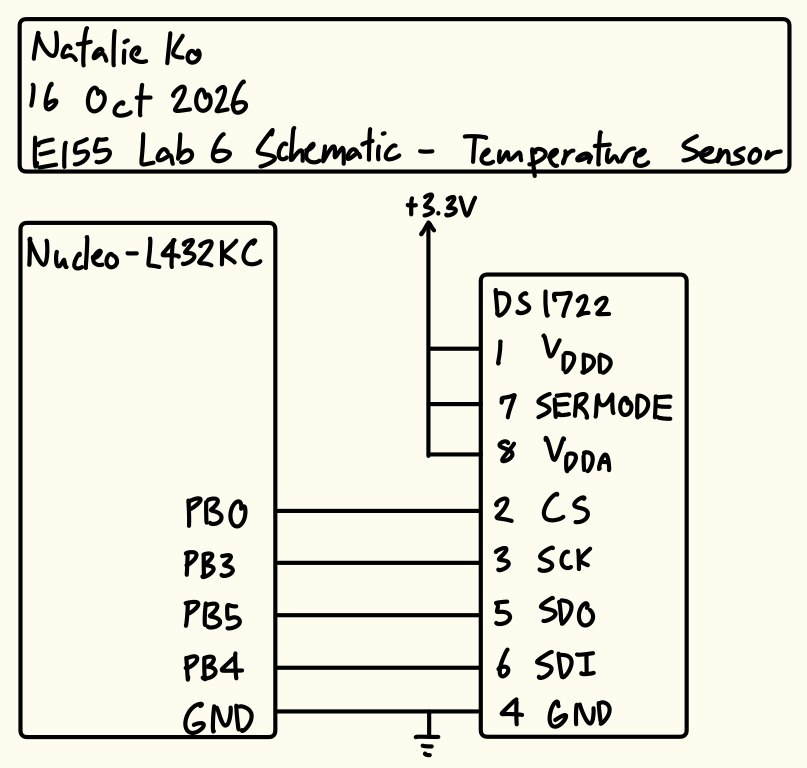
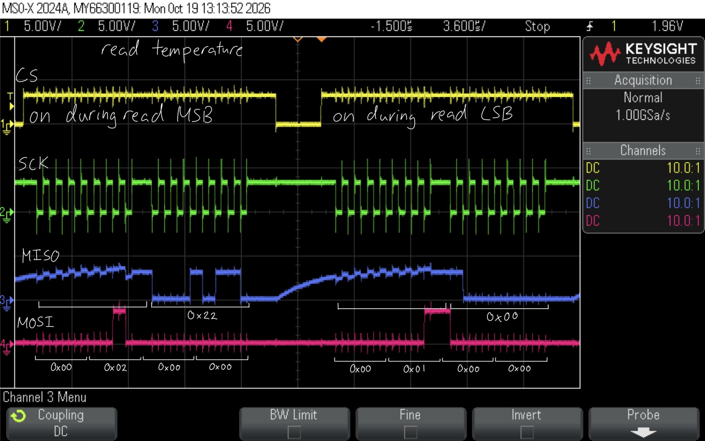

  
<strong>Timeline:</strong> 

  
<strong>Skills:</strong> 

:::{.columns}
::: {.column width="49%"}
**Video Showcasing Hardware Deployment:**



:::

::: {.column width="2%"}
:::

::: {.column width="49%"}
**Overview of Work:**

Designed and deployed an FPGA implementation to read a 4x4 matrix keypad and display the last two hexadecimal inputs on a dual seven-segment display. Accounted for key bounce, multi-press, and timing inconsistencies.

Key outcomes:

- **Interfaced the MCU with an ESP8266** to host a webpage displaying updated temperature sensor readings and led states
- **Communicated** with the ESP8266 and sensor using **SPI and UART protocols**
- **Utilized a 4-channel oscilloscope** to confirm SPI behaviour during configuration, read, and write

:::
:::

# Introduction
In this lab, a design was implemented on the MCU to host a web server on an ESP8266 through UART communication and read temperature readings of various resolutions using a temperature sensor through SPI communication. Data from the peripherals connected to the MCU would be displayed on the webpage.

# Design and Testing Methodology

On the MCU, SPI was configured for full-duplex communication. This was chosen over simplex communications because apart from receiving temperature readings from the sensor, the MCU would have to write to the configuration register throughout deployment to adjust the resolution of the temperature communicated. It was also chosen over half-duplex communication to increase the speed the devices could communicate at, which would lead to more accurate readings.

The temperature sensor used (DS1722) required a clock phase (CPHA) of 1. I chose to use a clock polarity (CPOL) of 1 so that data would be sampled on the rising edge of SCK.

Full-duplex SPI communication works by each device sending and receiving bits at the same time. So, for writing to the temperature sensor (ex. for writing the initial configuration and for writing new resolution bits), I would write the entire configuration and receive junk in return (that I wouldn't use). For reading temperatures from the sensor, I would write junk bits to the sensor and receive the temperature bits in return. Because of how the temperature sensor registers were configured, I would read the integer bits and decimal bits separately.

The MCU and ESP8266 interface through a 125000 baud serial UART connection on TX and RX lines. Because of this, to prevent sampling differences, the MCU and temperature sensor baud rate was also set to 125000.

HTML code was written so that the temperature and LED data could be properly displayed on the webpage, and users could press buttons to toggle the LED state and change the temperature resolution.

# Technical Documentation
The source code for the project can be found in the associated [GitHub repository](https://github.com/natalieko2024/E155-Labs/tree/main/E155-Lab6).

## Schematic

The schematic in Figure 1 shows the physical circuit connections outside the PCB. The ESP8266 was not included as that was plugged directly into the motherboard.

# Results and Discussion
The design met all intended design objectives.

## Hardware Deployment
This video showcases the design webpage outputs and LED states when each button is pressed. The LED state matches the LED on/off in real life, and the maximum number of decimal values the temperature sensor displays matches the selected resolution.



## Oscilloscope Confirmation

:::{layout-ncol="2"}

:::

These oscilloscope traces confirm the intended SPI behaviour during configuration, read, and write. CS was pulled high during read/write and pulled low otherwise, and the correct values were transmitted over MISO and MOSI.

# Conclusion
The design successfully utilized SPI and UART communication protocols to interface a temperature sensor, MCU implementation, and ESP8266 webpage together.